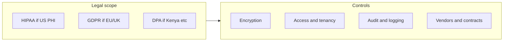

# Client data and privacy: standards and practical alignment

## What “industry standards” usually means

Standards fall into **legal/regulatory** (must comply where they apply), **contractual** (customers or partners require them), and **voluntary frameworks** (demonstrate maturity). For a pharmacy-style system, the mix often looks like this:

### Legal and regulatory (jurisdiction-dependent)

- **Health data (US)**: **HIPAA** (Privacy, Security, and Breach Notification Rules) applies when you handle **PHI** for **covered entities** or as a **business associate**. Controls include safeguards, BAAs, minimum necessary use/disclosure, and breach procedures.
- **EU/UK**: **GDPR** (and UK GDPR) for personal data; **special category** health data needs stricter bases and safeguards. Principles: lawfulness, purpose limitation, data minimization, storage limitation, integrity/confidentiality, accountability.
- **Kenya** (relevant if you operate or host there): **Data Protection Act, 2019** and Office of the Data Protection Commissioner (ODPC) guidance—lawful processing, registration where required, data subject rights, cross-border transfers, and security measures.
- **Payments**: If you store/process card data, **PCI DSS** applies; many apps avoid raw card storage and use providers (e.g. tokenization). **M-Pesa** integrations typically rely on Safaricom’s APIs and your obligations under their terms and local telecom/payment rules—not a substitute for protecting PII you store in your own DB.

### Voluntary / certification-oriented (often required by enterprise buyers)

- **ISO/IEC 27001**: Information security management system (ISMS)—risk-based controls and continual improvement.
- **SOC 2** (Trust Services Criteria): Security, availability, confidentiality, etc., attested by auditors—common for SaaS vendors.

These do not replace law; they help **organize** controls and prove them to customers.

---

## Technical and organizational measures (what “ensuring” privacy looks like)

These map to common expectations across HIPAA-style and GDPR-style regimes:

| Area                   | Typical expectations                                                                                                            |
| ---------------------- | ------------------------------------------------------------------------------------------------------------------------------- |
| **Encryption**         | TLS for data in transit; encryption at rest for DB/backups where supported; secrets in env/Vault—not in repo                    |
| **Access control**     | Authentication, least privilege, role-based access (you already have [roles + `organizationId](auth.config.ts)` in session/JWT) |
| **Tenant isolation**   | Every query scoped by `organizationId` (and tests to prevent cross-tenant leaks)                                                |
| **Auditability**       | Logs of access to sensitive records, admin actions, auth events; retention and review                                           |
| **Data minimization**  | Collect only fields needed; avoid logging PII in application logs                                                               |
| **Backups & recovery** | Encrypted backups, tested restore, defined RPO/RTO                                                                              |
| **Vendor risk**        | DPAs/BAAs where required; subprocessors list; review of hosting (e.g. region, subprocessors)                                    |
| **Incident response**  | Playbook, notification timelines per applicable law                                                                             |
| **Privacy UX**         | Notice at collection, consent where required, data subject request process                                                      |

---

## How this relates to your codebase (high level)

- **Strengths already present**: Credential auth with bcrypt (`[auth.handlers.ts](auth.handlers.ts)`), JWT session with role and `organizationId` (`[auth.config.ts](auth.config.ts)`), `[requireSession` / `requireRoles](lib/authz.ts)` patterns for server-side protection.
- **Gaps to close deliberately** (when you choose a compliance target): formal privacy policy and notices; documented data inventory; encryption/backups policy; audit logging for sensitive reads; subprocessors; and **jurisdiction-specific** steps (e.g. HIPAA BAAs, GDPR DPIA for high-risk processing).

---

## Recommended next step (if you want implementation later)

Pick **one primary jurisdiction and data type** (e.g. “Kenya retail pharmacy customers only, no clinical records” vs “US pharmacy with PHI”). That single choice drives which law and which contracts (DPA vs BAA vs neither) matter most; the technical checklist stays similar but the **legal paperwork and breach rules** differ sharply.