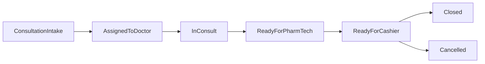

# Consultation flow (additive)

## Goals
- Add a dedicated consultation module that does **not** disrupt existing POS sales flow, but can hand off a finalized case to cashier for payment.
- Support **per-doctor consultation fees** (cash + insurance price) configured by Admin.
- Support **multi-encounter cases** (timeline/history for each patient in a case).
- Add a **doctor user role + doctor dashboard** to view assigned patients and their history.

## Current baseline (confirmed)
- Roles: `CASHIER | PHARM_TECH | ADMIN` in Prisma `UserRole`.
- POS checkout creates `Sale` with `SaleLine` (drug-only) and `Payment`, and decrements stock via FEFO.
- Prescriptions exist (`Prescription` + `PrescriptionItem`) and are client-scoped, but are not connected to POS.

## Key design decisions (chosen)
- **Consult fee model**: per-doctor (cash + insurance price).
- **Case shape**: one case can contain multiple encounters/notes over time.

## Data model (Prisma)
Add these (all scoped by `organizationId` like the rest of the app):
- **`UserRole.DOCTOR`**: extend enum and all role gates.
- **`DoctorProfile`**: `id`, `organizationId`, `userId` (unique), `speciality?`, `consultFeeCash`, `consultFeeInsurance`, `isActive`.
- **`ConsultationCase`**:
  - `id`, `organizationId`, `clientId`, `createdById` (pharmtech/admin), `assignedDoctorId?` (User),
  - `status` enum (e.g. `OPEN | ASSIGNED | IN_CONSULT | READY_FOR_PHARMTECH | READY_FOR_CASHIER | CLOSED | CANCELLED`),
  - timestamps.
- **`ConsultationEncounter`** (multi-entry timeline):
  - `id`, `caseId`, `createdById` (doctor),
  - triage/vitals (initial set): `temperatureC?`, `weightKg?`, `heightCm?`, `bpSystolic?`, `bpDiastolic?`, `pulseBpm?`, `spo2Percent?`, `respRate?`,
  - `chiefComplaint?`, `assessment?`, `plan?`, `notes?`, timestamps.
- **`ConsultationMedicationOrder`** (what doctor prescribes in the case):
  - `id`, `caseId`, `drugId`, `quantity`, `instructions?`, `status` (`DRAFT | SENT_TO_PHARMTECH | SENT_TO_CASHIER | DISPENSED | CANCELLED`).
  - This intentionally mirrors `PrescriptionItem`, but is workflow-aware.
- **`ConsultationCheckout`** (handoff object, created when pharmtech finalizes):
  - `id`, `caseId` (unique),
  - `buyInPharmacy` boolean,
  - `pricingMode` (`CASH | INSURANCE`),
  - snapshot amounts: `consultationFee`, `medsSubtotal`, `taxAmount?`, `totalDue`,
  - `cashierSaleId?` (link to `Sale` once paid), timestamps.

### Sales integration (minimal-impact additive)
To show “consultation fee + meds” on cashier receipt without forcing a fake drug item:
- Add **`SaleServiceLine`** table:
  - `id`, `saleId`, `description`, `quantity`, `unitPrice`, `lineTotal`, `usedInsurancePrice`.
- Keep existing POS unchanged (still writes only `SaleLine`).
- Add a new server action for cashier checkout from consultation that creates `Sale` with:
  - drug `SaleLine[]` (same FEFO allocation + stock decrement), plus
  - `SaleServiceLine[]` containing a single line: `"Consultation fee (Dr. X)"`.
- Update receipt rendering (`app/(dashboard)/pos/receipt/[id]/page.tsx`) to list both drug lines and service lines. Existing sales without service lines remain unchanged.

## Pages & UX
Add a new nav section entry (visible to relevant roles):
- **`/consultations` (PHARM_TECH, ADMIN)**: intake + monitoring board
  - create/select client (reuse `searchClients`, `ClientDialog`)
  - create case, assign doctor (list active doctors)
  - live statuses, queue filters (Open/Assigned/Ready)
- **`/consultations/[caseId]` (role-aware)**:
  - shared header with client details + status
  - doctor view: encounters timeline + vitals entry + medication orders + AI check
  - pharmtech view: medication orders list + finalize checkout (buy vs print-only)
  - cashier view: amount due + “Create sale & pay” → links into existing receipt
- **`/doctor` (DOCTOR)**: doctor dashboard
  - assigned cases, quick search by client
  - patient history: list past cases and encounters

## AI medication check (guardrails)
- Add a server action like `analyzeConsultationOrders(caseId)` in `[lib/actions/consultations.ts]` that:
  - loads client age (DOB), current medication orders (drug names/strength), and vitals if present,
  - calls existing AI infrastructure used by `app/api/ai/chat/route.ts` (new “consultation safety” tool/prompt),
  - returns warnings (duplication, contraindications heuristics, max dose reminders) as **advisory only**.
- Display results in doctor UI as warnings; do not block prescribing.

## Authorization & routing
- Extend `UserRole` enum + update:
  - `[lib/authz.ts](lib/authz.ts)` `requireRoles` usage in new layouts
  - `[components/dashboard-shell.tsx](components/dashboard-shell.tsx)` sidebar to include Consultation and Doctor links
  - `[components/user-dialog.tsx](components/user-dialog.tsx)` role select to include DOCTOR
  - `[lib/actions/users.ts](lib/actions/users.ts)` schema accepts DOCTOR automatically once enum updated

## Migration & seed
- Add Prisma migration for new enums/tables and seed updates if needed to create a sample doctor profile.

## Suggested status flow

## Test plan (lightweight)
- Create doctor user, set per-doctor fees.
- Create consultation case for a client, assign doctor.
- Doctor adds encounter + medication orders, runs AI check.
- Pharmtech finalizes: choose “buy in pharmacy” vs “print only”.
- Cashier creates sale: verify receipt shows consultation fee line + meds, and stock decrements only for meds.
- Ensure existing POS sales and receipts still render correctly when `SaleServiceLine` is absent.
