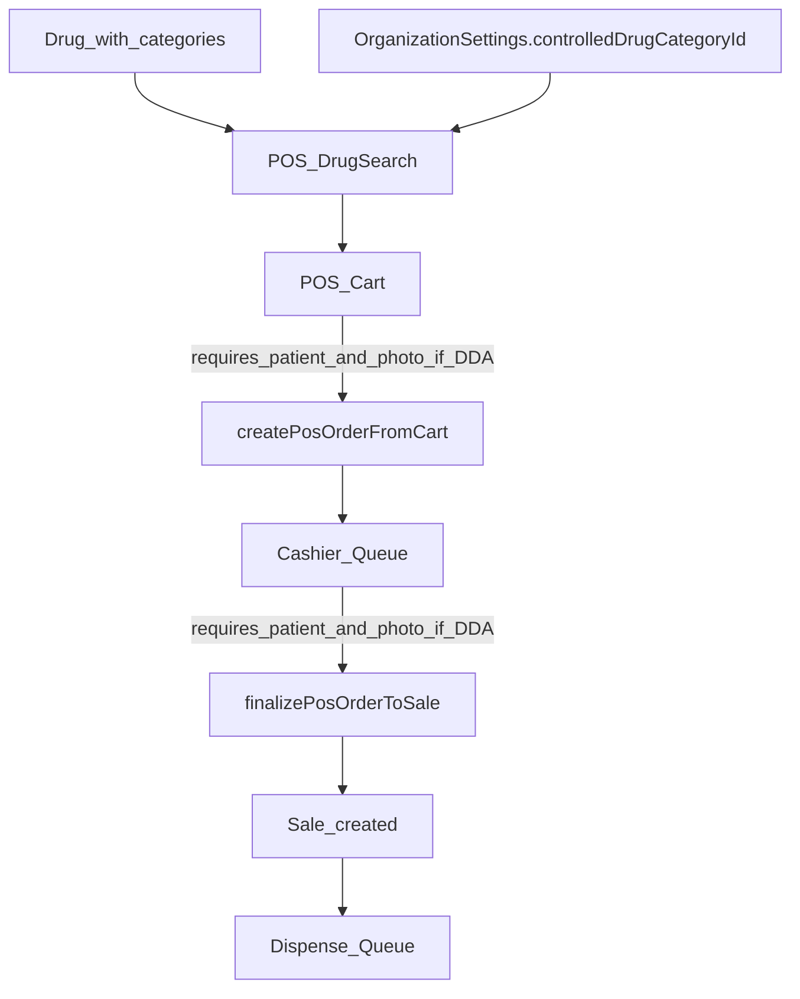

## Goal
Ensure **DDA/controlled drugs** are clearly identifiable and **cannot be sold** unless:
- **a patient is selected** (non-null `patientId`), and
- **a prescription photo is uploaded**.
Also add **visual cues and filtering** to track these items in POS queues.

## Key decisions (from your answers)
- **DDA identification**: category-based
- **Evidence required**: prescription photo **mandatory**
- **Patient requirement**: patient must be selected (no extra fields like phone/ID)

## Proposed design
### DDA category selection (configurable)
Add an org-level setting that points to the category that represents DDA.
- **Schema**: add `controlledDrugCategoryId` to `OrganizationSettings`.
- **UI**: in Admin Settings, allow selecting a Drug Category as the “DDA/Controlled drugs category”.

Why: categories are per-org and already exist; an explicit setting avoids hard-coding a slug like `dda`.

### Enforcement points (server-side, cannot be bypassed)
Enforce in both:
- `createPosOrderFromCart` (pharm-tech sends order to cashier)
- `finalizePosOrderToSale` (cashier creates the sale)

Implementation approach:
- Detect if the cart/order **contains any DDA drug** by checking whether any line’s `drug.categories` contains the configured `controlledDrugCategoryId`.
- If DDA present:
  - require `patientId` (non-null)
  - require `prescriptionPhotoUrl` (non-null)

This matches current data model where POS orders already have `patientId` and `prescriptionPhotoUrl` (see `[prisma/schema.prisma](/Users/bennyworld/Desktop/CodeManyatta/personal/pharmacy_system/prisma/schema.prisma)` model `PosOrder`).

### Visual cues + filters (front-end)
- **POS drug search**: show a visible badge like “DDA” on results for controlled drugs.
- **POS cart**: if the cart includes DDA items, show an alert and disable “Send to cashier” until patient + photo are provided.
- **Cashier queue (`CashierPos`)**: show a DDA badge on queue rows that contain DDA items; add a simple toggle filter “DDA only”.
- **Dispense queue (`DispenseQueue`)**: show a DDA badge per order and optionally filter.

## Files to change
- **Schema/migrations**
  - `[prisma/schema.prisma](/Users/bennyworld/Desktop/CodeManyatta/personal/pharmacy_system/prisma/schema.prisma)`
  - new Prisma migration for `OrganizationSettings.controlledDrugCategoryId`

- **Settings UI**
  - `[app/(dashboard)/admin/settings/page.tsx](/Users/bennyworld/Desktop/CodeManyatta/personal/pharmacy_system/app/(dashboard)/admin/settings/page.tsx)`
  - `[components/settings-form.tsx](/Users/bennyworld/Desktop/CodeManyatta/personal/pharmacy_system/components/settings-form.tsx)`
  - `[lib/actions/settings.ts](/Users/bennyworld/Desktop/CodeManyatta/personal/pharmacy_system/lib/actions/settings.ts)`

- **Drug data for POS**
  - `[lib/actions/drugs.ts](/Users/bennyworld/Desktop/CodeManyatta/personal/pharmacy_system/lib/actions/drugs.ts)` (extend `DrugForPos` to include `isDda`)
  - `[components/pos-drug-search.tsx](/Users/bennyworld/Desktop/CodeManyatta/personal/pharmacy_system/components/pos-drug-search.tsx)` (render badge)
  - `[components/pos-cart.tsx](/Users/bennyworld/Desktop/CodeManyatta/personal/pharmacy_system/components/pos-cart.tsx)` (require patient+photo in UI when DDA present)

- **POS order enforcement & queue tracking**
  - `[lib/actions/pos-orders.ts](/Users/bennyworld/Desktop/CodeManyatta/personal/pharmacy_system/lib/actions/pos-orders.ts)` (hard validation in `createPosOrderFromCart` and `finalizePosOrderToSale`; compute `hasDda` for listing)
  - `[components/cashier-pos.tsx](/Users/bennyworld/Desktop/CodeManyatta/personal/pharmacy_system/components/cashier-pos.tsx)` (badge + filter)
  - `[components/dispense-queue.tsx](/Users/bennyworld/Desktop/CodeManyatta/personal/pharmacy_system/components/dispense-queue.tsx)` (badge + optional filter)

## Data flow (high level)

## Implementation todos
- Add `controlledDrugCategoryId` to `OrganizationSettings` + migration.
- Update settings actions/validation + settings form to configure the DDA category.
- Extend POS drug search payload to include `isDda`.
- Add DDA badge in `PosDrugSearch` and cart-level enforcement UX in `PosCart`.
- Add server-side hard checks in `createPosOrderFromCart` and `finalizePosOrderToSale`.
- Add `hasDda` to queued/ready-to-dispense list results, render badge + filter in cashier/dispense queues.

## Acceptance criteria
- If an order contains at least one DDA drug:
  - cashier cannot finalize to sale unless `patientId` and `prescriptionPhotoUrl` are present.
  - pharm-tech cannot send to cashier unless `patientId` and `prescriptionPhotoUrl` are present.
- DDA items/orders are visually marked in POS search, cart, cashier queue, and dispense queue.
- Users can filter queue views to show only DDA-related orders.