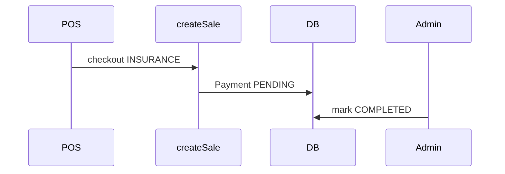

# Overview, insurance settlement, low-stock UX, and dispensing labels

## 1. Fast and slow moving drugs (Overview)

**Data:** Reuse the same window as analytics (30 days, completed sales) already used in `[getAnalyticsSummary](lib/actions/dashboard.ts)` (`saleLine.groupBy` by `drugId` with `_sum.quantity`).

- Add a small helper (e.g. `getProductMovementInsights` in `[lib/actions/dashboard.ts](lib/actions/dashboard.ts)`) or extend `getDashboardStats` to return:
  - **Fast movers:** top 5 drugs by total quantity sold (desc) — same pattern as `topProducts` with `take: 5`.
  - **Slow movers:** bottom 5 among drugs that had **at least one unit sold** in the period (`orderBy: { _sum: { quantity: "asc" } }`, `take: 5`). Optionally add a short subtitle if the list is empty (e.g. not enough variety of sales yet).

**UI:** On `[app/(dashboard)/dashboard/page.tsx](app/(dashboard)`/dashboard/page.tsx), add a responsive two-column section (stack on mobile) below the stat cards: two Cards with titles like “Fast movers (30d)” / “Slow movers (30d)”, compact tables (drug name + qty), subtle icons (e.g. trending up/down), matching existing card/table styling (`border-border/60`, `ring-1`, muted descriptions).

---

## 2. Insurance payment lifecycle (POS → Sales)

**Semantics (no enum migration needed):** `[PaymentStatus](prisma/schema.prisma)` already has `PENDING` and `COMPLETED`. Use:

| Stage                                | `Payment.status` | Meaning                                           |
| ------------------------------------ | ---------------- | ------------------------------------------------- |
| Sale completed on POS with insurance | `PENDING`        | “Payment initiated” / awaiting insurer settlement |
| Admin marks settled                  | `COMPLETED`      | Paid / received from insurer                      |

**Backend:** In `[createSale](lib/actions/sales.ts)`, when creating a `Payment` with `method === INSURANCE`, set `status: PaymentStatus.PENDING` instead of always `COMPLETED`. All other methods stay `COMPLETED` (only `[createSale](lib/actions/sales.ts)` creates payments today).

**Admin action:** New server action e.g. `setInsurancePaymentSettled(paymentId: string)` in `[lib/actions/sales.ts](lib/actions/sales.ts)` (or a small `payments.ts`): verify `session.user.role === "ADMIN"`, load payment by id + org, ensure `method === INSURANCE` and current status is `PENDING`, then `update` to `COMPLETED`; `[writeAuditLog](lib/audit)` with action like `payment.insurance_settled`; `revalidatePath` for `/admin/sales`, `/pos/receipt/...`, dashboard if needed.

**UI:** `[app/(dashboard)/admin/sales/page.tsx](app/(dashboard)`/admin/sales/page.tsx) is a server component — extract a thin client row or cell component (e.g. `InsurancePaymentActions`) that lists insurance payments with badge “Initiated” vs “Paid” and a **Mark as paid** button only for `INSURANCE` + `PENDING`. Pass payment ids from the existing `listSalesForAdmin` payload (ensure `payments` include `id`, `method`, `status`).

**Receipt:** `[components/invoice-document.tsx](components/invoice-document.tsx)` — for each payment, if `method === INSURANCE"`, show human-readable status (e.g. badge: “Awaiting settlement” vs “Settled”).

---

## 3. Low stock banner and batches page

**Links:** On `[app/(dashboard)/dashboard/page.tsx](app/(dashboard)`/dashboard/page.tsx):

- Wrap the destructive **Alert** (and optionally the middle “Low stock items” stat `[Card](app/(dashboard)`/dashboard/page.tsx)) so the primary action navigates to `**/inventory/batches?lowStock=1`** (use `Link` from `next/link` with stretched styling or an explicit “View low-stock batches” link for accessibility).

**Batches page:** Update `[app/(dashboard)/inventory/batches/page.tsx](app/(dashboard)`/inventory/batches/page.tsx) to accept `searchParams` (Next 16: `Promise<{ lowStock?: string }>`). When `lowStock` is truthy, compute per-row whether the batch is low: `reorderLevel` from drug is already available if you extend `[listBatches](lib/actions/batches.ts)` to include `drug.reorderLevel` in the `include`, or compute in the page from an extended query.

**Visual distinction:** Rows where `reorderLevel != null && quantityOnHand <= reorderLevel` get a distinct class (e.g. amber left border + subtle `bg-amber-500/5`); normal rows stay default. Optional: small `Badge` “Low” vs “OK” on the qty column when `lowStock` filter is on or always — your call; at minimum differentiate low vs normal as requested.

---

## 4. Dispensing directions on Drug + print per line

**Schema:** Add a non-optional string field on `[Drug](prisma/schema.prisma)`, e.g. `patientDirections` (or `dispensingInstructions`) — **required in the app for new creates**; use `@default("")` in Prisma so existing rows migrate cleanly, then enforce **min length 1** in `[drugFormSchema](lib/validations/drug.ts)` on create (use `id` presence in `upsertDrug`: if `!id`, require non-empty; if editing, allow empty until staff fill in — or require on every save for simplicity).

**Form:** `[components/drug-dialog.tsx](components/drug-dialog.tsx)` — add a labeled textarea (placeholder e.g. “e.g. Take one tablet twice daily after food”), wired to the new field.

**POS types:** Ensure POS drug type includes the new field if anything is typed locally, or rely on Prisma types from search.

**Print UX (recommended):** Add a dedicated route `**/pos/receipt/[id]/labels`** next to the existing receipt (`[app/(dashboard)/pos/receipt/[id]/page.tsx](app/(dashboard)`/pos/receipt/[id]/page.tsx)):

- Server page loads the same sale as the receipt via `[getSaleById](lib/actions/sales.ts)` (already includes `lines.drug`).
- New component e.g. `DispensingLabelsDocument`: for each line, one printable block — organization name/header, patient/client name if present, drug display name + strength + form, **quantity**, **directions** from `line.drug.patientDirections`, sale # and date footer.
- Reuse `[PrintButton](components/print-button.tsx)` and `print:` Tailwind classes like `[InvoiceDocument](components/invoice-document.tsx)` (hide chrome when printing).
- On the main receipt page, add a secondary button **“Print labels”** → `/pos/receipt/[id]/labels`.

This gives one clear path after checkout (redirect already goes to receipt) and the same path from **Sales → View** without duplicating logic.

**Optional:** Add the same “Print labels” link from `[admin/sales](app/(dashboard)`/admin/sales/page.tsx) row actions next to “View” for parity.

---

## 5. Consistency / follow-ups

- **Seed:** `[prisma/seed.ts](prisma/seed.ts)` — set `patientDirections` for seeded drugs so dev data validates.
- **AI tools:** If `[lib/ai/tools.ts](lib/ai/tools.ts)` snapshots drug fields, include the new field in selects where relevant (optional).

No new `PaymentStatus` enum value is required; insurance “initiated” maps to `PENDING` and “paid” to `COMPLETED`.