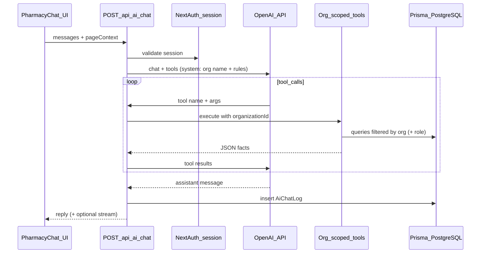

# Pharmacy-scoped AI (“Ask my pharmacy”) with OpenAI

## Goals

- **Scoped to this pharmacy**: Every API call runs after `[auth()](auth.config.ts)`; all data access uses `session.user.organizationId` (same pattern as `[lib/actions/dashboard.ts](lib/actions/dashboard.ts)` and other actions). The model must not be trusted for numbers—**ground answers with server-side tools** (function calling) that query Prisma with org filters.
- **Track questions**: Persist a row per exchange (at minimum: who asked, when, which page context, the user’s message; optionally assistant text, model, token usage) in PostgreSQL via Prisma.
- **UX**: One reusable assistant experience—**global** access (e.g. sidebar link + optional floating control) and **embeddable** on pages with a `pageContext` hint (e.g. `inventory`, `drugs`, `sales`, `pos`, `general`) to tailor the system prompt and which tools are advertised.
- **Auto-suggested questions**: On pages where it helps, show **tap-to-ask chips** (or short buttons) populated from a **central config** keyed by `pageContext` (and optionally overridden per page). Examples: POS → “What sold best today?”; drugs catalog → “Which items are low stock?”; batches → “What expires in the next 90 days?”; admin sales → “Compare this week vs last week”; analytics → “Top movers in the last 30 days?”. Tapping fills the input (or sends immediately—product choice in implementation). Suggestions are **static copy** aligned with available tools, not LLM-generated, so they stay predictable and cheap.

## Architecture (high level)

## Data model

Add a Prisma model (name can be `AiChatLog` or similar) on `[Organization](prisma/schema.prisma)`, for example:

- `organizationId`, `userId` (relations + indexes)
- `pageContext` (string enum in app code; stored as `String`, e.g. `general`, `pos`, `inventory`, `drugs`, `sales`, `analytics`)
- `userMessage` (`String` / `@db.Text`)
- `assistantMessage` (`String?` `@db.Text`) — useful for support/debug; omit or truncate if you prefer minimal retention
- `model` (`String?`), `metadata` (`Json?` for token counts, tool call count)
- `createdAt`

Run a normal Prisma migration after schema change.

## Server implementation

1. **Env**: `OPENAI_API_KEY` in `[.env](.env)` (server-only; never `NEXT_PUBLIC_`). Document in `.env.example` if the repo has one.
2. **Dependency**: Add the official `openai` npm package (server-side use from Route Handler or server action).
3. **Route**: `POST` handler under e.g. `[app/api/ai/chat/route.ts](app/api/ai/chat/route.ts)`:
  - Parse body with Zod: `{ messages: [...], pageContext: string }`.
  - `const session = await auth();` — require `session?.user?.organizationId` (401 if missing).
  - Load org name (optional) for the system prompt: `prisma.organization.findUnique({ where: { id: orgId } })`.
  - Call OpenAI with **tools** defined as JSON schemas whose **implementation** is local async functions that:
    - Receive `organizationId` from the closure (never from the client).
    - Enforce **role** where needed (mirror `[getAnalyticsSummary](lib/actions/dashboard.ts)`: `ADMIN` for broad analytics; cashiers might get POS-oriented tools only).
  - **Starter tools** (extend over time; keep first slice small):
    - Dashboard-style snapshot (today’s sales count/total, low stock / expiring hints)—reuse logic from `[getDashboardStats](lib/actions/dashboard.ts)`.
    - Drug search / stock summary by name or code—reuse patterns from `[lib/actions/drugs.ts](lib/actions/drugs.ts)` / batches.
    - Date-bounded sales summary—reuse patterns from `[lib/actions/sales.ts](lib/actions/sales.ts)` or analytics queries.
  - After a successful reply, **insert** the chat log row(s). On failure, still log the user message with an error flag in `metadata` if you want audit completeness.
4. **Safety / compliance** (brief system prompt rules):
  - Instruct the model to use tools for factual inventory/sales data; forbid inventing quantities or prices.
  - Avoid sending unnecessary client/patient PHI into the model; if you add client tools later, gate by role and minimize fields.

## UI

1. **Shared component**: e.g. `components/pharmacy-assistant.tsx` (client):
  - Chat UI using existing primitives (`[components/ui/sheet.tsx](components/ui/sheet.tsx)`, scroll area, input, button).
  - Calls `fetch('/api/ai/chat', …)` with `credentials: 'include'`.
  - Accepts `defaultPageContext` and optional `suggestedPrompts` override; if omitted, resolve suggestions from a small module e.g. `[lib/ai/suggestions.ts](lib/ai/suggestions.ts)` exporting `getSuggestedQuestions(pageContext): string[]` (and optionally role-filtered lists later).
2. **Auto-suggested questions (UI behavior)**:
  - Render a **horizontal row or wrap of chips** above the composer when the sheet opens (and optionally a compact strip on first load of empty thread). Clicking a chip **prefills** the textarea (user can edit) or **sends** in one tap—prefill is safer for transparency.
  - **Where to show**: Any page that mounts the assistant with a non-`general` context gets the defaults for that context; pages can pass **extra** `suggestedPrompts` for one-off copy (e.g. dashboard overview might add “Summarize today’s performance”).
  - **Pages that make sense** (initial set): `dashboard` / `general` (broad), `pos`, `drugs`, `inventory` (batches/stock), `sales` (admin), `analytics` (admin), `clients` (lighter—e.g. “How do I record a prescription?” if you add help-style answers later). Skip or keep minimal on settings/users if suggestions would be mostly generic.
3. **Global “Ask my pharmacy”**:
  - Add a **sidebar** item in `[components/dashboard-shell.tsx](components/dashboard-shell.tsx)` (all roles that use the dashboard) opening the sheet or linking to a dedicated page.
  - Optionally a **FAB** in the same shell so it is always one tap away (optional polish).
4. **Page-level**:
  - Mount the same component with different `defaultPageContext` on key routes, e.g. `(dashboard)/pos/page.tsx` → `pos`, `inventory/drugs` → `drugs`, `inventory/batches` → `inventory`, `admin/sales` → `sales`, `admin/analytics` → `analytics`. Implementation can be a thin client wrapper per page or a single `PharmacyAssistantMount` included from each `page.tsx` with props—keep duplication minimal.

## Optional follow-ups (not required for v1)

- **Streaming** responses (`text/event-stream`) for better UX on long answers.
- **Admin-only “Question log”** page listing `AiChatLog` for compliance (ADMIN role), with filters by date/user/context.

## Files likely touched

| Area               | Files                                                                                                                                                             |
| ------------------ | ----------------------------------------------------------------------------------------------------------------------------------------------------------------- |
| Schema + migration | `[prisma/schema.prisma](prisma/schema.prisma)`, new migration                                                                                                     |
| API + suggestions  | New: `app/api/ai/chat/route.ts`, `lib/ai/`* (tools + OpenAI wrapper + `suggestions.ts` for per-context copy)                                                      |
| UI                 | New: `components/pharmacy-assistant.tsx`; update `[components/dashboard-shell.tsx](components/dashboard-shell.tsx)`; selected `app/(dashboard)/**/page.tsx` files |
| Config             | `[package.json](package.json)`, `[.env](.env)` / `.env.example`                                                                                                   |

## Risk / complexity note

Grounding via **tools** is the main lever for “scoped for this pharmacy” and accurate sales/inventory answers. Pure RAG over embeddings is unnecessary for structured Prisma data and harder to keep in sync.