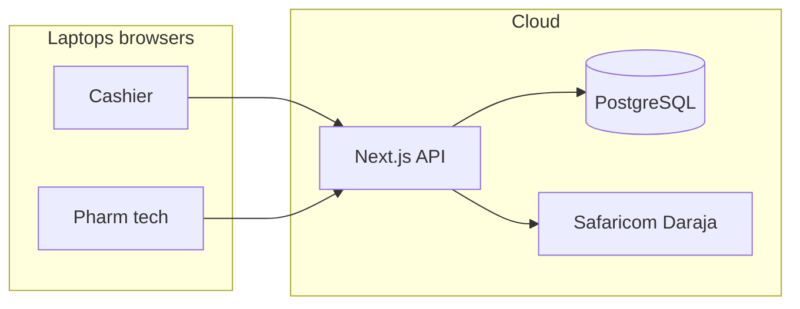

# Pharmacy management system — feature catalogue and build plan

## Your constraints (locked in)

- **UI**: [shadcn/ui](https://ui.shadcn.com/) — **already initialized** in the repo; **add only the components each feature needs** (e.g. `dialog`, `table`, `form`, `select`, `tabs`, `alert`) via the shadcn CLI. **Modals (`Dialog`)** for create/edit flows across entities (drugs, batches, users, clients, settings).
- **Deployment model**: **Cloud-hosted** (browser/app on two laptops hitting a central API + DB); **offline** = best-effort (PWA/cache + queued actions) with **sync when the network returns**.
- **M-Pesa**: **Live Daraja (e.g. STK Push)** plus **manual fallback** (Paybill/Till + reference and metadata) when the API fails or staff choose manual entry.
- **Tenancy**: **One linked pharmacy** (single organization); admin manages users and org-wide settings.
- **Data layer**: **Prisma ORM** against **PostgreSQL** (schema in `prisma/schema.prisma`, migrations via `prisma migrate`).

---

## Comprehensive feature list

### Core commerce and POS

- **Checkout / POS**: fast search (**drug** name, internal code, barcode), cart, line discounts (optional), tax/VAT lines (Kenya-ready), sale voids with reason, **session-level audit** (who sold what).
- **Payment methods**: **CASH**; **M-PESA** (STK + manual path); **INSURANCE** (higher price tier); optional **CARD** later.
- **Dual pricing on drugs**: per product store **cash/M-Pesa price** and **insurance price** (and optionally cost); POS enforces the correct price by payment mode.
- **Insurance workflow**: capture insurer/member/policy where needed; flags for **pending approval** vs **approved** if you split billing later.
- **Returns / refunds**: linked to original sale where possible; inventory restock rules.

### Inventory and stock control

#### Pharmaceutical product (drug) master — tracked items

Everything sellable is a **drug / pharmaceutical product** (not generic retail SKUs). The **product record** holds clinical and commercial identity; **stock quantity, batch number, and expiry** live on **inventory batches** (see below).

**Identity and catalog**

- **Internal code / SKU** (pharmacy-specific), **barcode** (GTIN/EAN or local) for scanning at POS.
- **Generic name** (INN where applicable), **brand / trade name** (optional).
- **Dosage form** (tablet, capsule, syrup, suspension, injection, cream, drops, etc.).
- **Strength**: numeric value + **unit** (e.g. `500` + `mg`, or `250` + `mg/5ml` for liquids — store structured fields so search and labels are correct).
- **Route of administration** (optional: oral, topical, IV, etc.).
- **Pack description**: e.g. “bottle of 100 ml”, “box of 30 tablets” — **units per pack** for ordering and pricing clarity.

**Classification and regulation**

- **Therapeutic / category** (custom taxonomy or simple tags).
- **ATC code** (optional, for reporting and standardization).
- **Prescription class**: **OTC** vs **Prescription-only** (`Rx`); **controlled substance schedule** where applicable (e.g. none / Class C — align with local law); flags drive **extra audit** on sale and stock.

**Supply chain and quality**

- **Manufacturer** (and optionally **MAH / distributor**).
- **Country of origin** (optional).

**Storage and handling**

- **Storage conditions** (ambient, refrigerated 2–8°C, protect from light, etc.) — supports alerts if cold-chain items are mishandled operationally (optional workflow).

**Commercial (per product)**

- **Dual pricing**: **cash/M-Pesa selling price** and **insurance selling price** (plus **cost / last purchase cost** for margin — optional but valuable).
- **Reorder level** / **minimum stock** (and optional max) for **low-stock alerts**.
- **Status**: active, discontinued, recalled (block sale if recalled).

**UI**: create/edit drug master data in **modals**; lists use **tables** with filters (name, form, controlled, low stock).

#### Batches and stock

- **Batch tracking** (per drug): **batch / lot number**, **expiry date**, **quantity on hand**, **supplier**, **received date**, optional **purchase order / invoice reference**.
- **FEFO**: allocation prefers **earliest expiry first**; sale lines record **which batch** was used for traceability.
- **Pricing**: keep **selling prices on the drug (product)** as the default; **optional batch-level cost** for margin without duplicating public prices unless you explicitly need batch-specific overrides later.
- **Alerts**: **low stock** (vs reorder/min), **expiry warnings** (e.g. 30/60/90 days), **near-expiry batch** reports.
- **Stock movements**: sales, adjustments, transfers (if a second location is added), returns.
- **Suppliers** (recommended): supplier records; **goods receipt** or PO flow to create batches.

### Offline, sync, and multi-device

- **Online-first**: authoritative state in **cloud DB**; both laptops see the same inventory and sales (with proper concurrency).
- **Offline-tolerant UX**: **service worker + background sync or action queue** for: create sale (queued), print receipt (queued), simple reads from cache when possible.
- **Conflict handling**: document rules (e.g. **inventory reservations** or **last-write-wins with server validation** on stock); never silently oversell.
- **Real-time updates** (optional phase 2): WebSockets or SSE for low-latency stock/cart awareness between cashier and pharm tech.

### Receipts and printing

- **Receipt templates**: logo, line items, taxes, payment breakdown, **M-Pesa confirmation code** when applicable.
- **Print paths**: **browser print** (always); **thermal ESC/POS** via a small local bridge or browser-only solution in a later iteration (often needs a desktop helper or supported browser APIs).
- **Offline printing**: queue jobs; **retry when device is back**; clear user feedback if print failed.

### Clients (CRM) and engagement

- **Client profiles**: demographics, contacts, consent for messaging.
- **Prescription tracking**: Rx ID, prescriber, dates, items, **refill due dates**.
- **Refill reminders**: scheduled notifications (SMS/WhatsApp — integrate provider in a phase).
- **Promotional campaigns**: segments (e.g. chronic patients), message templates, send history (compliance-friendly opt-in).

### Compliance and finance (Kenya)

- **KRA / eTIMS**: **phase later** — design **invoice/receipt data model** now (taxable amounts, tax rate, seller details) so you can plug **eTIMS** without rewriting POS; stub **“compliance pending”** flags.
- **Audit logs**: immutable log for price changes, stock adjustments, user admin actions, voids.

### Roles, dashboards, and admin

- **Roles** (minimum): **Cashier** (POS, limited client lookup), **Pharm tech** (dispensing, inventory, batches), **Admin** (everything + users + settings).
- **Dashboard (everyone)**: today’s sales, tasks, alerts snapshot.
- **Admin dashboard**: sales trends, product mix, inventory value, expiry risk, staff activity, **export** (CSV).
- **Admin user management**: invite/create, **ban/suspend**, **delete** (soft-delete recommended), role assignment.
- **Platform / org settings**: tax rates, receipt header/footer, **M-Pesa credentials** (sandbox vs prod), notification providers, **low-stock thresholds default**, insurance price list policies.

### Security and operations

- **Auth**: email/password or magic link + **session management**; optional 2FA for admin later.
- **Backups**: automated DB backups (provider-dependent).
- **Secrets**: Daraja keys in env / secret manager, never client-exposed.

---

## Suggested technical shape (fits your repo)

| Layer    | Choice                                                                                       |
| -------- | -------------------------------------------------------------------------------------------- |
| App      | [Next.js 16](package.json) App Router, **Server Actions** or Route Handlers for mutations    |
| UI       | **shadcn/ui** (initialized) — add components per feature; **Dialog** for create/edit         |
| DB       | **PostgreSQL** (e.g. Neon, Supabase, RDS) + **Prisma ORM**                                   |
| Auth     | **NextAuth.js (Auth.js)** or Clerk — map roles to DB                                         |
| Payments | **Safaricom Daraja** (STK) server-side; store transaction id, status, manual override fields |
| Offline  | **PWA** manifest + service worker; **IndexedDB** or similar for queued offline actions       |
| Hosting  | Vercel/similar + managed Postgres                                                            |

---

## Implementation phasing (pragmatic)

1. **Foundation**: Prisma schema + migrations (orgs, users, roles, audit), auth, app shell + **shadcn components as needed**, admin user CRUD + settings (placeholders).
2. **Inventory**: **pharmaceutical product (drug)** model with fields above, batches, FEFO allocation, low/expiry alerts, stock movements.
3. **POS**: cart, dual pricing by payment mode, sales posting to inventory, receipts (PDF/HTML + print).
4. **M-Pesa**: Daraja STK + webhook/callback + **manual payment** record path.
5. **Clients**: profiles, Rx/refill fields, reminder jobs (cron) + SMS/WhatsApp provider hook.
6. **PWA offline**: queue critical writes; sync + conflict UX.
7. **Analytics**: admin charts and exports.
8. **KRA eTIMS**: adapter layer + integration when you have credentials/spec.

---

## Risks and decisions to make during build (no blocker for starting)

- **Thermal printing** often needs a **local helper** or specific browser constraints — plan **browser print first**, thermal as enhancement.
- **Insurance pricing**: confirm whether **insurance price is always higher** or product-specific exceptions; model as two explicit columns on the **drug** + validation rules.
- **Field set**: the drug master list above is the target; MVP can ship a subset if needed, but Prisma models should allow extending without breaking POS (nullable optional fields).
- **eTIMS**: keep receipt fields **extensible**; avoid hard-coding KRA-only assumptions into core POS tables.

---

## Files you will touch first (when implementation starts)

- New UI: `[app/](app/)` routes for dashboard, POS, inventory, clients, admin.
- **shadcn**: already initialized; add missing primitives under `components/ui/` (e.g. `dialog`, `table`, `form`, `select`) when implementing each area.
- Schema and migrations: new `[prisma/schema.prisma](prisma/schema.prisma)` and migrations at repo root (Prisma).

This plan matches your listed features, adds standard pharmacy/retail capabilities (suppliers, audit, refunds, controlled substances flags), and aligns architecture with **cloud + PWA-style offline**, **Daraja + manual M-Pesa**, and **future eTIMS**.