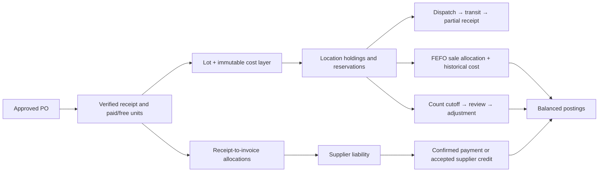
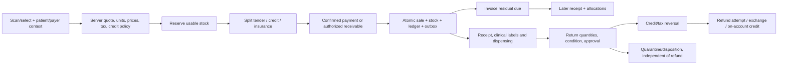
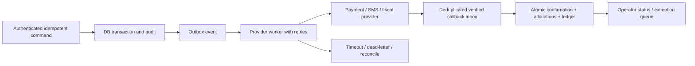

# PharmaPOS feature-parity execution plan

12 October 2026 · Kenyan retail pharmacies · Full parity target · Branches/transfers in first pilot

## Goal and definition of completion

Execute this plan to implement all observed PharmaPOS feature families while retaining our stronger consultation, prescription, dispensing and insurance workflows. Completion means working screens, validations, state transitions, persistent relationships, posting effects, reports and acceptance evidence—not menus or schema placeholders. The full parity target includes payroll/HR, accounting, loyalty, messaging, internal tickets and tools. These are not dropped because a retail pilot ships first.

This is a build plan, not a claim that parity already exists. The competitor was inspected read-only through Playwright: the previous 90-page baseline plus a deeper pass over visible modal inputs, return details, receiving line editors, import controls and system tools. No supplier/customer/sale/payment/stock/settings/payroll/message changes were submitted. Competitor database relationships and internal validation remain unknown. Proposed contracts are labeled accordingly.

Use this master plan with the [schema blueprint](/Users/bennyworld/Desktop/CodeManyatta/personal/pharmacy_system/docs/research/pharmacy-schema-blueprint-2026-10-12.md) and [machine-readable build contract](/Users/bennyworld/Desktop/CodeManyatta/personal/pharmacy_system/docs/research/pharmacy-parity-build-contract-2026-10-12.json). The earlier 67-item comparison remains the evidence registry; this plan maps every item to implementation modules and adds the second-pass details.

## Chosen starting architecture and decisions

- **Scope:** Full observed feature parity includes payroll, accounts, reminders, ticketing and tools. Retail pilot is an increment, not completion of the competitor parity goal.
- **Platform:** Retain Next.js/Prisma/PostgreSQL and existing auth/clinical/insurance code. Read installed Next guides before implementation; no generic rewrite or new framework is required.
- **Stock costing:** FEFO by batch for dispensing; FIFO acquisition layers within selected lot, immutable allocation cost. Display weighted cost of current holdings; report does not confuse it with historical COGS.
- **Reservation:** Reserve at queued handoff/cashier checkout and transfer approval, with configurable TTL; quote-only cart does not reserve indefinitely. Expiry and cancel release atomically.
- **Medicine returns:** Physical returns enter quarantine until permitted review; refund decision is independent. Generic retail immediate restock is not copied as default medicine behavior.
- **Posting:** Single consistent posting kernel writes documents, stock/ledger effects, audit and outbox together. No external provider calls inside replayable DB transactions.
- **Tax/pricing:** Explicit net/gross and inclusive/exclusive policy per configured price list; per-product tax treatment and dated version; official mapping review required.
- **Payer identity:** CustomerAccount is billing identity; Patient is care recipient. Preserve insurer claim ledger separately, preventing duplicate ordinary-customer debt.
- **Branch scope:** Organization owns shared drug/lot/supplier/account masters; branch/store/location partitions operations. Scope-aware joins and server authorization cover read/write/export/attachment.
- **Parity evidence:** Observed screen/input = evidence of available UI. Proposed state/transaction/schema = our implementation design. No claim that competitor DB tables or integration correctness were recovered.
- **Deadline:** No deadline/team size supplied. Size labels S/M/L/XL mean relative complexity, not weeks. Re-estimate after foundation spike; no invented launch date.
- **Legal/provider rules:** Exact KRA fiscal contracts, payroll calculations, clinical dispensing/returns rules and privacy obligations need current official/domain validation before production certification; no statute rates supplied here.

## Execution sequence and release gates

| Increment | Modules | Deliverables | Exit evidence |
| --- | --- | --- | --- |
| E0 — Foundation and baseline proof | M00 | Posting kernel, authorization contracts, model migration inventory, protected audit and source-event idempotency; baseline existing clinical/insurance flows. | Duplicate/tenant/transaction rollback tests pass before money/stock changes. |
| E1 — Branch-ready foundation | M01, M02, M03, M26, M36 | Branches/stores/nested locations/access joins; default branch/store migration; chart/posting mappings and sequences; safe gateway configuration. M26/M36 continue later with adapters/reports. | Two-branch scope and opening balances reconcile; no public secrets or cross-branch mutation. |
| E2 — Catalog, units, tax and inventory engine | M04, M05, M06, M07, M08, M11 | Master data, product behavior, costs/lots/positions, reservations, FEFO, import preview and supplier terms. | Pack/loose-unit/free-quantity/cost snapshots and concurrent last-unit allocation prove correct. |
| E3 — Physical stock operations and procurement | M09, M10, M12, M13 | Counts, approved adjustments, transfer transit/partial receipt, POs/GRNs/direct receiving. | Branches and transfers are included in the first releasable pilot; 20 dispatch/18 receive/2 unresolved preserves total. |
| E4 — Commercial operations and finance | M14, M15, M16, M17, M18, M19, M20, M25, M26, M27, M36, M39 | Supplier debt/returns, customer credit, POS/split tender, registers, callback adapters, partial refunds, expenses, reconciliation and statements. | Financial posting graph balances end-to-end; failed payment cannot release paid checkout; full daily close proves all sources. |
| E5 — Customer retention and pharmacy depth | M21, M22, M23, M24, M37 | Quotations, delivery print, loyalty/tender instruments, clinical preservation and reminders. | Parity tender/quote/loyalty/message workflows usable; no medicine returned to sellable stock without review. |
| E6 — Complete the back-office parity scope | M28, M29, M30, M31, M32 | Native employee/payroll/advances/disbursement statements, ticketing and tools. These are full-parity deliverables, not permanently optional because retail pilot shipped. | Payroll rules independently validated; employee-period snapshots, statements and no duplicate payments. |
| E7 — Owner visibility, exports and parity certification | M33, M34 | All observed report families and filters, owner dashboard, large exports, production pilot, restore/import drills and screen-by-screen parity signoff. | Every observed screen maps to implemented workflow with field/flow/schema/test evidence; no schema-only feature counted complete. |
| E8 — Surpass the observed baseline | M35, M38 | Offline selling, expiry redistribution/reorder suggestions, stronger clinical review, richer reconciliation and measured UX improvements. Some hardening is mandatory earlier. | Differentiation claims only after reproducible tests and pharmacy pilot feedback. |

The dependency graph has deliberate cross-module runtime cycles: POS uses a register and payment service, while payments reference sales. Build their shared interfaces first and integrate as one vertical slice; do not treat module dependency arrows as a strict topological build order. M26 ledger mappings and M36 outbox/configuration begin in E1; full statements and live adapters finish in E4. Clinical reminders similarly share event contracts before the full campaign UI.

**Pilot A (E0–E4 core):** two branches, catalog/units/tax, usable stock, transfers, receiving, reliable POS/tenders, returns, cash close and reconciled owner financial basics. Include mandatory posting correctness. **Parity B (through E7):** all observed retention/back-office/reporting features work and pass the parity checklist. **Beyond parity (E8):** offline and further pharmacy-specific advantages. No date promises until work is estimated against available team and provider access.

## Screen-by-screen coverage

- **Point of Sale:** New Sale→M16/M17; Sales Register/Daily Sales→M16/M33/M34; Close Day→M18.
- **Manage Sales:** Create Invoice/Manage Invoices→M16/M19; Cancelled Invoices→M20; Receive Payments→M19; New Returns/Returns List→M20.
- **Drugs Inventory:** Unit categories/units/conversion→M05; Categories/brands/manufacturers→M05; Taxes→M06; Product types/add/list/import→M04/M07; Stock/movements/audit/reconciliation/transfer→M08/M09/M10.
- **Purchase Orders:** PO create/list→M12; GRN create/list→M13; Receive/receiving list→M13; Purchase returns→M14.
- **Manage Customers:** Add/list/statement→M15/M19; Quotations create/manage→M21; Loyalty→M22.
- **Manage Suppliers:** Add/manage→M11; Invoices/pay supplier→M14.
- **Expense Center:** Add Expense/Income→M25 (same underlying accounting screen).
- **Payroll & HR:** Manage employees/directory→M28; Assign/configure parameters→M28; Process payroll/advances→M29; Summary/detailed reports→M29/M34; Pay salaries/salary ledger→M30.
- **Finance & Accounts:** Voteheads/entry/running balance/ledger→M25/M26; Chart/journal/list→M26; Income/balance/trial statements→M26/M34; Bank reconciliation→M27.
- **Reports:** All observed sales/stock/accounts/other report variants→M34; Company Snapshot→M33; Sales Audit→M34.
- **Manage Users:** Add/list/role/permission/assign→M03.
- **SMS & Emails:** Bulk/reminders/direct send/configuration→M24.
- **Company Settings:** Branches/profile→M01; Stores/locations/types→M02; M-Pesa/SMS gateways→M36/M24.
- **About and support:** About claims→M23/M36 with evidence caveats; My Tickets→M31; Tools/calculator/calendar/to-do→M32.

## Field input and validation contract

Each table identifies the **proposed** normalized field name, domain type, OUR requiredness, evidence basis and target storage/command owner. O=visible competitor input/label; L=existing local field; R=our recommendation or a detail that could not be verified. O does not prove the competitor server validates it. Derived fields are read-only server results; the supplied field contract is not executable Prisma and join/allocation normalization follows the schema blueprint. Repeating line models are arrays; a header can have many lines.

All mutation forms additionally receive a server-derived tenant/actor, business date, authorized scope, idempotency key, version where relevant, and correlation ID. Never accept posted totals, grant decisions or confirmed-payment state from the browser.

### Shared type validation

| Type | Validation rule |
| --- | --- |
| text | Trim; reject control characters; length bounded by field contract (default 256). |
| note | Plain text, max 4,000 characters; never render unescaped HTML. |
| code | Trim/normalize; max 64; unique within documented tenant/parent scope. |
| ref | Resolve an active authorized record; enforce tenant and parent scope. |
| refs | Distinct authorized record IDs; reject duplicate or cross-tenant selections. |
| enum | Allow-listed values only; server validates independently of UI. |
| flag | Explicit Boolean; apply server default when omitted. |
| money | Decimal currency amount; nonnegative unless explicitly signed; round to currency scale at defined boundary. |
| signedMoney | Decimal signed amount; opening/adjustment document must explain debit/credit direction. |
| qty | Decimal base-unit quantity; positive on posting lines; precision governed by unit; zero only in optional/draft inputs. |
| integer | Integer; nonnegative unless override stated. |
| factor | Positive Decimal conversion factor; one base unit has factor 1. |
| percent | Decimal percent in configured bounds; distinguish rate, discount and payroll purposes. |
| date | Valid local business date; document timezone determines period boundaries. |
| instant | UTC timestamp; show branch timezone; server timestamps posting events. |
| month | Valid YYYY-MM accounting/payroll period. |
| email | Optional valid email; normalize for matching; bounded length. |
| phone | Normalize supported Kenya/E.164 formats; preserve display form separately if useful. |
| url | HTTPS URL for trusted integrations; gateway endpoints allow-listed; user websites validated. |
| file | Private upload; allow-listed MIME/extension, configured size, scoped access and malware checks before use. |
| secret | Write-only input; encrypted/secret-manager reference; never return original value in GET responses or logs. |
| latitude | Decimal -90..90; optional, paired with longitude where supplied. |
| longitude | Decimal -180..180; optional, paired with latitude where supplied. |
| json | Validated/versioned structured payload; no arbitrary execution; limit size. |
| derived | Server calculation or identity snapshot; read-only to client; do not accept client totals as authoritative. |

### Shared form behavior

- Lookup selectors cascade branch → store → location and clear invalid children when a parent changes. References resolve only within granted scope; labels and IDs remain separate.
- Draft forms show errors without posting; Save Draft has no stock/financial effects. Post/Approve/Confirm uses versioned server validation and explicit state changes.
- Printed/exported documents use immutable name/unit/price/tax/cost snapshots. User-supplied text is escaped; files are private and scoped.
- Search/filter DTOs are not database columns by default. Derived totals cannot be freely edited. Dates use Africa/Nairobi defaults and UTC storage for instants.
- Shared field lengths must be finalized in validation schemas before implementation. Clinical, payroll and provider fields receive domain-specific validators in addition to generic types.

## Module specifications

### M00 — Shared posting kernel, authorization, audit and migration

**Increment:** E0 · **Actors:** Engineering, Owner, Domain reviewers · **Size:** XL (relative complexity only)

**Models:** `PostingGroup`, `OutboxEvent`, `MutationReceipt`, `DocumentSequence`, `AuditLog`, `Attachment`.

**Integration dependencies:** None; shared foundation.

| Proposed field | Type | Presence | Basis | Storage / command owner |
| --- | --- | --- | --- | --- |
| `idempotencyKey` | code | required | R | `CommandEnvelope.idempotencyKey` |
| `expectedVersion` | integer | conditional | R | `CommandEnvelope.expectedVersion` |
| `businessDate` | date | required | R | `CommandEnvelope.businessDate` |
| `branchId` | ref | conditional | R | `CommandEnvelope.branchId` |
| `actorId` | derived | derived | R | `CommandEnvelope.actorId` |
| `organizationId` | derived | derived | R | `CommandEnvelope.organizationId` |
| `correlationId` | derived | derived | R | `CommandEnvelope.correlationId` |

**Reads:** Authenticated session, effective permissions, entity version, unique source keys.

**Data flow and transaction effects:**

1. Authenticate/derive tenant.
2. Validate typed request and active scope.
3. Recompute totals/invariants.
4. Lock/conditionally update constrained rows.
5. Write domain documents, stock/financial events, audit/outbox/mutation result in one DB transaction.
6. Return same result on retry.
7. Deliver external effects after commit.

**Writes:** Typed domain documents, PostingGroup, AuditLog, OutboxEvent, MutationReceipt, DocumentSequence.

**States:** Command ACCEPTED→COMMITTED or fully rolled back; external delivery separate.

**Validation and failure behavior:**

- No side effects in database retry body.
- Critical FK tenant consistency; no untyped polymorphic references as sole integrity guarantee.
- Posted records not cascade-deleted; reversal/audit retains history.
- Audit before/after metadata bounded and sensitive fields redacted.
- Expand/backfill/reconcile/cutover; current IDs/clinical references preserved.

**Outputs:** Posting service contracts, exception telemetry, reconciliation and recovery runbook.

**Acceptance:**

- Kill process mid-post: no half-stock/half-ledger document.
- Duplicate command returns original ID/results.
- Cross-tenant IDs rejected before and by relational constraints.

**Backlog traceability:** F13, F55, F64, F67.

### M01 — Organization, branches and business profile

**Increment:** E1 · **Actors:** Owner, Organization admin · **Size:** M (relative complexity only)

**Models:** `Organization`, `OrganizationSettings`, `Branch`.

**Integration dependencies:** M00.

**Evidence screens:** [settings/manage_branches](https://pharmapos.jisoftapps.cc/?page=settings/manage_branches).

| Proposed field | Type | Presence | Basis | Storage / command owner |
| --- | --- | --- | --- | --- |
| `code` | code | required | O | `Branch.code` |
| `name` | text | required | O | `Branch.name` |
| `openingDate` | date | optional | O | `Branch.openingDate` |
| `logo` | file | optional | O | `Branch.logo` |
| `managerUserId` | ref | optional | O | `Branch.managerUserId` |
| `status` | enum (ACTIVE, INACTIVE) | required | O | `Branch.status` |
| `isHeadOffice` | flag | optional | O | `Branch.isHeadOffice` |
| `phone` | phone | optional | O | `Branch.phone` |
| `email` | email | optional | O | `Branch.email` |
| `country` | text | optional | O | `Branch.country` |
| `county` | text | optional | O | `Branch.county` |
| `town` | text | optional | O | `Branch.town` |
| `postalAddress` | text | optional | O | `Branch.postalAddress` |
| `physicalAddress` | note | optional | O | `Branch.physicalAddress` |
| `latitude` | latitude | optional | O | `Branch.latitude` |
| `longitude` | longitude | optional | O | `Branch.longitude` |
| `timezone` | text | required | R | `Branch.timezone` |
| `currency` | code | required | R | `Branch.currency` |
| `receiptHeader` | note | optional | L | `Branch.receiptHeader` |
| `receiptFooter` | note | optional | L | `Branch.receiptFooter` |
| `businessName` | text | required | L | `OrganizationSettings.businessName` |
| `businessTagline` | text | optional | L | `OrganizationSettings.businessTagline` |
| `website` | url | optional | L | `OrganizationSettings.website` |
| `logo` | file | optional | L | `OrganizationSettings.logo` |
| `invoiceTemplate` | json | optional | L | `OrganizationSettings.invoiceTemplate` |

**Reads:** Organization, active users, existing organization settings.

**Data flow and transaction effects:**

1. Select organization → create branch draft.
2. Validate code, manager grant and location.
3. Save branch/profile without stock or financial posting.
4. Grant explicit staff scope and set default branch.

**Writes:** Branch, OrganizationSettings, AuditLog.

**States:** ACTIVE ↔ INACTIVE; deactivation blocks new posting but retains history.

**Validation and failure behavior:**

- Code unique within organization.
- Manager must be a same-tenant user; use searchable selection rather than raw numeric ID.
- At most one designated head office per tenant under initial policy.
- Logo scopes and GPS bounds; timezone defaults Africa/Nairobi.

**Outputs:** Branch registry, branch-branded receipts/invoices, consolidated scope selector.

**Acceptance:**

- Two branches share one drug catalog but documents retain their branch.
- Deactivating a branch preserves historical reports.

**Backlog traceability:** F01.

### M02 — Stores, types and nested storage locations

**Increment:** E1 · **Actors:** Owner, Branch manager, Inventory manager · **Size:** M (relative complexity only)

**Models:** `StoreType`, `Store`, `StockLocation`.

**Integration dependencies:** M01.

**Evidence screens:** [settings/manage_stores](https://pharmapos.jisoftapps.cc/?page=settings/manage_stores), [settings/store_types](https://pharmapos.jisoftapps.cc/?page=settings/store_types), [settings/store_locations](https://pharmapos.jisoftapps.cc/?page=settings/store_locations).

| Proposed field | Type | Presence | Basis | Storage / command owner |
| --- | --- | --- | --- | --- |
| `name` | text | required | O | `StoreType.name` |
| `displayOrder` | integer | optional | O | `StoreType.displayOrder` |
| `status` | enum (ACTIVE, INACTIVE) | required | O | `StoreType.status` |
| `description` | note | optional | O | `StoreType.description` |
| `countsInValuation` | flag | optional | O | `StoreType.countsInValuation` |
| `allowSales` | flag | optional | O | `StoreType.allowSales` |
| `allowReceipts` | flag | optional | O | `StoreType.allowReceipts` |
| `allowTransfers` | flag | optional | O | `StoreType.allowTransfers` |
| `isDefault` | flag | optional | O | `StoreType.isDefault` |
| `branchId` | ref | required | O | `Store.branchId` |
| `storeTypeId` | ref | required | O | `Store.storeTypeId` |
| `code` | code | required | O | `Store.code` |
| `name` | text | required | O | `Store.name` |
| `managerUserId` | ref | optional | O | `Store.managerUserId` |
| `phone` | phone | optional | O | `Store.phone` |
| `email` | email | optional | O | `Store.email` |
| `description` | note | optional | O | `Store.description` |
| `allowNegativeStock` | flag | optional | O | `Store.allowNegativeStock` |
| `status` | enum (ACTIVE, INACTIVE) | required | O | `Store.status` |
| `storeId` | ref | required | O | `StockLocation.storeId` |
| `parentId` | ref | optional | O | `StockLocation.parentId` |
| `code` | code | required | O | `StockLocation.code` |
| `name` | text | required | O | `StockLocation.name` |
| `spaceType` | enum (ZONE, AISLE, RACK, SHELF, BIN, COUNTER, FLOOR, ROOM, OTHER) | required | O | `StockLocation.spaceType` |
| `barcode` | text | optional | O | `StockLocation.barcode` |
| `sortOrder` | integer | optional | O | `StockLocation.sortOrder` |
| `status` | enum (ACTIVE, INACTIVE) | required | O | `StockLocation.status` |
| `notes` | note | optional | O | `StockLocation.notes` |
| `isPickable` | flag | optional | O | `StockLocation.isPickable` |
| `isReceiving` | flag | optional | O | `StockLocation.isReceiving` |
| `isDispatch` | flag | optional | O | `StockLocation.isDispatch` |
| `isDefault` | flag | optional | O | `StockLocation.isDefault` |
| `dispositionPolicy` | enum (SELLABLE, QUARANTINE, DAMAGED, TRANSIT) | required | R | `StockLocation.dispositionPolicy` |

**Reads:** Branch, StoreType, existing same-store locations.

**Data flow and transaction effects:**

1. Create reusable store rules.
2. Create store under authorized branch.
3. Create location; select same-store parent.
4. Resolve effective sell/receive/pick rules during every stock operation.

**Writes:** StoreType, Store, StockLocation, AuditLog.

**States:** ACTIVE ↔ INACTIVE.

**Validation and failure behavior:**

- Reject location cycles and cross-store parent.
- Exactly one active default leaf destination per store; stock exists at leaf locations; parent sums are derived.
- Block negative medicine stock even if generic-item policy allows it; controlled exception remains audited.
- Quarantine/expired holdings count as assets where appropriate but never as sellable stock.

**Outputs:** Store/location tree, pick/receive lists, location-filtered inventory.

**Acceptance:**

- Move stock between shelf and quarantine without changing organization total.
- Reject parent cycles and a shelf from the wrong store.

**Backlog traceability:** F02, F03.

### M03 — Users, roles, permissions and branch/store assignments

**Increment:** E1 · **Actors:** Owner, Authorized user administrator · **Size:** L (relative complexity only)

**Models:** `User`, `Role`, `Permission`, `RolePermission`, `UserRoleAssignment`, `UserBranchAccess`, `UserStoreAccess`.

**Integration dependencies:** M01, M02.

**Evidence screens:** [users/create_user](https://pharmapos.jisoftapps.cc/?page=users/create_user), [users/user_list](https://pharmapos.jisoftapps.cc/?page=users/user_list), [users/add_roles](https://pharmapos.jisoftapps.cc/?page=users/add_roles), [users/add_permissions](https://pharmapos.jisoftapps.cc/?page=users/add_permissions), [users/assign_permissions](https://pharmapos.jisoftapps.cc/?page=users/assign_permissions).

| Proposed field | Type | Presence | Basis | Storage / command owner |
| --- | --- | --- | --- | --- |
| `name` | text | required | O | `User.name` |
| `username` | code | required | O | `User.username` |
| `email` | email | required | O | `User.email` |
| `phone` | phone | required | O | `User.phone` |
| `password` | secret | conditional | O | `User.password` |
| `roleIds` | refs | required | O | `User.roleIds` |
| `branchIds` | refs | required | O | `User.branchIds` |
| `employeeId` | ref | optional | O | `User.employeeId` |
| `storeIds` | refs | optional | O | `User.storeIds` |
| `county` | text | optional | O | `User.county` |
| `town` | text | optional | O | `User.town` |
| `physicalAddress` | note | optional | O | `User.physicalAddress` |
| `name` | text | required | O | `Role.name` |
| `code` | code | required | O | `Permission.code` |
| `module` | enum (SALES, INVOICE, CUSTOMERS, SUPPLIERS, INVENTORY, ADMINISTRATION, USERS, ACCOUNTING) | required | O | `Permission.module` |
| `description` | note | optional | O | `Permission.description` |
| `branchScopeId` | ref | optional | R | `UserRoleAssignment.branchScopeId` |
| `expiresAt` | instant | optional | R | `UserRoleAssignment.expiresAt` |

**Reads:** Organization, Branch, Store, Employee, permission catalogue.

**Data flow and transaction effects:**

1. Admin creates staff or maps existing user.
2. Assign seeded/custom roles and explicit scopes.
3. Validate permission subset and scope.
4. Server authorizes each read, mutation, export and background operation.

**Writes:** User, role/access joins, AuditLog.

**States:** INVITED/ACTIVE → SUSPENDED → ARCHIVED (proposed); sessions invalidated on suspension.

**Validation and failure behavior:**

- Client-supplied organizationId cannot establish authority.
- Only bounded catalogue permissions enforce behavior; creating a permission name does not create code capability.
- Prevent removal of last owner; direct URL/action/export restrictions.
- Preserve existing DOCTOR/PHARM_TECH roles during transition; password changes handled by authenticated user flow.

**Outputs:** Staff registry, role matrix, effective-access preview, revocation history.

**Acceptance:**

- Branch A cashier cannot read/export/write Branch B via server calls.
- Custom permission changes take effect and audit is retained.

**Backlog traceability:** F04, F54.

### M04 — Drug/product master and operational behavior

**Increment:** E2 · **Actors:** Pharmacist, Inventory manager · **Size:** L (relative complexity only)

**Models:** `Drug`, `ProductType`, `DrugCategoryOnDrug`, `DrugPrice`, `DrugUnit`, `DrugLocationPolicy`.

**Integration dependencies:** M02, M05, M06.

**Evidence screens:** [inventory/add_products](https://pharmapos.jisoftapps.cc/?page=inventory/add_products), [inventory/product_list](https://pharmapos.jisoftapps.cc/?page=inventory/product_list), [inventory/product_types](https://pharmapos.jisoftapps.cc/?page=inventory/product_types).

| Proposed field | Type | Presence | Basis | Storage / command owner |
| --- | --- | --- | --- | --- |
| `productTypeId` | ref | required | O | `Drug.productTypeId` |
| `categoryIds` | refs | required | O | `Drug.categoryIds` |
| `taxClassId` | ref | optional | O | `Drug.taxClassId` |
| `brandId` | ref | optional | O | `Drug.brandId` |
| `manufacturerId` | ref | optional | O | `Drug.manufacturerId` |
| `purchaseUnitId` | ref | required | O | `Drug.purchaseUnitId` |
| `salesUnitId` | ref | required | O | `Drug.salesUnitId` |
| `stockUnitId` | ref | required | O | `Drug.stockUnitId` |
| `internalCode` | code | required | O | `Drug.internalCode` |
| `barcode` | text | optional | O | `Drug.barcode` |
| `receiptAlias` | text | optional | O | `Drug.receiptAlias` |
| `genericName` | text | required | O | `Drug.genericName` |
| `description` | note | optional | O | `Drug.description` |
| `buyingPrice` | money | required | O | `Drug.buyingPrice` |
| `priceCash` | money | required | O | `Drug.priceCash` |
| `priceWholesale` | money | optional | O | `Drug.priceWholesale` |
| `priceSpecial` | money | optional | O | `Drug.priceSpecial` |
| `priceFloor` | money | optional | O | `Drug.priceFloor` |
| `branchId` | ref | conditional | O | `Drug.branchId` |
| `openingStoreId` | ref | conditional | O | `Drug.openingStoreId` |
| `openingLocationId` | ref | conditional | O | `Drug.openingLocationId` |
| `openingQuantity` | qty | optional | O | `Drug.openingQuantity` |
| `minimumStock` | qty | optional | O | `Drug.minimumStock` |
| `maximumStock` | qty | optional | O | `Drug.maximumStock` |
| `reorderLevel` | qty | optional | O | `Drug.reorderLevel` |
| `trackInventory` | flag | optional | O | `Drug.trackInventory` |
| `allowNegativeStock` | flag | optional | O | `Drug.allowNegativeStock` |
| `requiresSerial` | flag | optional | O | `Drug.requiresSerial` |
| `requiresBatch` | flag | optional | O | `Drug.requiresBatch` |
| `requiresExpiry` | flag | optional | O | `Drug.requiresExpiry` |
| `weight` | qty | optional | O | `Drug.weight` |
| `length` | qty | optional | O | `Drug.length` |
| `width` | qty | optional | O | `Drug.width` |
| `height` | qty | optional | O | `Drug.height` |
| `image` | file | optional | O | `Drug.image` |
| `internalNotes` | note | optional | O | `Drug.internalNotes` |
| `status` | enum (ACTIVE, INACTIVE) | required | O | `Drug.status` |
| `code` | code | required | O | `ProductType.code` |
| `name` | text | required | O | `ProductType.name` |
| `sortOrder` | integer | optional | O | `ProductType.sortOrder` |
| `description` | note | optional | O | `ProductType.description` |
| `trackInventory` | flag | optional | O | `ProductType.trackInventory` |
| `allowSales` | flag | optional | O | `ProductType.allowSales` |
| `allowPurchases` | flag | optional | O | `ProductType.allowPurchases` |
| `allowReturns` | flag | optional | O | `ProductType.allowReturns` |
| `allowNegativeStock` | flag | optional | O | `ProductType.allowNegativeStock` |
| `requiresSerial` | flag | optional | O | `ProductType.requiresSerial` |
| `requiresBatch` | flag | optional | O | `ProductType.requiresBatch` |
| `requiresExpiry` | flag | optional | O | `ProductType.requiresExpiry` |
| `isBundle` | flag | optional | O | `ProductType.isBundle` |
| `isService` | flag | optional | O | `ProductType.isService` |
| `isDigital` | flag | optional | O | `ProductType.isDigital` |
| `isAsset` | flag | optional | O | `ProductType.isAsset` |
| `status` | enum (ACTIVE, INACTIVE) | required | O | `ProductType.status` |
| `brandName` | text | optional | L | `Drug.brandName` |
| `dosageForm` | text | required | L | `Drug.dosageForm` |
| `strengthValue` | text | optional | L | `Drug.strengthValue` |
| `strengthUnit` | text | optional | L | `Drug.strengthUnit` |
| `routeOfAdmin` | text | optional | L | `Drug.routeOfAdmin` |
| `packDescription` | text | optional | L | `Drug.packDescription` |
| `atcCode` | code | optional | L | `Drug.atcCode` |
| `prescriptionClass` | enum (OTC, RX) | required | L | `Drug.prescriptionClass` |
| `controlledSchedule` | text | optional | L | `Drug.controlledSchedule` |
| `storageConditions` | note | optional | L | `Drug.storageConditions` |
| `patientDirections` | note | optional | L | `Drug.patientDirections` |
| `priceInsurance` | money | required | L | `Drug.priceInsurance` |

**Reads:** Classifications, unit definitions, tax versions, location scope.

**Data flow and transaction effects:**

1. Create shared clinical/product identity.
2. Assign unit/price/type policies.
3. Validate mandatory medicine tracking.
4. Opening stock invokes explicit opening receipt with batch/expiry/cost, not direct quantity update.

**Writes:** Drug, DrugUnit, DrugPrice, DrugLocationPolicy, optional GoodsReceipt, AuditLog.

**States:** ACTIVE → INACTIVE/DISCONTINUED/RECALLED; status meanings explicit.

**Validation and failure behavior:**

- Do not confuse dosage form with retail product type.
- Tracked medicine opening quantity requires lot, expiry and destination.
- Price floor and overrides; minimum/reorder/max order must be coherent.
- Serial, bundle, digital and asset flags do not imply hidden engines: implement semantics or disable unsupported flags; define non-medical item support separately.

**Outputs:** Product list/search, barcode scanning, receipt alias, clinical dispensing labels.

**Acceptance:**

- Buy/sell one drug in different units without duplicate product records.
- A recalled or expired medicine cannot be allocated.

**Backlog traceability:** F19, F22.

### M05 — Units, categories, brands and manufacturers

**Increment:** E2 · **Actors:** Inventory manager · **Size:** M (relative complexity only)

**Models:** `UnitCategory`, `UnitOfMeasure`, `DrugUnit`, `DrugCategory`, `Brand`, `Manufacturer`.

**Integration dependencies:** M01.

**Evidence screens:** [inventory/unit_categories](https://pharmapos.jisoftapps.cc/?page=inventory/unit_categories), [inventory/units](https://pharmapos.jisoftapps.cc/?page=inventory/units), [inventory/unit_conversion](https://pharmapos.jisoftapps.cc/?page=inventory/unit_conversion), [inventory/product_categories](https://pharmapos.jisoftapps.cc/?page=inventory/product_categories), [inventory/brands](https://pharmapos.jisoftapps.cc/?page=inventory/brands), [inventory/manufacturers](https://pharmapos.jisoftapps.cc/?page=inventory/manufacturers).

| Proposed field | Type | Presence | Basis | Storage / command owner |
| --- | --- | --- | --- | --- |
| `name` | text | required | O | `UnitCategory.name` |
| `description` | note | optional | O | `UnitCategory.description` |
| `sortOrder` | integer | optional | O | `UnitCategory.sortOrder` |
| `status` | enum (ACTIVE, INACTIVE) | required | O | `UnitCategory.status` |
| `categoryId` | ref | required | O | `UnitOfMeasure.categoryId` |
| `name` | text | required | O | `UnitOfMeasure.name` |
| `symbol` | code | required | O | `UnitOfMeasure.symbol` |
| `decimalPlaces` | integer | optional | O | `UnitOfMeasure.decimalPlaces` |
| `isCategoryBase` | flag | optional | O | `UnitOfMeasure.isCategoryBase` |
| `status` | enum (ACTIVE, INACTIVE) | required | O | `UnitOfMeasure.status` |
| `drugId` | ref | required | R | `DrugUnit.drugId` |
| `unitId` | ref | required | O | `DrugUnit.unitId` |
| `toBaseFactor` | factor | required | O | `DrugUnit.toBaseFactor` |
| `status` | enum (ACTIVE, INACTIVE) | required | O | `DrugUnit.status` |
| `code` | code | required | O | `DrugCategory.code` |
| `name` | text | required | O | `DrugCategory.name` |
| `parentId` | ref | optional | O | `DrugCategory.parentId` |
| `sortOrder` | integer | optional | O | `DrugCategory.sortOrder` |
| `description` | note | optional | O | `DrugCategory.description` |
| `image` | file | optional | O | `DrugCategory.image` |
| `status` | enum (ACTIVE, INACTIVE) | required | O | `DrugCategory.status` |
| `code` | code | required | O | `Brand.code` |
| `name` | text | required | O | `Brand.name` |
| `website` | url | optional | O | `Brand.website` |
| `email` | email | optional | O | `Brand.email` |
| `phone` | phone | optional | O | `Brand.phone` |
| `country` | text | optional | O | `Brand.country` |
| `sortOrder` | integer | optional | O | `Brand.sortOrder` |
| `status` | enum (ACTIVE, INACTIVE) | required | O | `Brand.status` |
| `logo` | file | optional | O | `Brand.logo` |
| `notes` | note | optional | O | `Brand.notes` |
| `code` | code | required | O | `Manufacturer.code` |
| `name` | text | required | O | `Manufacturer.name` |
| `contactPerson` | text | optional | O | `Manufacturer.contactPerson` |
| `phone` | phone | optional | O | `Manufacturer.phone` |
| `mobile` | phone | optional | O | `Manufacturer.mobile` |
| `email` | email | optional | O | `Manufacturer.email` |
| `website` | url | optional | O | `Manufacturer.website` |
| `country` | text | optional | O | `Manufacturer.country` |
| `town` | text | optional | O | `Manufacturer.town` |
| `postalAddress` | text | optional | O | `Manufacturer.postalAddress` |
| `physicalAddress` | note | optional | O | `Manufacturer.physicalAddress` |
| `taxIdentifier` | text | optional | O | `Manufacturer.taxIdentifier` |
| `registrationNumber` | text | optional | O | `Manufacturer.registrationNumber` |
| `sortOrder` | integer | optional | O | `Manufacturer.sortOrder` |
| `status` | enum (ACTIVE, INACTIVE) | required | O | `Manufacturer.status` |
| `logo` | file | optional | O | `Manufacturer.logo` |
| `notes` | note | optional | O | `Manufacturer.notes` |

**Reads:** Organization, existing Drugs and free-text values.

**Data flow and transaction effects:**

1. Define reusable measurement units.
2. For a selected product configure purchase/dispensing/base conversions.
3. Normalize brand/manufacturer lookups and category hierarchy.
4. Snapshot conversions on transaction lines.

**Writes:** Lookup models, DrugUnit, AuditLog.

**States:** ACTIVE ↔ INACTIVE; used records archived, not removed.

**Validation and failure behavior:**

- Universal litre-to-ml conversion allowed within category; box-to-tablet conversion is product-specific.
- No category cycles.
- Unit factor cannot change posted transactions; exactly one drug base unit.
- decimalPlaces 0..6; medicine tablet/capsule base normally integer.

**Outputs:** Master-data registries, lookup reuse, catalog filters.

**Acceptance:**

- Box=100 for drug A and box=30 for drug B converts correctly.
- Unit changes do not change historical sold quantities.

**Backlog traceability:** F08, F09, F20, F21.

### M06 — Tax classes, effective rates and pricing tiers

**Increment:** E2 · **Actors:** Owner, Accountant, Authorized pricing manager · **Size:** L (relative complexity only)

**Models:** `TaxClass`, `TaxRateVersion`, `PriceList`, `DrugPrice`, `PriceOverride`.

**Integration dependencies:** M01, M05.

**Evidence screens:** [inventory/manage_taxes](https://pharmapos.jisoftapps.cc/?page=inventory/manage_taxes), [inventory/add_products](https://pharmapos.jisoftapps.cc/?page=inventory/add_products).

| Proposed field | Type | Presence | Basis | Storage / command owner |
| --- | --- | --- | --- | --- |
| `code` | code | required | O | `TaxClass.code` |
| `name` | text | required | O | `TaxClass.name` |
| `description` | note | optional | O | `TaxClass.description` |
| `isDefault` | flag | optional | O | `TaxClass.isDefault` |
| `status` | enum (ACTIVE, INACTIVE) | required | O | `TaxClass.status` |
| `classId` | ref | required | O | `TaxRateVersion.classId` |
| `name` | text | required | O | `TaxRateVersion.name` |
| `ratePercent` | percent | required | O | `TaxRateVersion.ratePercent` |
| `effectiveFrom` | date | required | O | `TaxRateVersion.effectiveFrom` |
| `effectiveTo` | date | optional | O | `TaxRateVersion.effectiveTo` |
| `isCompound` | flag | optional | O | `TaxRateVersion.isCompound` |
| `status` | enum (ACTIVE, INACTIVE) | required | O | `TaxRateVersion.status` |
| `treatment` | enum (STANDARD, ZERO_RATED, EXEMPT, OUT_OF_SCOPE) | required | R | `TaxClass.treatment` |
| `drugUnitId` | ref | required | R | `DrugPrice.drugUnitId` |
| `priceListId` | ref | required | R | `DrugPrice.priceListId` |
| `amount` | money | required | O | `DrugPrice.amount` |
| `effectiveFrom` | date | required | R | `DrugPrice.effectiveFrom` |
| `effectiveTo` | date | optional | R | `DrugPrice.effectiveTo` |
| `branchId` | ref | optional | R | `DrugPrice.branchId` |
| `taxInclusive` | flag | required | R | `DrugPrice.taxInclusive` |
| `reason` | note | conditional | R | `PriceOverride.reason` |
| `approvedById` | ref | conditional | R | `PriceOverride.approvedById` |

**Reads:** Tax/price versions, drug unit, discount policy.

**Data flow and transaction effects:**

1. Choose tax treatment/rate by business date.
2. Select cash/insurance/wholesale/special tier.
3. Compute line net/discount/tax and invoice allocations server-side.
4. Persist rate, conversion, price and rounding snapshots.

**Writes:** TaxClass, TaxRateVersion, PriceList, DrugPrice, transaction snapshots.

**States:** DRAFT → ACTIVE → RETIRED; no overlapping applicable versions.

**Validation and failure behavior:**

- Explicit inclusive/exclusive pricing policy; no blanket VAT switch for mixed baskets.
- Tax classes observed are not legal determination for medicines.
- Compound-rate order must be specified and tested before allowing it.
- Allocation rounding residues deterministic; overrides need reason/permission.

**Outputs:** Mixed-tax receipt, tax summaries, price history.

**Acceptance:**

- Mixed standard/exempt/zero basket balances with discounts.
- Rate change next month does not restate last month.

**Backlog traceability:** F17, F18.

### M07 — Catalog and opening-balance import

**Increment:** E2 · **Actors:** Inventory manager, Accountant · **Size:** L (relative complexity only)

**Models:** `ImportJob`, `ImportRowResult`, `GoodsReceipt`, `OpeningBalanceDocument`.

**Integration dependencies:** M04, M08, M00.

**Evidence screens:** [inventory/items_import](https://pharmapos.jisoftapps.cc/?page=inventory/items_import).

| Proposed field | Type | Presence | Basis | Storage / command owner |
| --- | --- | --- | --- | --- |
| `file` | file | required | O | `ImportJob.file` |
| `defaultBranchId` | ref | conditional | O | `ImportJob.defaultBranchId` |
| `defaultStoreId` | ref | conditional | O | `ImportJob.defaultStoreId` |
| `defaultLocationId` | ref | conditional | O | `ImportJob.defaultLocationId` |
| `columnMapping` | json | required | R | `ImportJob.columnMapping` |
| `duplicatePolicy` | enum (CREATE_ONLY, UPDATE_MATCHED, SKIP) | required | R | `ImportJob.duplicatePolicy` |
| `dryRun` | flag | required | R | `ImportJob.dryRun` |
| `sourceLabel` | text | required | R | `ImportJob.sourceLabel` |

**Reads:** Product lookup data, units, locations, existing codes/barcodes.

**Data flow and transaction effects:**

1. Upload private sample/data file.
2. Map columns and validate all rows.
3. Preview create/update/stock/debt effects.
4. Approve import.
5. Commit accepted rows once and provide reconciliation/errors.

**Writes:** ImportJob, ImportRowResult, master data, opening receipts/ledger entries.

**States:** UPLOADED → VALIDATING → READY → APPROVED → RUNNING → COMPLETED/PARTIAL/FAILED.

**Validation and failure behavior:**

- Sample CSV link was visible but download timed out; exact competitor columns unverified.
- No implicit creation of unknown tax/unit/branch from misspellings.
- Opening debt/inventory require explicit date, sign, lot and cost; mark unknown provenance.
- Import policy controls all-or-nothing vs reviewed partial rows; resumable chunks cannot duplicate documents.

**Outputs:** Template, preview, error file, import audit, opening-stock totals.

**Acceptance:**

- Malformed row makes no unexplained stock change.
- Replaying approved import creates no duplicate opening stock.

**Backlog traceability:** F23, F67.

### M08 — Lot holdings, reservations and stock ledger

**Increment:** E2 · **Actors:** Inventory manager, Pharmacist, System · **Size:** XL (relative complexity only)

**Models:** `DrugBatch`, `BatchLocationBalance`, `StockReceiptLayer`, `StockLayerPosition`, `StockReservation`, `StockMovement`, `SerialItem`.

**Integration dependencies:** M02, M04, M00.

**Evidence screens:** [inventory/stock](https://pharmapos.jisoftapps.cc/?page=inventory/stock), [inventory/stock_movement](https://pharmapos.jisoftapps.cc/?page=inventory/stock_movement), [inventory/stock_logs](https://pharmapos.jisoftapps.cc/?page=inventory/stock_logs), [purchases/expiry](https://pharmapos.jisoftapps.cc/?page=purchases/expiry).

| Proposed field | Type | Presence | Basis | Storage / command owner |
| --- | --- | --- | --- | --- |
| `drugId` | ref | required | L | `DrugBatch.drugId` |
| `batchNumber` | code | required | O | `DrugBatch.batchNumber` |
| `expiryDate` | date | conditional | O | `DrugBatch.expiryDate` |
| `status` | enum (ACTIVE, RECALLED) | required | R | `DrugBatch.status` |
| `supplierId` | ref | conditional | L | `StockReceiptLayer.supplierId` |
| `receiptLineId` | ref | required | R | `StockReceiptLayer.receiptLineId` |
| `quantityBase` | qty | required | R | `StockReceiptLayer.quantityBase` |
| `unitCostBaseSnapshot` | money | required | R | `StockReceiptLayer.unitCostBaseSnapshot` |
| `receivedAt` | instant | required | L | `StockReceiptLayer.receivedAt` |
| `locationId` | ref | required | O | `StockLayerPosition.locationId` |
| `disposition` | enum (SELLABLE, QUARANTINE, DAMAGED, TRANSIT) | required | R | `StockLayerPosition.disposition` |
| `onHandBase` | derived | derived | O | `StockLayerPosition.onHandBase` |
| `reservedBase` | derived | derived | O | `StockLayerPosition.reservedBase` |
| `availableBase` | derived | derived | O | `StockLayerPosition.availableBase` |
| `weightedOnHandCost` | derived | derived | O | `StockLayerPosition.weightedOnHandCost` |
| `lastCost` | derived | derived | O | `StockLayerPosition.lastCost` |
| `serialNumber` | code | conditional | O | `SerialItem.serialNumber` |
| `positionId` | ref | conditional | R | `SerialItem.positionId` |
| `ownerLineId` | ref | required | R | `StockReservation.ownerLineId` |
| `quantityBase` | qty | required | R | `StockReservation.quantityBase` |
| `expiresAt` | instant | required | R | `StockReservation.expiresAt` |

**Reads:** Usable lots, receipt layers, location rules, active reservations.

**Data flow and transaction effects:**

1. Receipt creates immutable cost layers.
2. Post signed movements and update layer positions atomically.
3. Reserve sellable stock for checkout/transfer.
4. Allocate FEFO by lot then FIFO by receipt layer within lot.
5. Snapshot cost on sale; release/consume reservation once.

**Writes:** StockReceiptLayer, StockLayerPosition, StockMovement, StockReservation, SaleLineBatch.

**States:** Reservation ACTIVE → CONSUMED/RELEASED/EXPIRED; holdings use dispositions.

**Validation and failure behavior:**

- Physical and reserved projections reconcile; stock excludes recalled/expired/deleted lots from sale.
- Medicine negative holdings forbidden; atomic conditional decrement/version or locking.
- Two locations may hold same lot; supplier/cost belongs to receipt rather than just lot.
- All transfers/corrections retain acquisition-layer identity; quantities in shared base units.

**Outputs:** Stock registry, cost/selling valuations, movement explorer, expiry alerts.

**Acceptance:**

- Two cashiers race for last unit: exactly one gets it.
- Editing master price/cost leaves old sale margin unchanged.

**Backlog traceability:** F12, F13, F14, F15, F16, F47.

### M09 — Stocktake, reconciliation and controlled adjustments

**Increment:** E3 · **Actors:** Stock counter, Inventory manager, Approver · **Size:** L (relative complexity only)

**Models:** `StocktakeSession`, `StocktakeLine`, `StockAdjustment`, `StockAdjustmentLine`.

**Integration dependencies:** M08.

**Evidence screens:** [inventory/stock_reconcile](https://pharmapos.jisoftapps.cc/?page=inventory/stock_reconcile), [inventory/stock_logs](https://pharmapos.jisoftapps.cc/?page=inventory/stock_logs), [reports/stock_take](https://pharmapos.jisoftapps.cc/?page=reports/stock_take).

| Proposed field | Type | Presence | Basis | Storage / command owner |
| --- | --- | --- | --- | --- |
| `branchId` | ref | required | O | `StocktakeSession.branchId` |
| `storeId` | ref | required | O | `StocktakeSession.storeId` |
| `locationIds` | refs | optional | R | `StocktakeSession.locationIds` |
| `cutoffAt` | instant | required | R | `StocktakeSession.cutoffAt` |
| `blindCount` | flag | optional | R | `StocktakeSession.blindCount` |
| `batchId` | ref | required | R | `StocktakeLine.batchId` |
| `locationId` | ref | required | O | `StocktakeLine.locationId` |
| `countedQtyBase` | qty | required | O | `StocktakeLine.countedQtyBase` |
| `expectedQtyBase` | derived | derived | O | `StocktakeLine.expectedQtyBase` |
| `reason` | enum (PHYSICAL_COUNT, DAMAGED, THEFT_LOSS, DATA_CORRECTION, OTHER) | conditional | O | `StocktakeLine.reason` |
| `remarks` | note | conditional | O | `StocktakeLine.remarks` |
| `newUnitCost` | money | conditional | O | `StockAdjustmentLine.newUnitCost` |
| `newSellingPrice` | money | conditional | O | `StockAdjustmentLine.newSellingPrice` |
| `destinationStoreId` | ref | conditional | O | `StockAdjustmentLine.destinationStoreId` |

**Reads:** Balance/version at count cutoff, movements during count, permission scopes.

**Data flow and transaction effects:**

1. Create count snapshot.
2. Capture/import counted quantities.
3. Reconcile intervening movements.
4. Review variance and valuation impact.
5. Approve once; post adjustments.
6. Price changes and transfers use their own linked document rather than masquerading as counts.

**Writes:** StocktakeSession, StocktakeLine, StockAdjustment, StockMovement, AuditLog.

**States:** OPEN → COUNTING → REVIEW → APPROVED → POSTED; CANCELLED before posting.

**Validation and failure behavior:**

- Zero counts allowed; nonzero variance requires reason.
- Counter cannot self-approve above configured threshold.
- Competitor says edits save live; our stock counts use review/posting instead.
- Price/cost correction must not rewrite acquisition history; positive unknown stock gets explicit approved cost layer.

**Outputs:** Count sheets, variance report, reason/operator audit.

**Acceptance:**

- Concurrent sale during count produces correct reconciled variance.
- Approve twice posts only one adjustment.

**Backlog traceability:** F10, F11, F14.

### M10 — Inter-store and inter-branch transfers

**Increment:** E3 · **Actors:** Inventory manager, Dispatcher, Receiving staff, Approver · **Size:** XL (relative complexity only)

**Models:** `StockTransfer`, `StockTransferLine`, `TransferDispatchAllocation`, `TransferReceipt`, `TransferReceiptLine`.

**Integration dependencies:** M03, M08.

**Evidence screens:** [inventory/transfer_stock](https://pharmapos.jisoftapps.cc/?page=inventory/transfer_stock).

| Proposed field | Type | Presence | Basis | Storage / command owner |
| --- | --- | --- | --- | --- |
| `sourceBranchId` | ref | required | O | `StockTransfer.sourceBranchId` |
| `sourceStoreId` | ref | required | O | `StockTransfer.sourceStoreId` |
| `sourceLocationId` | ref | conditional | O | `StockTransfer.sourceLocationId` |
| `destinationBranchId` | ref | required | O | `StockTransfer.destinationBranchId` |
| `destinationStoreId` | ref | required | O | `StockTransfer.destinationStoreId` |
| `destinationLocationId` | ref | conditional | O | `StockTransfer.destinationLocationId` |
| `remarks` | note | optional | O | `StockTransfer.remarks` |
| `drugId` | ref | required | O | `StockTransferLine.drugId` |
| `quantityBase` | qty | required | O | `StockTransferLine.quantityBase` |
| `batchId` | ref | required | R | `TransferDispatchAllocation.batchId` |
| `receiptLayerId` | ref | required | R | `TransferDispatchAllocation.receiptLayerId` |
| `quantityBase` | qty | required | R | `TransferDispatchAllocation.quantityBase` |
| `dispatchAllocationId` | ref | required | R | `TransferReceiptLine.dispatchAllocationId` |
| `receivedQuantityBase` | qty | required | R | `TransferReceiptLine.receivedQuantityBase` |
| `disposition` | enum (SELLABLE, QUARANTINE, DAMAGED) | required | R | `TransferReceiptLine.disposition` |
| `discrepancyReason` | note | conditional | R | `TransferReceiptLine.discrepancyReason` |

**Reads:** Source sellable holdings, reservations, destination rules, staff scopes.

**Data flow and transaction effects:**

1. Request multiple product lines.
2. Approve and reserve source.
3. Dispatch source→transit with preserved layers.
4. Receiver accepts partial quantities transit→destination.
5. Resolve shortages/damage via approved adjustments.
6. Close only when allocations accounted for.

**Writes:** Transfer documents, reservations, paired StockMovement, positions, AuditLog.

**States:** DRAFT → APPROVED → DISPATCHED → PARTIALLY_RECEIVED → RECEIVED; CANCELLED before dispatch.

**Validation and failure behavior:**

- Source/destination differ and share tenant.
- Received plus resolved shortage ≤ dispatched.
- Interbranch receiving authority independent of source authority.
- Before dispatch cancellation releases reservations; afterward reverse movements, not status-only restore.

**Outputs:** Transfer note, in-transit report, receipt/discrepancy trail.

**Acceptance:**

- Dispatch 20, receive 18, retain 2 in transit/dispute; organization stock preserved.
- Duplicate receipt is harmless.

**Backlog traceability:** F05, F06, F07, F66.

### M11 — Supplier master and terms

**Increment:** E2 · **Actors:** Purchaser, Accountant · **Size:** M (relative complexity only)

**Models:** `Supplier`, `OpeningBalanceDocument`.

**Integration dependencies:** M01, M00.

**Evidence screens:** [purchases/add_supplier](https://pharmapos.jisoftapps.cc/?page=purchases/add_supplier), [purchases/manage_suppliers](https://pharmapos.jisoftapps.cc/?page=purchases/manage_suppliers).

| Proposed field | Type | Presence | Basis | Storage / command owner |
| --- | --- | --- | --- | --- |
| `code` | code | required | O | `Supplier.code` |
| `name` | text | required | O | `Supplier.name` |
| `contactPerson` | text | optional | O | `Supplier.contactPerson` |
| `phone` | phone | optional | O | `Supplier.phone` |
| `mobile` | phone | optional | O | `Supplier.mobile` |
| `email` | email | optional | O | `Supplier.email` |
| `website` | url | optional | O | `Supplier.website` |
| `taxIdentifier` | text | optional | O | `Supplier.taxIdentifier` |
| `registrationNumber` | text | optional | O | `Supplier.registrationNumber` |
| `country` | text | optional | O | `Supplier.country` |
| `county` | text | optional | O | `Supplier.county` |
| `town` | text | optional | O | `Supplier.town` |
| `postalAddress` | text | optional | O | `Supplier.postalAddress` |
| `physicalAddress` | note | optional | O | `Supplier.physicalAddress` |
| `openingBalance` | signedMoney | optional | O | `Supplier.openingBalance` |
| `creditLimit` | money | optional | O | `Supplier.creditLimit` |
| `paymentTermsDays` | integer | optional | O | `Supplier.paymentTermsDays` |
| `status` | enum (ACTIVE, INACTIVE) | required | O | `Supplier.status` |
| `notes` | note | optional | O | `Supplier.notes` |

**Reads:** Organization, existing supplier bills/payments.

**Data flow and transaction effects:**

1. Create supplier identity and terms.
2. If opening debt supplied, create a dated reviewed balance document.
3. Use terms as default due date for invoices.
4. Derive outstanding/aging from bills, credits and payments.

**Writes:** Supplier, optional opening document, AuditLog.

**States:** ACTIVE ↔ INACTIVE; balances remain reportable.

**Validation and failure behavior:**

- Code unique per organization.
- Terms nonnegative; opening balance entered only through auditable document.
- Supplier shared across branches; display branch activity without duplicate identity.

**Outputs:** Supplier list, debt/credit/terms summary.

**Acceptance:**

- Opening debt plus bills minus payments and credits equals statement closing debt.

**Backlog traceability:** F24.

### M12 — Purchase orders and approvals

**Increment:** E3 · **Actors:** Purchaser, Procurement approver · **Size:** L (relative complexity only)

**Models:** `PurchaseOrder`, `PurchaseOrderLine`.

**Integration dependencies:** M11, M04, M06.

**Evidence screens:** [purchases/add_purchase_order](https://pharmapos.jisoftapps.cc/?page=purchases/add_purchase_order), [purchases/manage_purchase_orders](https://pharmapos.jisoftapps.cc/?page=purchases/manage_purchase_orders).

| Proposed field | Type | Presence | Basis | Storage / command owner |
| --- | --- | --- | --- | --- |
| `number` | derived | derived | O | `PurchaseOrder.number` |
| `supplierId` | ref | required | O | `PurchaseOrder.supplierId` |
| `branchId` | ref | required | O | `PurchaseOrder.branchId` |
| `targetStoreId` | ref | required | O | `PurchaseOrder.targetStoreId` |
| `orderDate` | date | required | O | `PurchaseOrder.orderDate` |
| `expectedDate` | date | optional | O | `PurchaseOrder.expectedDate` |
| `notes` | note | optional | O | `PurchaseOrder.notes` |
| `shipping` | money | optional | O | `PurchaseOrder.shipping` |
| `drugId` | ref | required | O | `PurchaseOrderLine.drugId` |
| `purchaseUnitId` | ref | required | O | `PurchaseOrderLine.purchaseUnitId` |
| `quantity` | qty | required | O | `PurchaseOrderLine.quantity` |
| `unitCost` | money | required | O | `PurchaseOrderLine.unitCost` |
| `discount` | money | optional | O | `PurchaseOrderLine.discount` |
| `tax` | money | optional | O | `PurchaseOrderLine.tax` |
| `remarks` | note | optional | O | `PurchaseOrderLine.remarks` |
| `lineTotal` | derived | derived | O | `PurchaseOrderLine.lineTotal` |
| `subtotal` | derived | derived | O | `PurchaseOrder.subtotal` |
| `discountTotal` | derived | derived | O | `PurchaseOrder.discountTotal` |
| `taxTotal` | derived | derived | O | `PurchaseOrder.taxTotal` |
| `grandTotal` | derived | derived | O | `PurchaseOrder.grandTotal` |
| `discountType` | enum (AMOUNT, PERCENT) | required | R | `PurchaseOrderLine.discountType` |
| `conversionSnapshot` | derived | derived | R | `PurchaseOrderLine.conversionSnapshot` |
| `taxClassSnapshot` | derived | derived | R | `PurchaseOrderLine.taxClassSnapshot` |

**Reads:** Supplier terms, product/unit/tax policies, existing open orders.

**Data flow and transaction effects:**

1. Draft header and lines.
2. Compute ordered base quantities and totals.
3. Submit approval.
4. Approve/version snapshot.
5. Receive partially through linked GRNs.
6. Close/partially cancel outstanding lines.

**Writes:** PurchaseOrder, PurchaseOrderLine, ApprovalDecision, AuditLog.

**States:** DRAFT → SUBMITTED → APPROVED → PARTIALLY_RECEIVED → RECEIVED; REJECTED/CANCELLED.

**Validation and failure behavior:**

- PO creates no on-hand stock or supplier debt before actual receipt/invoice.
- No line with zero posted quantity; expected delivery not earlier than order without reason.
- Changes after approval create revision or reapproval.
- Receiving totals bounded across all GRN allocations.

**Outputs:** Printable PO, outstanding quantities, delivery due alerts.

**Acceptance:**

- PO 100, GRNs 60+40 close correctly; 101 requires explicit approved exception.

**Backlog traceability:** F25, F26.

### M13 — GRNs, direct receiving and free quantities

**Increment:** E3 · **Actors:** Receiving clerk, Pharmacist, Purchaser · **Size:** XL (relative complexity only)

**Models:** `GoodsReceipt`, `GoodsReceiptLine`, `ReceiptOrderAllocation`, `StockReceiptLayer`, `SupplierBill`, `SupplierBillLine`.

**Integration dependencies:** M08, M12.

**Evidence screens:** [purchases/create_grn](https://pharmapos.jisoftapps.cc/?page=purchases/create_grn), [purchases/manage_grn](https://pharmapos.jisoftapps.cc/?page=purchases/manage_grn), [purchases/items_invoice](https://pharmapos.jisoftapps.cc/?page=purchases/items_invoice), [purchases/items_invoice_list](https://pharmapos.jisoftapps.cc/?page=purchases/items_invoice_list).

| Proposed field | Type | Presence | Basis | Storage / command owner |
| --- | --- | --- | --- | --- |
| `purchaseOrderId` | ref | conditional | O | `GoodsReceipt.purchaseOrderId` |
| `supplierId` | ref | required | O | `GoodsReceipt.supplierId` |
| `supplierInvoiceReference` | text | conditional | O | `GoodsReceipt.supplierInvoiceReference` |
| `invoiceDate` | date | conditional | O | `GoodsReceipt.invoiceDate` |
| `branchId` | ref | required | R | `GoodsReceipt.branchId` |
| `storeId` | ref | required | R | `GoodsReceipt.storeId` |
| `receivedAt` | instant | required | R | `GoodsReceipt.receivedAt` |
| `drugId` | ref | required | O | `GoodsReceiptLine.drugId` |
| `batchNumber` | code | conditional | O | `GoodsReceiptLine.batchNumber` |
| `expiryDate` | date | conditional | O | `GoodsReceiptLine.expiryDate` |
| `purchaseUnitId` | ref | required | O | `GoodsReceiptLine.purchaseUnitId` |
| `paidQuantity` | qty | required | O | `GoodsReceiptLine.paidQuantity` |
| `freeQuantity` | qty | optional | O | `GoodsReceiptLine.freeQuantity` |
| `unitCost` | money | required | O | `GoodsReceiptLine.unitCost` |
| `discountType` | enum (AMOUNT, PERCENT) | required | O | `GoodsReceiptLine.discountType` |
| `discountValue` | money | optional | O | `GoodsReceiptLine.discountValue` |
| `taxRatePercent` | percent | optional | O | `GoodsReceiptLine.taxRatePercent` |
| `lineTotal` | derived | derived | O | `GoodsReceiptLine.lineTotal` |
| `destinationLocationId` | ref | required | R | `GoodsReceiptLine.destinationLocationId` |
| `acceptedQuantityBase` | qty | required | R | `GoodsReceiptLine.acceptedQuantityBase` |
| `rejectedQuantityBase` | qty | optional | R | `GoodsReceiptLine.rejectedQuantityBase` |
| `rejectionReason` | note | conditional | R | `GoodsReceiptLine.rejectionReason` |
| `conversionSnapshot` | derived | derived | R | `GoodsReceiptLine.conversionSnapshot` |
| `allocatedFreight` | derived | derived | R | `GoodsReceiptLine.allocatedFreight` |

**Reads:** Approved PO outstanding lines or direct supplier, lot identity, storage rules, unit conversions.

**Data flow and transaction effects:**

1. Choose PO receipt or direct invoice path.
2. Capture actual paid/free units, lots, expiry, cost, discounts and tax.
3. Split lots/locations into receipt lines.
4. Verify receipt.
5. Post accepted quantities + immutable cost layer + matched invoice liability in one quick-receive transaction where selected.
6. Allocate each line to PO lines; mark partial status.

**Writes:** GoodsReceipt/lines, PO allocations, cost layers, StockMovement, optional supplier bill/lines, outbox.

**States:** DRAFT → VERIFIED → POSTED; cancellation before posting; return/reversal afterward.

**Validation and failure behavior:**

- Free goods increase stock, not amount owed; distribute net acquisition cost over paid+free units.
- Preserve unpaid tax/freight policy: recoverable tax separate from cost, nonrecoverable charges capitalized where approved accounting policy says so.
- Supplier+reference duplicate detection; dates and batch/expiry validation.
- Existing receipt Edit Items form observed; posted editing in ours uses correction documents.
- GRN detail behind empty PO list remains designed, not fully observed.

**Outputs:** GRN, receiving list, stock/lot history, invoice link, bonus-unit cost allocation.

**Acceptance:**

- Buy 100 at cost 10 plus 10 free: 110 base units, bill net 1,000, cost layer 1,000/110 before other charges.
- Retry one receipt produces one stock movement group and one liability.

**Backlog traceability:** F26, F27, F28, F29.

### M14 — Supplier bills, matching, payments, credits and aging

**Increment:** E4 · **Actors:** Accountant, Purchaser, Payment approver · **Size:** XL (relative complexity only)

**Models:** `SupplierBill`, `SupplierBillLine`, `BillReceiptAllocation`, `SupplierPayment`, `SupplierPaymentAllocation`, `SupplierReturn`, `SupplierReturnLine`, `SupplierCreditNote`, `SupplierCreditAllocation`.

**Integration dependencies:** M13, M26.

**Evidence screens:** [purchases/purchase_invoice](https://pharmapos.jisoftapps.cc/?page=purchases/purchase_invoice), [purchases/purchase_payments](https://pharmapos.jisoftapps.cc/?page=purchases/purchase_payments), [purchases/purchase_returns](https://pharmapos.jisoftapps.cc/?page=purchases/purchase_returns).

| Proposed field | Type | Presence | Basis | Storage / command owner |
| --- | --- | --- | --- | --- |
| `supplierId` | ref | required | O | `SupplierBill.supplierId` |
| `reference` | text | conditional | O | `SupplierBill.reference` |
| `billDate` | date | required | O | `SupplierBill.billDate` |
| `dueDate` | date | conditional | L | `SupplierBill.dueDate` |
| `notes` | note | optional | L | `SupplierBill.notes` |
| `description` | text | required | R | `SupplierBillLine.description` |
| `drugId` | ref | optional | R | `SupplierBillLine.drugId` |
| `quantity` | qty | required | R | `SupplierBillLine.quantity` |
| `unitCost` | money | required | R | `SupplierBillLine.unitCost` |
| `tax` | money | optional | R | `SupplierBillLine.tax` |
| `receiptLineIds` | refs | optional | R | `SupplierBillLine.receiptLineIds` |
| `invoiceId` | ref | required | O | `SupplierPayment.invoiceId` |
| `paidAt` | date | required | O | `SupplierPayment.paidAt` |
| `method` | enum (CASH, MPESA, BANK) | required | O | `SupplierPayment.method` |
| `externalReference` | text | conditional | O | `SupplierPayment.externalReference` |
| `amount` | money | required | O | `SupplierPayment.amount` |
| `notes` | note | optional | O | `SupplierPayment.notes` |
| `originalInvoiceId` | ref | required | O | `SupplierReturn.originalInvoiceId` |
| `returnDate` | date | required | O | `SupplierReturn.returnDate` |
| `reason` | note | required | O | `SupplierReturn.reason` |
| `originalReceiptLineId` | ref | required | R | `SupplierReturnLine.originalReceiptLineId` |
| `quantityBase` | qty | required | O | `SupplierReturnLine.quantityBase` |
| `originalReceived` | derived | derived | O | `SupplierReturnLine.originalReceived` |
| `alreadyReturned` | derived | derived | O | `SupplierReturnLine.alreadyReturned` |
| `lineCredit` | derived | derived | O | `SupplierReturnLine.lineCredit` |
| `reference` | text | required | R | `SupplierCreditNote.reference` |
| `acceptedAmount` | money | required | R | `SupplierCreditNote.acceptedAmount` |
| `billAllocations` | json | conditional | R | `SupplierCreditNote.billAllocations` |

**Reads:** Received/billed/returned quantities, existing payable allocations, supplier terms.

**Data flow and transaction effects:**

1. Match invoice lines to receipt/PO allocations.
2. Flag disputed quantity/price/tax.
3. Post liability.
4. Record approved payment and allocations.
5. Dispatch supplier return linked to original cost layer.
6. Recognize supplier credit when accepted and allocate to debt.
7. Derive aging by due date.

**Writes:** Bill lines/matches, SupplierPayment allocations, return movements, credits, JournalEntry, AuditLog.

**States:** Bill UNPAID → PARTIALLY_PAID → PAID; disputed overlay; return DRAFT→APPROVED→DISPATCHED→ACCEPTED; credit settlement separate.

**Validation and failure behavior:**

- Existing payment allocation capped to remaining debt; do not silently discard overpayment—reject or hold on-account.
- Cumulative return cannot exceed receipt less prior returns; dispatched stock must still exist.
- Deleting a bill is not a repayment/stock reversal.
- Physical return does not guarantee supplier credit; retain pending claim.

**Outputs:** Supplier statement, aging, invoice dispute list, payment ledger, return note.

**Acceptance:**

- A payment can settle multiple bills without duplicate cash event.
- Partial return reduces exact original layer; accepted credit adjusts payable once.

**Backlog traceability:** F29, F30, F31.

### M15 — Customer accounts, patient identity and credit terms

**Increment:** E4 · **Actors:** Cashier, Account manager, Pharmacist · **Size:** L (relative complexity only)

**Models:** `CustomerAccount`, `Patient`, `PatientAccountLink`, `OpeningBalanceDocument`.

**Integration dependencies:** M01, M00.

**Evidence screens:** [customers/add_customer](https://pharmapos.jisoftapps.cc/?page=customers/add_customer), [customers/manage_customers](https://pharmapos.jisoftapps.cc/?page=customers/manage_customers), [sales/customer_statement](https://pharmapos.jisoftapps.cc/?page=sales/customer_statement).

| Proposed field | Type | Presence | Basis | Storage / command owner |
| --- | --- | --- | --- | --- |
| `code` | derived | derived | O | `CustomerAccount.code` |
| `name` | text | required | O | `CustomerAccount.name` |
| `companyName` | text | optional | O | `CustomerAccount.companyName` |
| `nationalIdentifier` | text | optional | O | `CustomerAccount.nationalIdentifier` |
| `taxIdentifier` | text | optional | O | `CustomerAccount.taxIdentifier` |
| `dob` | date | optional | O | `CustomerAccount.dob` |
| `gender` | enum (MALE, FEMALE, OTHER) | optional | O | `CustomerAccount.gender` |
| `phone` | phone | optional | O | `CustomerAccount.phone` |
| `alternativePhone` | phone | optional | O | `CustomerAccount.alternativePhone` |
| `email` | email | optional | O | `CustomerAccount.email` |
| `town` | text | optional | O | `CustomerAccount.town` |
| `county` | text | optional | O | `CustomerAccount.county` |
| `country` | text | optional | O | `CustomerAccount.country` |
| `postalAddress` | text | optional | O | `CustomerAccount.postalAddress` |
| `physicalAddress` | note | optional | O | `CustomerAccount.physicalAddress` |
| `latitude` | latitude | optional | O | `CustomerAccount.latitude` |
| `longitude` | longitude | optional | O | `CustomerAccount.longitude` |
| `openingBalance` | signedMoney | optional | O | `CustomerAccount.openingBalance` |
| `creditLimit` | money | optional | O | `CustomerAccount.creditLimit` |
| `paymentTermsDays` | integer | optional | O | `CustomerAccount.paymentTermsDays` |
| `status` | enum (ACTIVE, INACTIVE) | required | O | `CustomerAccount.status` |
| `isWalkInDefault` | flag | optional | O | `CustomerAccount.isWalkInDefault` |
| `notes` | note | optional | O | `CustomerAccount.notes` |
| `type` | enum (INDIVIDUAL, CORPORATE, WALK_IN) | required | R | `CustomerAccount.type` |
| `clinicalPatientId` | ref | optional | R | `CustomerAccount.clinicalPatientId` |
| `marketingConsent` | flag | optional | L | `CustomerAccount.marketingConsent` |
| `communicationPreferences` | json | optional | R | `CustomerAccount.communicationPreferences` |

**Reads:** Existing Patients, credit ledger, branch context.

**Data flow and transaction effects:**

1. Create payer account.
2. Optionally link patient/corporate membership.
3. Record reviewed opening charge/credit.
4. Apply terms/limits at credit sale.
5. Derive statements across invoices, credits and settlement allocations.

**Writes:** CustomerAccount, PatientAccountLink, optional opening ledger, AuditLog.

**States:** ACTIVE ↔ INACTIVE; suspended credit distinct from clinical access.

**Validation and failure behavior:**

- Collect ID/GPS only if needed; optional competitor inputs need not become required.
- At most one default walk-in account per selected tenant/branch policy.
- Do not store corporate contact as every patient receiving medicines.
- Opening debt one-time document, not mutable balance.

**Outputs:** Account directory, financial statement, clinical patient remains separate.

**Acceptance:**

- Company can pay for two patients while clinical histories remain distinct.
- Walk-in sale works without requiring national ID or clinical registration.

**Backlog traceability:** F33, F34, F43.

### M16 — POS, credit invoice and checkout data flow

**Increment:** E4 · **Actors:** Cashier, Pharmacist, Price/refund approver · **Size:** XL (relative complexity only)

**Models:** `PosOrder`, `PosOrderLine`, `Sale`, `SaleLine`, `SaleLineBatch`, `SaleServiceLine`, `CustomerPaymentAllocation`.

**Integration dependencies:** M08, M15, M17, M18, M26.

**Evidence screens:** [sales/pos](https://pharmapos.jisoftapps.cc/?page=sales/pos), [sales/create_invoice](https://pharmapos.jisoftapps.cc/?page=sales/create_invoice), [sales/manage_sales](https://pharmapos.jisoftapps.cc/?page=sales/manage_sales), [sales/manage_invoices](https://pharmapos.jisoftapps.cc/?page=sales/manage_invoices), [sales/daily_sales](https://pharmapos.jisoftapps.cc/?page=sales/daily_sales).

| Proposed field | Type | Presence | Basis | Storage / command owner |
| --- | --- | --- | --- | --- |
| `branchId` | ref | required | O | `Sale.branchId` |
| `storeId` | ref | required | O | `Sale.storeId` |
| `cashierId` | derived | derived | O | `Sale.cashierId` |
| `customerAccountId` | ref | conditional | O | `Sale.customerAccountId` |
| `saleDate` | date | required | O | `Sale.saleDate` |
| `globalDiscount` | money | optional | O | `Sale.globalDiscount` |
| `shippingHandling` | money | optional | O | `Sale.shippingHandling` |
| `remarks` | note | optional | O | `Sale.remarks` |
| `drugId` | ref | required | O | `SaleLine.drugId` |
| `unitId` | ref | required | R | `SaleLine.unitId` |
| `quantity` | qty | required | O | `SaleLine.quantity` |
| `priceTier` | enum (CASH, INSURANCE, WHOLESALE, SPECIAL) | required | O | `SaleLine.priceTier` |
| `unitPrice` | money | required | O | `SaleLine.unitPrice` |
| `discount` | money | optional | R | `SaleLine.discount` |
| `taxClass` | derived | derived | R | `SaleLine.taxClass` |
| `directions` | note | optional | L | `SaleLine.directions` |
| `patientId` | ref | conditional | L | `PosOrder.patientId` |
| `prescriptionAttachment` | file | conditional | L | `PosOrder.prescriptionAttachment` |
| `discountCodes` | refs | optional | L | `PosOrder.discountCodes` |
| `subtotal` | derived | derived | O | `Sale.subtotal` |
| `taxTotal` | derived | derived | O | `Sale.taxTotal` |
| `total` | derived | derived | O | `Sale.total` |
| `paid` | derived | derived | O | `Sale.paid` |
| `due` | derived | derived | O | `Sale.due` |
| `dueAt` | date | conditional | R | `Sale.dueAt` |
| `registerSessionId` | ref | conditional | R | `Sale.registerSessionId` |

**Reads:** Products/prices/units, register session, customer credit, clinical checks, usable stock, payment instruments.

**Data flow and transaction effects:**

1. Scan/search and choose tier/units.
2. Identify patient only where clinical workflow requires; account only where credit/payer needed.
3. Server quotes basket and available stock.
4. Reserve at handoff; cashier claims order.
5. Validate patient/RX, credit and override policy.
6. Confirm/record tenders.
7. Post sale, allocations, movements, journals, receipt and outbox atomically.
8. Dispensing staff complete fulfillment.

**Writes:** PosOrder, Sale/lines, allocation cost snapshots, payments, customer receivable if allowed, movements, journals, outbox.

**States:** Order QUEUED→IN_PROGRESS→FINALIZED→READY_TO_DISPENSE→DISPENSED; Sale POSTED/VOIDED; settlement UNPAID/PARTIAL/PAID independent.

**Validation and failure behavior:**

- Backend currently supports payment arrays but main cashier UI is single mode—implement visible split tender.
- Direct cashier quick-sale and pharmacist-approved lane coexist by permission.
- Expired/recalled/insufficient stock cannot finalize; controlled drugs retain existing required patient/photo checks.
- Credit sale needs registered account, due date and limit authorization; no false cash collection.
- Barcode repetitions, F2/F8 shortcuts, tax math and tender/change separation.

**Outputs:** Thermal/A4 receipt, invoice, delivery note, dispensing labels, daily cashier ledger.

**Acceptance:**

- Mixed unit/tax/tender sale reconciles all ledgers.
- Credit invoice posts stock/revenue without inventing cash.
- Repeat submit/cashier race finalizes once.

**Backlog traceability:** F33, F37, F38, F40, F41.

### M17 — Payment channels, split tender and callback verification

**Increment:** E4 · **Actors:** Cashier, Accountant, System · **Size:** XL (relative complexity only)

**Models:** `Payment`, `CustomerReceipt`, `PaymentAttempt`, `WebhookEvent`, `SettlementAccount`.

**Integration dependencies:** M00, M15, M36, M26.

**Evidence screens:** [sales/create_invoice](https://pharmapos.jisoftapps.cc/?page=sales/create_invoice), [reports/payments](https://pharmapos.jisoftapps.cc/?page=reports/payments), [settings/mpesa_settings](https://pharmapos.jisoftapps.cc/?page=settings/mpesa_settings).

| Proposed field | Type | Presence | Basis | Storage / command owner |
| --- | --- | --- | --- | --- |
| `method` | enum (CASH, MPESA, AIRTEL_MONEY, CARD, BANK_TRANSFER, CHEQUE, CREDIT_ACCOUNT, GIFT_CARD, LOYALTY, VOUCHER, INSURANCE) | required | O | `Payment.method` |
| `amount` | money | required | O | `Payment.amount` |
| `externalReference` | text | conditional | O | `Payment.externalReference` |
| `notes` | note | optional | O | `Payment.notes` |
| `mpesaPhone` | phone | conditional | L | `Payment.mpesaPhone` |
| `manualMpesaType` | enum (PAYBILL, TILL) | conditional | L | `Payment.manualMpesaType` |
| `businessNumber` | code | conditional | L | `Payment.businessNumber` |
| `memberReference` | text | conditional | L | `Payment.memberReference` |
| `policyReference` | text | optional | L | `Payment.policyReference` |
| `insuranceSchemeId` | ref | conditional | L | `Payment.insuranceSchemeId` |
| `cashTendered` | money | conditional | R | `Payment.cashTendered` |
| `change` | derived | derived | R | `Payment.change` |
| `settlementAccountId` | ref | conditional | R | `Payment.settlementAccountId` |
| `bankName` | text | conditional | R | `Payment.bankName` |
| `chequeNumber` | text | conditional | R | `Payment.chequeNumber` |
| `chequeDate` | date | conditional | R | `Payment.chequeDate` |
| `instrumentId` | ref | conditional | R | `Payment.instrumentId` |
| `providerEventKey` | code | required | R | `WebhookEvent.providerEventKey` |
| `resultCode` | integer | required | R | `WebhookEvent.resultCode` |
| `receiptNumber` | text | conditional | R | `WebhookEvent.receiptNumber` |
| `amount` | money | conditional | R | `WebhookEvent.amount` |
| `payloadHash` | derived | derived | R | `WebhookEvent.payloadHash` |

**Reads:** Outstanding invoice, verified provider events, channel accounts, gift/loyalty balances.

**Data flow and transaction effects:**

1. Quote required tenders.
2. Create payment attempts or manual recorded tender.
3. Call STK service outside DB transaction.
4. Persist idempotent callback/inbox.
5. Validate account, reference, expected amount and actual result.
6. Confirm settlement transactionally.
7. Allocate receipt to invoices and publish updated cashier status.
8. Reconcile to external settlement later.

**Writes:** Payments/attempts, WebhookEvent, CustomerReceipt allocations, journal postings, outbox.

**States:** INITIATED→PENDING→CONFIRMED/FAILED/CANCELLED/EXPIRED; cheque UNCLEARED→CLEARED/BOUNCED.

**Validation and failure behavior:**

- Current initiateStkPush is a placeholder and callback wrongly completes failures—implement both.
- Payment recording is not proof of live card/Airtel gateway; baseline tender recording and explicit reconciliation required, live integrations separate.
- Credit Account is deferred receivable, not collected money.
- Cash tender 1,000 against 850 sale produces change 150 and applied cash 850.
- No payment complete from client flag alone; callback delivery not assumed authenticated; validate per provider and reconcile/query when needed.

**Outputs:** Payment ledger, pending checkout, channel/cashier totals, exceptions.

**Acceptance:**

- Failed/cancelled/replayed/out-of-order callbacks never produce false or duplicate payment.
- Split 300 cash + 550 M-Pesa settles an 850 invoice only after confirmation.

**Backlog traceability:** F38, F39, F60, F61.

### M18 — Registers, cash movements and day closing

**Increment:** E4 · **Actors:** Cashier, Branch manager, Cash-close approver · **Size:** L (relative complexity only)

**Models:** `CashRegister`, `RegisterSession`, `RegisterCashMovement`, `RegisterCloseApproval`.

**Integration dependencies:** M17.

**Evidence screens:** [sales/sales_register](https://pharmapos.jisoftapps.cc/?page=sales/sales_register).

| Proposed field | Type | Presence | Basis | Storage / command owner |
| --- | --- | --- | --- | --- |
| `name` | text | required | O | `CashRegister.name` |
| `branchId` | ref | required | R | `CashRegister.branchId` |
| `storeId` | ref | required | R | `CashRegister.storeId` |
| `openingFloat` | money | required | O | `RegisterSession.openingFloat` |
| `openingNotes` | note | optional | R | `RegisterSession.openingNotes` |
| `countedClosingCash` | money | conditional | R | `RegisterSession.countedClosingCash` |
| `closingNotes` | note | conditional | R | `RegisterSession.closingNotes` |
| `denominationCounts` | json | optional | R | `RegisterSession.denominationCounts` |
| `direction` | enum (IN, OUT) | required | R | `RegisterCashMovement.direction` |
| `amount` | money | required | R | `RegisterCashMovement.amount` |
| `reason` | note | required | R | `RegisterCashMovement.reason` |
| `reference` | text | optional | R | `RegisterCashMovement.reference` |

**Reads:** Confirmed cash receipts/refunds, float, cash-in/out, supplier/expense disbursements actually routed through drawer.

**Data flow and transaction effects:**

1. Open physical register session.
2. Post all drawer-affecting receipts/movements with session link.
3. Request close; freeze agreed cutoff.
4. Calculate expected cash and count actual.
5. Explain variance and approve.
6. Close without permitting post-cutoff movements.

**Writes:** RegisterSession, RegisterCashMovement, close approval, AuditLog.

**States:** CLOSED→OPEN→CLOSING→CLOSED; explicit review/reopen with audit.

**Validation and failure behavior:**

- One open session per register; count creates no revenue.
- Expected cash=opening float+applied cash collections+cash-in−cash refunds−cash-out−drawer-paid disbursements.
- Same payout not counted both as cash-out and supplier payment.
- Close fields proposed: competitor had no open session; no register was opened to reveal them.

**Outputs:** Cash-close slip, expected/counted/variance, cashier/day history.

**Acceptance:**

- Opening 500 + cash sales 850 − refund 100 − payout 200 = expected 1,050.
- Pending M-Pesa never enters cash drawer total.

**Backlog traceability:** F32.

### M19 — Customer invoice settlement and statements

**Increment:** E4 · **Actors:** Cashier, Accountant · **Size:** L (relative complexity only)

**Models:** `CustomerReceipt`, `CustomerPaymentAllocation`, `CustomerCreditNote`, `CreditApplication`.

**Integration dependencies:** M15, M17.

**Evidence screens:** [sales/invoice_payments](https://pharmapos.jisoftapps.cc/?page=sales/invoice_payments), [sales/customer_statement](https://pharmapos.jisoftapps.cc/?page=sales/customer_statement), [sales/manage_invoices](https://pharmapos.jisoftapps.cc/?page=sales/manage_invoices).

| Proposed field | Type | Presence | Basis | Storage / command owner |
| --- | --- | --- | --- | --- |
| `invoiceId` | ref | required | O | `CustomerReceipt.invoiceId` |
| `receivedAt` | date | required | R | `CustomerReceipt.receivedAt` |
| `method` | enum (CASH, MPESA, AIRTEL_MONEY, CARD, BANK_TRANSFER, CHEQUE) | required | O | `CustomerReceipt.method` |
| `amount` | money | required | O | `CustomerReceipt.amount` |
| `reference` | text | conditional | O | `CustomerReceipt.reference` |
| `notes` | note | optional | O | `CustomerReceipt.notes` |
| `invoiceIds` | refs | required | R | `CustomerPaymentAllocation.invoiceIds` |
| `allocationAmounts` | json | required | R | `CustomerPaymentAllocation.allocationAmounts` |
| `onAccountAmount` | money | optional | R | `CustomerPaymentAllocation.onAccountAmount` |
| `customerAccountId` | ref | required | O | `CustomerStatementQuery.customerAccountId` |
| `branchId` | ref | optional | O | `CustomerStatementQuery.branchId` |
| `from` | date | required | O | `CustomerStatementQuery.from` |
| `to` | date | required | O | `CustomerStatementQuery.to` |

**Reads:** Account invoices, confirmed receipts, credits, opening balances.

**Data flow and transaction effects:**

1. Search due invoices/account.
2. Confirm receipt once.
3. Allocate across eligible invoices.
4. Retain explicitly approved on-account credit.
5. Derive invoice balance and running statement by posting date.
6. Print thermal or A4.

**Writes:** CustomerReceipt, allocations, register movement where cash, journal, AuditLog.

**States:** Invoice UNPAID→PARTIAL→PAID; payment reversal restores due.

**Validation and failure behavior:**

- Money receipt and allocation separate; no extra sale revenue on old debt collection.
- Reject over-allocation, cross-account and duplicates.
- Statement includes opening charges/credits and balances at date cutoff.

**Outputs:** Debtor aging, account statement, settlement receipt, overdue list.

**Acceptance:**

- Receipt settling two invoices produces one cash event.
- Collecting last month invoice changes cash/receivable, not this month sales.

**Backlog traceability:** F33, F34, F45.

### M20 — Sales returns, credit notes, refunds and exchange

**Increment:** E4 · **Actors:** Cashier, Pharmacist, Refund approver · **Size:** XL (relative complexity only)

**Models:** `SaleReturn`, `SaleReturnLine`, `ReturnBatchDisposition`, `CustomerCreditNote`, `Refund`, `RefundAllocation`.

**Integration dependencies:** M16, M17, M19.

**Evidence screens:** [sales/sales_returns](https://pharmapos.jisoftapps.cc/?page=sales/sales_returns), [sales/sales_returns_list](https://pharmapos.jisoftapps.cc/?page=sales/sales_returns_list), [sales/cancelled_sales](https://pharmapos.jisoftapps.cc/?page=sales/cancelled_sales).

| Proposed field | Type | Presence | Basis | Storage / command owner |
| --- | --- | --- | --- | --- |
| `originalSaleId` | ref | required | O | `SaleReturn.originalSaleId` |
| `returnLocationId` | ref | required | O | `SaleReturn.returnLocationId` |
| `reason` | enum (DAMAGED, WRONG_ITEM, EXPIRED, DISSATISFIED, WARRANTY, PRICING_ERROR, OTHER) | required | O | `SaleReturn.reason` |
| `refundMethod` | enum (ORIGINAL_TENDER, CASH, CREDIT_NOTE, EXCHANGE, NONE) | required | O | `SaleReturn.refundMethod` |
| `processingMode` | enum (IMMEDIATE, APPROVAL) | required | O | `SaleReturn.processingMode` |
| `remarks` | note | conditional | O | `SaleReturn.remarks` |
| `originalSaleLineId` | ref | required | O | `SaleReturnLine.originalSaleLineId` |
| `quantityBase` | qty | required | O | `SaleReturnLine.quantityBase` |
| `condition` | enum (GOOD, DAMAGED, EXPIRED, DEFECTIVE, DISPOSED) | required | O | `SaleReturnLine.condition` |
| `restockRequested` | flag | optional | O | `SaleReturnLine.restockRequested` |
| `alreadyReturned` | derived | derived | O | `SaleReturnLine.alreadyReturned` |
| `originalSaleAllocationId` | ref | required | R | `ReturnBatchDisposition.originalSaleAllocationId` |
| `destinationLocationId` | ref | conditional | R | `ReturnBatchDisposition.destinationLocationId` |
| `approvedDisposition` | enum (QUARANTINE, SELLABLE, DAMAGED, DISPOSED) | required | R | `ReturnBatchDisposition.approvedDisposition` |
| `amount` | money | required | R | `Refund.amount` |
| `originalPaymentAllocations` | json | conditional | R | `Refund.originalPaymentAllocations` |
| `providerReference` | text | conditional | R | `Refund.providerReference` |

**Reads:** Original line/tax/discount/cost allocations, prior returns, payments, drug return policy.

**Data flow and transaction effects:**

1. Select original invoice.
2. Choose eligible quantities and condition.
3. Compute exact original allocated refund/tax/cost amounts.
4. Approve based on policy.
5. Credit account/reverse revenue and tax.
6. Receive physical goods to reviewed disposition only.
7. Execute/record refund or exchange as separate linked settlement.
8. Audit void/reversal history.

**Writes:** Return lines/dispositions, credits, refund attempts, stock movements, journals, linked replacement sale.

**States:** PENDING→APPROVED→COMPLETED; REJECTED/CANCELLED; refund independently PENDING/CONFIRMED/FAILED.

**Validation and failure behavior:**

- Cannot return more than sold less earlier accepted returns.
- Competitor Good + Restock defaults are observed; ours must not auto-resell returned medicine.
- A refund may occur without physical restock; stock and money outcomes independent.
- Exchange is original return + new sale + difference settlement.
- Cancelled invoice restoration uses controlled reversal/repost preserving references; no historical destructive delete.

**Outputs:** Return note, refund/credit, returns registry, reason/channel/product analytics.

**Acceptance:**

- Partial return reverses matching tax/discount cost proportion with rounding bounds.
- Refund failure leaves financial refund outstanding; no duplicate restock.
- Returning damaged medicine never increases sellable quantity.

**Backlog traceability:** F36, F37.

### M21 — Quotations, delivery documents and conversion

**Increment:** E5 · **Actors:** Sales clerk, Cashier · **Size:** M (relative complexity only)

**Models:** `Quotation`, `QuotationLine`, `DeliveryDocument`.

**Integration dependencies:** M16.

**Evidence screens:** [sales/create_quotation](https://pharmapos.jisoftapps.cc/?page=sales/create_quotation), [sales/manage_quotations](https://pharmapos.jisoftapps.cc/?page=sales/manage_quotations), [reports/invoices](https://pharmapos.jisoftapps.cc/?page=reports/invoices).

| Proposed field | Type | Presence | Basis | Storage / command owner |
| --- | --- | --- | --- | --- |
| `number` | derived | derived | O | `Quotation.number` |
| `customerAccountId` | ref | conditional | O | `Quotation.customerAccountId` |
| `branchId` | ref | required | O | `Quotation.branchId` |
| `preparedById` | derived | derived | O | `Quotation.preparedById` |
| `quotationDate` | date | required | O | `Quotation.quotationDate` |
| `validUntil` | date | required | O | `Quotation.validUntil` |
| `notes` | note | optional | O | `Quotation.notes` |
| `globalDiscount` | money | optional | O | `Quotation.globalDiscount` |
| `drugId` | ref | optional | O | `QuotationLine.drugId` |
| `description` | text | required | O | `QuotationLine.description` |
| `unit` | text | optional | O | `QuotationLine.unit` |
| `quantity` | qty | required | O | `QuotationLine.quantity` |
| `unitPrice` | money | required | O | `QuotationLine.unitPrice` |
| `taxRate` | percent | optional | O | `QuotationLine.taxRate` |
| `lineTotal` | derived | derived | O | `QuotationLine.lineTotal` |
| `saleId` | ref | required | O | `DeliveryDocument.saleId` |
| `recipient` | text | optional | R | `DeliveryDocument.recipient` |
| `address` | note | optional | R | `DeliveryDocument.address` |
| `dispatchedAt` | instant | optional | R | `DeliveryDocument.dispatchedAt` |
| `deliveryCharge` | money | optional | O | `DeliveryDocument.deliveryCharge` |

**Reads:** Customer, product/unit/prices, current stock at conversion.

**Data flow and transaction effects:**

1. Prepare quote without stock posting.
2. Print/send via approved communication.
3. Track customer acceptance/rejection.
4. Convert once using current price/stock validation and preserve original quotation version.
5. Issue delivery note from sale, not a second stock deduction.

**Writes:** Quotation/lines, conversion link, DeliveryDocument, AuditLog.

**States:** PENDING→SENT→ACCEPTED/REJECTED/EXPIRED→CONVERTED.

**Validation and failure behavior:**

- Valid-until ≥ quote date.
- Free text permitted for quotation but stock sale must resolve tracked item or service.
- Price changes shown at conversion; no hidden reservation unless explicitly requested.

**Outputs:** Quotation PDF/A4, status list, delivery note.

**Acceptance:**

- Converting twice yields one linked sale.
- Delivery print does not deduct stock again.

**Backlog traceability:** F35, F41.

### M22 — Discount rules, loyalty and stored-value instruments

**Increment:** E5 · **Actors:** Owner, Cashier, Account manager · **Size:** L (relative complexity only)

**Models:** `DiscountCode`, `SaleDiscount`, `LoyaltyAccount`, `LoyaltyEntry`, `GiftCard`, `StoredValueEntry`, `Voucher`, `VoucherRedemption`.

**Integration dependencies:** M16, M19.

**Evidence screens:** [customers/manage_loyalty](https://pharmapos.jisoftapps.cc/?page=customers/manage_loyalty), [reports/payments](https://pharmapos.jisoftapps.cc/?page=reports/payments), [inventory/add_products](https://pharmapos.jisoftapps.cc/?page=inventory/add_products).

| Proposed field | Type | Presence | Basis | Storage / command owner |
| --- | --- | --- | --- | --- |
| `customerAccountId` | ref | required | O | `LoyaltyEntry.customerAccountId` |
| `branchId` | ref | required | O | `LoyaltyEntry.branchId` |
| `pointsToRedeem` | qty | required | O | `LoyaltyEntry.pointsToRedeem` |
| `earnRate` | factor | required | R | `LoyaltyPolicy.earnRate` |
| `pointValue` | money | required | R | `LoyaltyPolicy.pointValue` |
| `expiresAfterDays` | integer | optional | R | `LoyaltyPolicy.expiresAfterDays` |
| `eligibleCategoryIds` | refs | optional | R | `LoyaltyPolicy.eligibleCategoryIds` |
| `code` | code | required | R | `GiftCard.code` |
| `initialValue` | money | required | R | `GiftCard.initialValue` |
| `expiresAt` | date | optional | R | `GiftCard.expiresAt` |
| `ownerAccountId` | ref | optional | R | `GiftCard.ownerAccountId` |
| `status` | enum (ACTIVE, SUSPENDED, EXPIRED) | required | R | `GiftCard.status` |
| `code` | code | required | R | `Voucher.code` |
| `valueType` | enum (FIXED, PERCENT) | required | R | `Voucher.valueType` |
| `value` | money | required | R | `Voucher.value` |
| `scope` | json | required | R | `Voucher.scope` |
| `expiresAt` | date | optional | R | `Voucher.expiresAt` |
| `maxUses` | integer | optional | R | `Voucher.maxUses` |
| `code` | code | required | L | `DiscountCode.code` |
| `name` | text | required | L | `DiscountCode.name` |
| `valueType` | enum (PERCENT, FIXED) | required | L | `DiscountCode.valueType` |
| `value` | money | required | L | `DiscountCode.value` |
| `drugIds` | refs | optional | L | `DiscountCode.drugIds` |
| `patientSegment` | enum (ANY, NEW, RETURNING) | required | L | `DiscountCode.patientSegment` |
| `patientIds` | refs | optional | L | `DiscountCode.patientIds` |
| `startsAt` | instant | optional | L | `DiscountCode.startsAt` |
| `endsAt` | instant | optional | L | `DiscountCode.endsAt` |
| `stackable` | flag | optional | L | `DiscountCode.stackable` |
| `priority` | integer | optional | L | `DiscountCode.priority` |

**Reads:** Existing discount engine, account point/value ledgers, sale eligibility.

**Data flow and transaction effects:**

1. Apply ordered discounts server-side.
2. Earn loyalty only on eligible settled sale.
3. Redeem points/value via atomic ledger debit.
4. Reverse earned/redeemed value appropriately on return.
5. Record tender portion and reconcile liabilities rather than calling stored-value issuance new revenue.

**Writes:** SaleDiscount snapshots, LoyaltyEntry, StoredValueEntry, VoucherRedemption, journal.

**States:** Instrument ACTIVE→SUSPENDED/EXPIRED/EXHAUSTED; entries immutable and reversible.

**Validation and failure behavior:**

- Gift/card/voucher tender options observed but issuance UI not observed—baseline record/reference tender; issuance engine is proposed to make channels operational.
- Do not double-count promo voucher as both discount and payment.
- Atomic sufficient-balance checks; currency/point rounding and expiry.
- Discount code vs voucher semantics explicit; pharmacist-approved promotional policy.

**Outputs:** Points summary, redemption history, value balance, discount utilization.

**Acceptance:**

- Redeem same available balance simultaneously: one succeeds.
- Return reverses original point impact and discount/tender math.

**Backlog traceability:** F18, F42.

### M23 — Prescriptions, clinical consultations and dispensing

**Increment:** E5 · **Actors:** Doctor, Pharmacist, Cashier · **Size:** L (relative complexity only)

**Models:** `Patient`, `Prescription`, `PrescriptionItem`, `ConsultationCase`, `ConsultationEncounter`, `ConsultationMedicationOrder`, `ConsultationCheckout`, `PosOrder`.

**Integration dependencies:** M16, M24.

**Evidence screens:** [about](https://pharmapos.jisoftapps.cc/?page=about).

| Proposed field | Type | Presence | Basis | Storage / command owner |
| --- | --- | --- | --- | --- |
| `patientId` | ref | required | L | `Prescription.patientId` |
| `prescriberName` | text | conditional | L | `Prescription.prescriberName` |
| `rxNumber` | code | optional | L | `Prescription.rxNumber` |
| `issuedAt` | date | optional | L | `Prescription.issuedAt` |
| `refillDueAt` | date | optional | L | `Prescription.refillDueAt` |
| `notes` | note | optional | L | `Prescription.notes` |
| `attachment` | file | conditional | L | `Prescription.attachment` |
| `drugId` | ref | required | L | `PrescriptionItem.drugId` |
| `quantity` | qty | required | L | `PrescriptionItem.quantity` |
| `instructions` | note | optional | L | `PrescriptionItem.instructions` |
| `assignedDoctorId` | ref | conditional | L | `ConsultationEncounter.assignedDoctorId` |
| `temperatureC` | qty | optional | L | `ConsultationEncounter.temperatureC` |
| `weightKg` | qty | optional | L | `ConsultationEncounter.weightKg` |
| `heightCm` | qty | optional | L | `ConsultationEncounter.heightCm` |
| `bpSystolic` | integer | optional | L | `ConsultationEncounter.bpSystolic` |
| `bpDiastolic` | integer | optional | L | `ConsultationEncounter.bpDiastolic` |
| `pulseBpm` | integer | optional | L | `ConsultationEncounter.pulseBpm` |
| `spo2Percent` | percent | optional | L | `ConsultationEncounter.spo2Percent` |
| `respRate` | integer | optional | L | `ConsultationEncounter.respRate` |
| `chiefComplaint` | note | optional | L | `ConsultationEncounter.chiefComplaint` |
| `assessment` | note | optional | L | `ConsultationEncounter.assessment` |
| `plan` | note | optional | L | `ConsultationEncounter.plan` |
| `externalDrugName` | text | conditional | L | `ConsultationMedicationOrder.externalDrugName` |
| `fulfillOutside` | flag | optional | L | `ConsultationMedicationOrder.fulfillOutside` |
| `instructions` | note | optional | L | `ConsultationMedicationOrder.instructions` |
| `structuredAllergies` | json | optional | R | `Patient.structuredAllergies` |
| `clinicalConsent` | json | optional | R | `Patient.clinicalConsent` |

**Reads:** Patient prescriptions/vitals, doctor orders, drug clinical identity, branch stock.

**Data flow and transaction effects:**

1. Intake/assign clinician.
2. Record encounter and medication orders.
3. Pharmacist review with optional advisory AI.
4. Choose pharmacy/external fulfillment.
5. Cashier checkout and reservation.
6. Print instructions/labels.
7. Dispense and record staff/time.
8. Schedule refill reminders.

**Writes:** Existing clinical records, ReviewDecision, Sale link, dispense history, notification outbox.

**States:** Existing consultation status chain retained; explicit review decision; prescription ACTIVE→FULFILLED/EXPIRED/CANCELLED.

**Validation and failure behavior:**

- Competitor clinical workflows only About-page claim; preserve local features as differentiators.
- AI warning cannot grant clearance; source-supported review and override reason.
- Clinical numeric validation by domain-specific bounds, not generic nonnegative qty alone.
- RX/controlled-drug checks at finalization and dispensing; patient/branch permissions distinct.

**Outputs:** Prescription print, dispensing labels, clinical timeline, refill schedule.

**Acceptance:**

- Consultation checkout/dispensing still works after branch model migration.
- External medication orders never decrement our stock.

**Backlog traceability:** F46, F65.

### M24 — Bulk SMS, email, overdue and refill reminders

**Increment:** E5 · **Actors:** Account manager, Pharmacist, Owner · **Size:** L (relative complexity only)

**Models:** `PromoCampaign`, `CommunicationPreference`, `Notification`, `NotificationRecipient`, `NotificationDelivery`, `GatewayConfiguration`.

**Integration dependencies:** M15, M19, M23, M00.

**Evidence screens:** [settings/send_bulk_sms](https://pharmapos.jisoftapps.cc/?page=settings/send_bulk_sms), [settings/invoice_due_sms](https://pharmapos.jisoftapps.cc/?page=settings/invoice_due_sms), [settings/due_invoices](https://pharmapos.jisoftapps.cc/?page=settings/due_invoices), [settings/sms_settings](https://pharmapos.jisoftapps.cc/?page=settings/sms_settings).

| Proposed field | Type | Presence | Basis | Storage / command owner |
| --- | --- | --- | --- | --- |
| `audienceMode` | enum (ALL, SELECTED) | required | O | `PromoCampaign.audienceMode` |
| `customerIds` | refs | conditional | O | `PromoCampaign.customerIds` |
| `messageTemplate` | note | required | O | `PromoCampaign.messageTemplate` |
| `recipientEmail` | email | conditional | O | `Notification.recipientEmail` |
| `subject` | text | conditional | O | `Notification.subject` |
| `message` | note | required | O | `Notification.message` |
| `attachment` | file | optional | O | `Notification.attachment` |
| `invoiceId` | ref | conditional | O | `Notification.invoiceId` |
| `scheduledAt` | instant | optional | R | `Notification.scheduledAt` |
| `prescriptionId` | ref | conditional | R | `Notification.prescriptionId` |
| `smsUserId` | text | conditional | O | `GatewayConfiguration.smsUserId` |
| `smsPassword` | secret | conditional | O | `GatewayConfiguration.smsPassword` |
| `senderId` | code | conditional | O | `GatewayConfiguration.senderId` |
| `apiEndpoint` | url | conditional | O | `GatewayConfiguration.apiEndpoint` |
| `enabled` | flag | required | O | `GatewayConfiguration.enabled` |
| `emailProvider` | enum (SMTP, APPROVED_API_ADAPTER) | optional | R | `GatewayConfiguration.emailProvider` |
| `secretReference` | secret | optional | R | `GatewayConfiguration.secretReference` |
| `purpose` | enum (CARE_REMINDER, BALANCE_NOTICE, MARKETING) | required | R | `CommunicationPreference.purpose` |
| `channel` | enum (SMS, EMAIL) | required | R | `CommunicationPreference.channel` |
| `allowed` | flag | required | R | `CommunicationPreference.allowed` |

**Reads:** Valid recipient contact/consent, due invoices, refillDueAt, message templates.

**Data flow and transaction effects:**

1. Select audience and purpose.
2. Resolve tokens (NAME/COMPANY) safely.
3. Preview recipients/message/segments and estimated SMS segments.
4. Approve send.
5. Write outbox and deliver asynchronously.
6. Persist delivery/retry status.
7. Suppress opt-outs/settled dues and duplicate refill reminder.

**Writes:** Campaign/notifications/deliveries, outbox, AuditLog.

**States:** DRAFT→APPROVED→QUEUED→SENDING→SENT/PARTIAL/FAILED; delivery retry states.

**Validation and failure behavior:**

- Never send to every customer just because contact exists.
- Attachment private; contact and gateway credentials excluded from exports/logs.
- Overdue eligibility rechecked at send time.
- Template escaping; webhook verification where provider supports it.
- Configure does not test-send without explicit operator action.

**Outputs:** Recipient preview, delivery history, overdue filters, SMS segment count, refill reminders.

**Acceptance:**

- Customer opting out between scheduling and send is suppressed.
- Repeated job execution sends each deduplication key at most once logically.

**Backlog traceability:** F44, F45, F46.

### M25 — Expenses, other income and configurable voteheads

**Increment:** E4 · **Actors:** Accountant, Authorized branch manager · **Size:** L (relative complexity only)

**Models:** `ExpenseCategory`, `Expense`, `OtherIncome`, `SettlementAccount`, `JournalEntry`.

**Integration dependencies:** M26, M18.

**Evidence screens:** [accounting/categories](https://pharmapos.jisoftapps.cc/?page=accounting/categories), [accounting/entry](https://pharmapos.jisoftapps.cc/?page=accounting/entry), [accounting/running_balance](https://pharmapos.jisoftapps.cc/?page=accounting/running_balance), [accounting/ledger_view](https://pharmapos.jisoftapps.cc/?page=accounting/ledger_view).

| Proposed field | Type | Presence | Basis | Storage / command owner |
| --- | --- | --- | --- | --- |
| `name` | text | required | O | `ExpenseCategory.name` |
| `type` | enum (INCOME, EXPENSE) | required | O | `ExpenseCategory.type` |
| `description` | note | optional | O | `ExpenseCategory.description` |
| `categoryId` | ref | required | O | `Expense.categoryId` |
| `amount` | money | required | O | `Expense.amount` |
| `transactionDate` | date | required | O | `Expense.transactionDate` |
| `paymentSource` | enum (CASH, MPESA, AIRTEL_MONEY, CARD, BANK_TRANSFER, CHEQUE, CREDIT_ACCOUNT, GIFT_CARD, LOYALTY, VOUCHER) | required | O | `Expense.paymentSource` |
| `description` | note | optional | O | `Expense.description` |
| `branchId` | ref | required | R | `Expense.branchId` |
| `reference` | text | optional | L | `Expense.reference` |
| `attachment` | file | optional | R | `Expense.attachment` |
| `settlementAccountId` | ref | required | R | `Expense.settlementAccountId` |

**Reads:** Account/category mappings, settlement account, drawer session if cash.

**Data flow and transaction effects:**

1. Create expense/other-income draft.
2. Validate category/account and source.
3. Approve/post ledger event.
4. Associate drawer disbursement only if money leaves that drawer.
5. Print/export running balances from posted journal data.

**Writes:** Expense/OtherIncome, JournalEntry, optional RegisterCashMovement, AuditLog.

**States:** DRAFT→APPROVED→POSTED→REVERSED.

**Validation and failure behavior:**

- Sales-derived revenue cannot also be entered as other income.
- Payment channel eligibility for expense explicit; unsupported voucher/loyalty expense disabled rather than silently counting cash.
- Protected mapped voteheads archived instead of deleted.
- Credit expense posts payable, not cash-out.

**Outputs:** Expense list, running balance, income/expense ledger, by-source summaries.

**Acceptance:**

- An expense paid by bank does not reduce drawer balance.
- Recording sale through POS creates no duplicate other-income record.

**Backlog traceability:** F52.

### M26 — Double-entry ledger, accounts and financial statements

**Increment:** E1/E4 · **Actors:** Accountant, Owner · **Size:** XL (relative complexity only)

**Models:** `LedgerAccount`, `JournalEntry`, `JournalLine`, `PeriodClose`, `PostingSource`.

**Integration dependencies:** M00.

**Evidence screens:** [accounting/accounts](https://pharmapos.jisoftapps.cc/?page=accounting/accounts), [accounting/journal_entry](https://pharmapos.jisoftapps.cc/?page=accounting/journal_entry), [accounting/journal_list](https://pharmapos.jisoftapps.cc/?page=accounting/journal_list), [accounting/trial_balance](https://pharmapos.jisoftapps.cc/?page=accounting/trial_balance), [accounting/balance_sheet](https://pharmapos.jisoftapps.cc/?page=accounting/balance_sheet), [accounting/income_statement](https://pharmapos.jisoftapps.cc/?page=accounting/income_statement).

| Proposed field | Type | Presence | Basis | Storage / command owner |
| --- | --- | --- | --- | --- |
| `name` | text | required | O | `LedgerAccount.name` |
| `type` | enum (ASSET, LIABILITY, EQUITY, INCOME, EXPENSE) | required | O | `LedgerAccount.type` |
| `code` | code | required | O | `LedgerAccount.code` |
| `isActive` | flag | required | O | `LedgerAccount.isActive` |
| `entryDate` | date | required | O | `JournalEntry.entryDate` |
| `reference` | text | optional | O | `JournalEntry.reference` |
| `description` | note | optional | O | `JournalEntry.description` |
| `accountId` | ref | required | O | `JournalLine.accountId` |
| `debit` | money | conditional | O | `JournalLine.debit` |
| `credit` | money | conditional | O | `JournalLine.credit` |
| `branchId` | ref | conditional | R | `JournalLine.branchId` |
| `sourcePostingId` | ref | conditional | R | `JournalEntry.sourcePostingId` |
| `status` | enum (DRAFT, POSTED, REVERSED) | required | R | `JournalEntry.status` |
| `reversalOfId` | ref | optional | R | `JournalEntry.reversalOfId` |
| `currency` | code | required | R | `JournalEntry.currency` |

**Reads:** Chart of accounts, mappings, operational events, fiscal period rules.

**Data flow and transaction effects:**

1. Configure chart and source mappings in foundation.
2. Every committed operational event posts balanced journal with unique source.
3. Manual journal reviewed and posted.
4. Freeze period and handle adjustments through later authorized period.
5. Compute statements from identical ledger/date/currency scope.

**Writes:** LedgerAccount, JournalEntry/lines, PeriodClose, PostingSource, AuditLog.

**States:** DRAFT→POSTED→REVERSED; period OPEN→CLOSED.

**Validation and failure behavior:**

- Entry needs ≥2 valid lines; each line only debit or credit; sum debit=sum credit.
- Never accept net balancing plug silently.
- Stock/COGS assets cost excludes recoverable tax; actual tax treatment reviewed separately.
- Branch dimensions balance or use interbranch clearing policy; consolidated internal transfers cancel.
- Opening balances reconciled before period close.

**Outputs:** Trial balance, balance sheet, income statement, manual journal list, account drilldown.

**Acceptance:**

- Assets=liabilities+equity and trial balance debit=credit.
- Historical-cost change does not rewrite posted journal.
- Closed period edits rejected.

**Backlog traceability:** F48, F49, F50.

### M27 — Cash, bank and mobile-money reconciliation

**Increment:** E4 · **Actors:** Accountant, Reconciliation reviewer · **Size:** XL (relative complexity only)

**Models:** `SettlementAccount`, `StatementImport`, `StatementLine`, `ReconciliationSession`, `ReconciliationMatch`.

**Integration dependencies:** M17, M26.

**Evidence screens:** [accounting/bank_reconciliation](https://pharmapos.jisoftapps.cc/?page=accounting/bank_reconciliation).

| Proposed field | Type | Presence | Basis | Storage / command owner |
| --- | --- | --- | --- | --- |
| `asOfDate` | date | required | O | `ReconciliationSession.asOfDate` |
| `statementClosingBalance` | money | required | O | `ReconciliationSession.statementClosingBalance` |
| `settlementAccountId` | ref | required | R | `ReconciliationSession.settlementAccountId` |
| `branchId` | ref | conditional | R | `ReconciliationSession.branchId` |
| `statementFile` | file | optional | R | `ReconciliationSession.statementFile` |
| `openingBalance` | signedMoney | conditional | R | `ReconciliationSession.openingBalance` |
| `statementLineIds` | refs | required | R | `ReconciliationMatch.statementLineIds` |
| `paymentIds` | refs | required | R | `ReconciliationMatch.paymentIds` |
| `fees` | money | optional | R | `ReconciliationMatch.fees` |
| `varianceReason` | note | conditional | R | `ReconciliationMatch.varianceReason` |
| `reviewedById` | ref | conditional | R | `ReconciliationMatch.reviewedById` |

**Reads:** External statement rows, confirmed payments/refunds, payouts, ledger, prior reconciliations.

**Data flow and transaction effects:**

1. Import/deduplicate statement.
2. Suggest exact reference/amount matches.
3. Review exceptions, fees, deposits in transit and uncleared instruments.
4. Post adjustments through balanced journals.
5. Approve reconciliation with matching cutoff.

**Writes:** StatementImport/lines, ReconciliationMatch, fee/adjustment journals, AuditLog.

**States:** OPEN→MATCHING→REVIEW→RECONCILED; later adjustment is explicit reopening/reversal.

**Validation and failure behavior:**

- One statement amount cannot be fully matched twice; partial matches totals bounded.
- Cash/mobile/bank accounts separate.
- No fake payment confirmation to eliminate variance.
- Competitor screen provides summary-balance reconciliation; row matching is our recommended operational implementation.

**Outputs:** Variance summary, unmatched rows, clearing list, bank/cash reconciliation report.

**Acceptance:**

- Duplicate statement import produces no extra settlement.
- Bank fee changes net bank balance but not gross sale revenue.

**Backlog traceability:** F51.

### M28 — Employees, payroll parameter definitions and assignments

**Increment:** E6 · **Actors:** HR administrator, Payroll accountant · **Size:** L (relative complexity only)

**Models:** `Employee`, `Department`, `Designation`, `PayrollParameter`, `EmployeePayrollParameter`.

**Integration dependencies:** M01, M03, M26.

**Evidence screens:** [payroll/employees](https://pharmapos.jisoftapps.cc/?page=payroll/employees), [payroll/employees_list](https://pharmapos.jisoftapps.cc/?page=payroll/employees_list), [payroll/configure_payslip](https://pharmapos.jisoftapps.cc/?page=payroll/configure_payslip), [payroll/assign_allow_deduct](https://pharmapos.jisoftapps.cc/?page=payroll/assign_allow_deduct).

| Proposed field | Type | Presence | Basis | Storage / command owner |
| --- | --- | --- | --- | --- |
| `code` | code | required | O | `Employee.code` |
| `firstName` | text | required | O | `Employee.firstName` |
| `lastName` | text | required | O | `Employee.lastName` |
| `gender` | enum (MALE, FEMALE, OTHER) | optional | O | `Employee.gender` |
| `phone` | phone | optional | O | `Employee.phone` |
| `email` | email | optional | O | `Employee.email` |
| `employmentType` | enum (FULL_TIME, PART_TIME, CONTRACTOR, INTERN) | required | O | `Employee.employmentType` |
| `designationId` | ref | required | O | `Employee.designationId` |
| `departmentId` | ref | required | O | `Employee.departmentId` |
| `classification` | enum (IN_HOUSE, OUTSOURCED) | required | O | `Employee.classification` |
| `bankName` | text | optional | O | `Employee.bankName` |
| `bankAccountNumber` | text | optional | O | `Employee.bankAccountNumber` |
| `basicSalary` | money | optional | O | `Employee.basicSalary` |
| `monthlyAdvanceRepayment` | money | optional | O | `Employee.monthlyAdvanceRepayment` |
| `status` | enum (ACTIVE, INACTIVE) | required | O | `Employee.status` |
| `userId` | ref | optional | R | `Employee.userId` |
| `branchId` | ref | required | R | `Employee.branchId` |
| `employmentStart` | date | optional | R | `Employee.employmentStart` |
| `payrollIdentifiers` | json | conditional | R | `Employee.payrollIdentifiers` |
| `name` | text | required | O | `PayrollParameter.name` |
| `kind` | enum (ALLOWANCE, DEDUCTION) | required | O | `PayrollParameter.kind` |
| `calculationType` | enum (FIXED, PERCENT, RULE) | required | R | `PayrollParameter.calculationType` |
| `taxTreatment` | enum (TAXABLE, NON_TAXABLE, VERIFIED_RULE_DEFINED) | conditional | R | `PayrollParameter.taxTreatment` |
| `effectiveFrom` | date | required | R | `PayrollParameter.effectiveFrom` |
| `effectiveTo` | date | optional | R | `PayrollParameter.effectiveTo` |
| `employeeId` | ref | required | O | `EmployeePayrollParameter.employeeId` |
| `parameterId` | ref | required | O | `EmployeePayrollParameter.parameterId` |
| `amountOrRate` | money | required | R | `EmployeePayrollParameter.amountOrRate` |
| `effectiveFrom` | date | required | R | `EmployeePayrollParameter.effectiveFrom` |
| `effectiveTo` | date | optional | R | `EmployeePayrollParameter.effectiveTo` |

**Reads:** Employee profile, parameter versions, bank choices, branch scope.

**Data flow and transaction effects:**

1. Create staff profile linked optionally to login.
2. Define allowance/deduction types.
3. Assign effective-dated parameters to employee.
4. Snapshot assignments into payroll period.
5. Mask financial identifiers outside payroll roles.

**Writes:** Employee, Department, Designation, PayrollParameter/assignment, AuditLog.

**States:** Employee ACTIVE→INACTIVE; parameter version effective dates.

**Validation and failure behavior:**

- No employee creation required for ordinary cashier access.
- Bank account text preserves leading zeros.
- Assignment amounts/detail controls inaccessible without demo employees; proposed fields clearly marked.
- Applicable payroll law/tax/benefit rules require independent current validation; no rates inferred from template names.

**Outputs:** Directory by designation, employee parameter table, bank details export with permission.

**Acceptance:**

- Changing employee salary/parameter today leaves closed prior payroll unchanged.

**Backlog traceability:** F56, F57.

### M29 — Advances and payroll runs

**Increment:** E6 · **Actors:** Payroll accountant, Payroll approver · **Size:** XL (relative complexity only)

**Models:** `EmployeeAdvance`, `AdvanceRepayment`, `PayrollRun`, `PayrollLine`, `PayrollLineAdjustment`.

**Integration dependencies:** M28.

**Evidence screens:** [payroll/advance](https://pharmapos.jisoftapps.cc/?page=payroll/advance), [payroll/payroll_process](https://pharmapos.jisoftapps.cc/?page=payroll/payroll_process), [payroll/payroll_report](https://pharmapos.jisoftapps.cc/?page=payroll/payroll_report), [payroll/payroll_report_detailed](https://pharmapos.jisoftapps.cc/?page=payroll/payroll_report_detailed).

| Proposed field | Type | Presence | Basis | Storage / command owner |
| --- | --- | --- | --- | --- |
| `payMonth` | month | required | O | `PayrollRun.payMonth` |
| `employeeId` | ref | required | O | `PayrollLine.employeeId` |
| `advanceDeductionOverride` | money | optional | O | `PayrollLine.advanceDeductionOverride` |
| `basicSalarySnapshot` | derived | derived | O | `PayrollLine.basicSalarySnapshot` |
| `allowanceTotal` | derived | derived | O | `PayrollLine.allowanceTotal` |
| `deductionTotal` | derived | derived | O | `PayrollLine.deductionTotal` |
| `netPay` | derived | derived | O | `PayrollLine.netPay` |
| `advanceBalance` | derived | derived | O | `PayrollLine.advanceBalance` |
| `employeeId` | ref | required | O | `EmployeeAdvance.employeeId` |
| `issueDate` | date | required | R | `EmployeeAdvance.issueDate` |
| `amount` | money | required | R | `EmployeeAdvance.amount` |
| `repaymentPerPeriod` | money | required | R | `EmployeeAdvance.repaymentPerPeriod` |
| `method` | enum (CASH, MPESA, BANK) | required | R | `EmployeeAdvance.method` |
| `reference` | text | conditional | R | `EmployeeAdvance.reference` |
| `notes` | note | optional | R | `EmployeeAdvance.notes` |
| `branchIds` | refs | required | R | `PayrollRun.branchIds` |
| `calculationRuleVersion` | code | required | R | `PayrollRun.calculationRuleVersion` |
| `approvalNotes` | note | optional | R | `PayrollRun.approvalNotes` |

**Reads:** Effective employee parameters, active advances, validated statutory policy, payroll periods.

**Data flow and transaction effects:**

1. Select period and employees.
2. Calculate frozen component lines and proposed repayments.
3. Review overrides.
4. Approve/post net salary liability and advance offsets.
5. Generate payslips and immutable payroll exports.

**Writes:** PayrollRun/lines/adjustments, AdvanceRepayment, salary liability journal, AuditLog.

**States:** DRAFT→CALCULATED→REVIEW→APPROVED→POSTED; regeneration before posting only.

**Validation and failure behavior:**

- Unique posted employee-period payroll; no duplicate payroll on rerun.
- Advance deduction ≤ balance and applicable permitted deduction policy.
- Net pay/component arithmetic consistent; outsider payroll distinction retained.
- No statutory rule guessed; pending verified rule requirements block production payroll certification, not planning.

**Outputs:** Summary/detailed payroll, Excel export, payslips, advance ledger.

**Acceptance:**

- 100 advance balance with override 150 rejected.
- Approved payroll replay produces no second liability.

**Backlog traceability:** F57, F58.

### M30 — Salary payments and employee salary statements

**Increment:** E6 · **Actors:** Payroll accountant, Payment approver · **Size:** L (relative complexity only)

**Models:** `PayrollPayment`, `PayrollPaymentAllocation`, `EmployeeSalaryStatement`.

**Integration dependencies:** M29, M17.

**Evidence screens:** [payroll/salary_payments](https://pharmapos.jisoftapps.cc/?page=payroll/salary_payments), [payroll/salary_ledger](https://pharmapos.jisoftapps.cc/?page=payroll/salary_ledger), [reports/payroll_list](https://pharmapos.jisoftapps.cc/?page=reports/payroll_list).

| Proposed field | Type | Presence | Basis | Storage / command owner |
| --- | --- | --- | --- | --- |
| `payrollLineId` | ref | required | O | `PayrollPayment.payrollLineId` |
| `amount` | money | required | O | `PayrollPayment.amount` |
| `method` | enum (BANK, MPESA, CASH, CHEQUE) | required | O | `PayrollPayment.method` |
| `externalReference` | text | conditional | O | `PayrollPayment.externalReference` |
| `paidAt` | date | required | R | `PayrollPayment.paidAt` |
| `employeeId` | ref | optional | O | `EmployeeSalaryStatement.employeeId` |
| `fromMonth` | month | required | O | `EmployeeSalaryStatement.fromMonth` |
| `toMonth` | month | required | O | `EmployeeSalaryStatement.toMonth` |
| `search` | text | optional | O | `EmployeeSalaryStatement.search` |

**Reads:** Posted payroll liabilities, existing allocations, bank/mobile confirmation.

**Data flow and transaction effects:**

1. Select outstanding payroll lines.
2. Record/confirm partial payment.
3. Allocate payment to salary liability.
4. Derive outstanding and employee running statement.
5. Print slip/ledger or payment export.

**Writes:** PayrollPayment/allocation, journal, optional drawer event, AuditLog.

**States:** Salary UNPAID→PARTIAL→PAID; settlement pending independent.

**Validation and failure behavior:**

- Disbursement posting separate from calculating payroll.
- No duplicate payment or over-allocation; signed reversal restores liability.
- External bank export file is not proof that funds were actually sent.
- Statement may span multiple periods/branches under scope.

**Outputs:** Salary payment ledger, outstanding, employee statement, print/export.

**Acceptance:**

- Split payment 60+40 pays a 100 net salary once.
- Failed transfer leaves salary unpaid.

**Backlog traceability:** F58.

### M31 — Internal support tickets and attachments

**Increment:** E6 · **Actors:** Staff, Ticket assignee, Support manager · **Size:** M (relative complexity only)

**Models:** `SupportTicket`, `TicketMessage`, `Attachment`.

**Integration dependencies:** M03, M24.

**Evidence screens:** [ticketing/tickets](https://pharmapos.jisoftapps.cc/?page=ticketing/tickets).

| Proposed field | Type | Presence | Basis | Storage / command owner |
| --- | --- | --- | --- | --- |
| `recipientUserId` | ref | required | O | `SupportTicket.recipientUserId` |
| `subject` | text | required | O | `SupportTicket.subject` |
| `priority` | enum (LOW, MEDIUM, HIGH) | required | O | `SupportTicket.priority` |
| `attachment` | file | optional | O | `SupportTicket.attachment` |
| `initialMessage` | note | required | O | `SupportTicket.initialMessage` |
| `ticketId` | ref | required | R | `TicketMessage.ticketId` |
| `body` | note | required | R | `TicketMessage.body` |
| `attachments` | refs | optional | R | `TicketMessage.attachments` |

**Reads:** Eligible staff, branch permissions, existing ticket history.

**Data flow and transaction effects:**

1. Create request with scoped recipient.
2. Post first message/attachment.
3. Assignee reviews/responds.
4. Change status with history.
5. Dashboard shows pending actionable requests.

**Writes:** SupportTicket, TicketMessage, private Attachment, notification outbox, AuditLog.

**States:** OPEN→ASSIGNED→IN_PROGRESS→RESOLVED→CLOSED; REOPENED.

**Validation and failure behavior:**

- Messages visible only to participants/authorized support.
- Attachment ownership/scope checked on download.
- Sending notification is a configured workflow step, not arbitrary external email.

**Outputs:** My tickets, thread view, dashboard pending list.

**Acceptance:**

- Unrelated branch staff cannot download attachment by ID.
- Closing/reopening retains original messages.

**Backlog traceability:** F59.

### M32 — Calculator, calendar and personal to-do tools

**Increment:** E6 · **Actors:** Staff · **Size:** S (relative complexity only)

**Models:** `PersonalTask`, `CalculationHistory`.

**Integration dependencies:** M03.

**Evidence screens:** [accounting/tools](https://pharmapos.jisoftapps.cc/?page=accounting/tools).

| Proposed field | Type | Presence | Basis | Storage / command owner |
| --- | --- | --- | --- | --- |
| `expression` | text | required | O | `Calculator.expression` |
| `result` | derived | derived | O | `Calculator.result` |
| `month` | month | required | O | `CalendarView.month` |
| `title` | text | required | O | `PersonalTask.title` |
| `completed` | flag | required | R | `PersonalTask.completed` |
| `sortOrder` | integer | optional | R | `PersonalTask.sortOrder` |

**Reads:** Current user, personal task state.

**Data flow and transaction effects:**

1. Evaluate calculator with a restricted arithmetic parser.
2. Show local calendar month controls.
3. Keep recent history.
4. Add/toggle/remove personal tasks with user-only scope.

**Writes:** PersonalTask, optional CalculationHistory.

**States:** Task OPEN→DONE; deletion recoverable under policy.

**Validation and failure behavior:**

- No eval/arbitrary JS for calculator.
- Never treat calculation result as authoritative accounting posting.
- Persistence/delete controls unverified; proposed user-owned behavior.

**Outputs:** Calculator/history, calendar, to-do list.

**Acceptance:**

- Arithmetic operations and precedence correct.
- One user cannot read another personal task list.

**Backlog traceability:** Additional parity behavior or preservation of existing pharmacy capabilities.

### M33 — Operational dashboard and actionable work queues

**Increment:** E7 · **Actors:** Owner, Branch manager, Cashier, Inventory manager · **Size:** L (relative complexity only)

**Models:** `Read models over Sale/Payment/Stock/Payables/Payroll/Tickets`.

**Integration dependencies:** M14, M20, M25, M30, M31.

**Evidence screens:** [dashboard](https://pharmapos.jisoftapps.cc/?page=dashboard), [reports/business_snapshot](https://pharmapos.jisoftapps.cc/?page=reports/business_snapshot).

| Proposed field | Type | Presence | Basis | Storage / command owner |
| --- | --- | --- | --- | --- |
| `period` | enum (TODAY, WEEK, MONTH, LAST_MONTH, CUSTOM) | required | O | `DashboardQuery.period` |
| `from` | date | conditional | O | `DashboardQuery.from` |
| `to` | date | conditional | O | `DashboardQuery.to` |
| `branchIds` | refs | optional | R | `DashboardQuery.branchIds` |
| `storeIds` | refs | optional | R | `DashboardQuery.storeIds` |

**Reads:** Posted sales and returns, confirmed payments, ledger, current holdings, open tickets, reorder policies.

**Data flow and transaction effects:**

1. Authorize scope.
2. Resolve one date/currency policy.
3. Query authoritative read models.
4. Calculate revenue vs collection, balances, stock and exception queues.
5. Drill into underlying documents with same filters.

**Writes:** No business mutation, optional cached query projections.

**States:** Read-only; cache invalidated by committed source events.

**Validation and failure behavior:**

- Sales and collection use different dates; do not count recorded sales-income journal twice.
- Stock cost/selling values labeled; liability/receivable as-of date separate from period movement.
- KPIs align across dashboard and reports.
- Cashier sees own activity; owner sees consolidated scope.

**Outputs:** Revenue, collections, net cash, stock valuation, customer/supplier debt, returns, expenses, cashier/product performance, low stock, tickets.

**Acceptance:**

- Dashboard net cash and report ledger reconcile.
- Source drilldown uses the same period/branch filter.

**Backlog traceability:** F07, F55, F66.

### M34 — Report catalogue, filters and exports

**Increment:** E7 · **Actors:** Owner, Accountant, Branch manager, Authorized staff · **Size:** XL (relative complexity only)

**Models:** `ReportDefinition`, `ReportExportJob (optional)`.

**Integration dependencies:** M33.

**Evidence screens:** [reports/sales](https://pharmapos.jisoftapps.cc/?page=reports/sales), [reports/invoices](https://pharmapos.jisoftapps.cc/?page=reports/invoices), [reports/sales_returns](https://pharmapos.jisoftapps.cc/?page=reports/sales_returns), [reports/payments](https://pharmapos.jisoftapps.cc/?page=reports/payments), [reports/stock](https://pharmapos.jisoftapps.cc/?page=reports/stock), [reports/stock_take](https://pharmapos.jisoftapps.cc/?page=reports/stock_take), [reports/stock_movement](https://pharmapos.jisoftapps.cc/?page=reports/stock_movement), [purchases/expiry](https://pharmapos.jisoftapps.cc/?page=purchases/expiry), [reports/product_list](https://pharmapos.jisoftapps.cc/?page=reports/product_list), [reports/payroll_list](https://pharmapos.jisoftapps.cc/?page=reports/payroll_list), [reports/business_snapshot](https://pharmapos.jisoftapps.cc/?page=reports/business_snapshot), [sales/sales_audit](https://pharmapos.jisoftapps.cc/?page=sales/sales_audit).

| Proposed field | Type | Presence | Basis | Storage / command owner |
| --- | --- | --- | --- | --- |
| `search` | text | optional | O | `ReportQuery.search` |
| `from` | date | optional | O | `ReportQuery.from` |
| `to` | date | optional | O | `ReportQuery.to` |
| `branchId` | ref | optional | O | `ReportQuery.branchId` |
| `storeId` | ref | optional | O | `ReportQuery.storeId` |
| `locationId` | ref | optional | O | `ReportQuery.locationId` |
| `cashierId` | ref | optional | O | `ReportQuery.cashierId` |
| `customerId` | ref | optional | O | `ReportQuery.customerId` |
| `categoryId` | ref | optional | O | `ReportQuery.categoryId` |
| `paymentMethod` | enum (CASH, MPESA, AIRTEL_MONEY, CARD, BANK_TRANSFER, CHEQUE, CREDIT_ACCOUNT, GIFT_CARD, LOYALTY, VOUCHER, INSURANCE) | optional | O | `ReportQuery.paymentMethod` |
| `paymentStatus` | enum (UNPAID, PARTIAL, PAID, PENDING, CONFIRMED, FAILED, REVERSED) | optional | O | `ReportQuery.paymentStatus` |
| `documentStatus` | enum (DRAFT, SUBMITTED, APPROVED, POSTED, COMPLETED, REJECTED, CANCELLED, VOIDED, REVERSED) | optional | O | `ReportQuery.documentStatus` |
| `movementType` | enum (OPENING, RECEIPT, SALE, CUSTOMER_RETURN, SUPPLIER_RETURN, TRANSFER_OUT, TRANSFER_IN, ADJUSTMENT, DISPOSAL, COUNT, BUNDLE_CONSUMPTION, MANUFACTURED_GOODS, INTERNAL_USE) | optional | O | `ReportQuery.movementType` |
| `expiryDays` | integer | optional | O | `ReportQuery.expiryDays` |
| `expiredOnly` | flag | optional | O | `ReportQuery.expiredOnly` |
| `balancesOnly` | flag | optional | O | `ReportQuery.balancesOnly` |
| `payrollMonth` | month | optional | O | `ReportQuery.payrollMonth` |
| `pageSize` | integer | required | O | `ReportQuery.pageSize` |
| `format` | enum (SCREEN, CSV, XLSX, PRINT, PDF) | required | O | `ReportQuery.format` |

**Reads:** All posted domain data, opening balance, line/cost/tax snapshots.

**Data flow and transaction effects:**

1. Resolve report definition and supported filters.
2. Authorize both rows and sensitive columns.
3. Compute totals over entire filtered result, not current page.
4. Render table/drilldown.
5. Export identical query snapshot.
6. Persist export metadata if long-running.

**Writes:** ReportExportJob, download audit, no stock/accounting mutation.

**States:** QUEUED→RUNNING→READY/FAILED for exports.

**Validation and failure behavior:**

- CSV formula-injection mitigation; streamed large exports; expiring private links.
- All dates timezone-correct; inclusive dates implemented via next-day exclusive cutoff.
- Do not expose margin/payroll/clinical columns to unauthorized roles.
- Screen/XLSX/print totals identical within rounding policy.

**Outputs:** All 12 report families plus statements, payroll detail, returns and stock audit, see catalogue.

**Acceptance:**

- Export 2 pages of filtered data includes all rows and correct grand total.
- Direct export request cannot bypass branch scope.

**Backlog traceability:** F14, F53.

### M35 — Offline operation and synchronization

**Increment:** E8 · **Actors:** Cashier, System · **Size:** XL (relative complexity only)

**Models:** `OfflineOperation`, `MutationReceipt`, `DeviceRegistration`, `SyncConflict`.

**Integration dependencies:** M16, M00.

**Evidence screens:** [about](https://pharmapos.jisoftapps.cc/?page=about).

| Proposed field | Type | Presence | Basis | Storage / command owner |
| --- | --- | --- | --- | --- |
| `clientMutationId` | code | required | R | `OfflineOperation.clientMutationId` |
| `deviceId` | ref | required | R | `OfflineOperation.deviceId` |
| `branchId` | ref | required | R | `OfflineOperation.branchId` |
| `operationType` | enum (CASH_SALE, MANUAL_TENDER_SALE, CART_SAVE) | required | R | `OfflineOperation.operationType` |
| `payloadVersion` | integer | required | R | `OfflineOperation.payloadVersion` |
| `payload` | json | required | R | `OfflineOperation.payload` |
| `createdLocallyAt` | instant | required | R | `OfflineOperation.createdLocallyAt` |

**Reads:** Cached authorized catalog/price snapshots, stock allowance, session/device scope.

**Data flow and transaction effects:**

1. Persist supported transaction locally.
2. Show provisional receipt/pending sync.
3. Reconnect and upload idempotent operations.
4. Server validates scope/version/credit/stock/payment.
5. Commit eligible operations or open conflict.
6. Reconcile operator-visible results.

**Writes:** MutationReceipt, accepted business documents, SyncConflict, offline audit.

**States:** LOCAL_PENDING→SYNCING→SYNCED/CONFLICT/FAILED.

**Validation and failure behavior:**

- Competitor offline capability unverified; this is differentiation, not confirmed parity gap.
- No STK/card/insurance confirmation invented offline.
- Constrain stock through offline allowance or explicit oversell policy; never silent negative medicine stock.
- Private cache isolated by user/tenant and cleared on logout/device revocation.

**Outputs:** Pending sync count, conflict queue, provisional vs confirmed receipt.

**Acceptance:**

- Replaying 100 offline operations posts each once.
- Price/stock conflict is visible and requires explicit resolution.

**Backlog traceability:** F63.

### M36 — Gateway configuration, fiscal queue and reliability

**Increment:** E1/E4 · **Actors:** Owner, Integration administrator, System · **Size:** XL (relative complexity only)

**Models:** `GatewayConfiguration`, `FiscalDocument`, `FiscalSubmissionAttempt`, `WebhookEvent`, `OutboxEvent`, `MutationReceipt`, `DocumentSequence`.

**Integration dependencies:** M00, M01.

**Evidence screens:** [settings/mpesa_settings](https://pharmapos.jisoftapps.cc/?page=settings/mpesa_settings), [settings/sms_settings](https://pharmapos.jisoftapps.cc/?page=settings/sms_settings), [about](https://pharmapos.jisoftapps.cc/?page=about).

| Proposed field | Type | Presence | Basis | Storage / command owner |
| --- | --- | --- | --- | --- |
| `environment` | enum (SANDBOX, PRODUCTION) | required | O | `GatewayConfiguration.environment` |
| `businessShortcode` | code | conditional | O | `GatewayConfiguration.businessShortcode` |
| `consumerKey` | secret | conditional | O | `GatewayConfiguration.consumerKey` |
| `consumerSecret` | secret | conditional | O | `GatewayConfiguration.consumerSecret` |
| `onlinePasskey` | secret | conditional | O | `GatewayConfiguration.onlinePasskey` |
| `b2cInitiatorName` | text | optional | O | `GatewayConfiguration.b2cInitiatorName` |
| `callbackUrl` | url | conditional | R | `GatewayConfiguration.callbackUrl` |
| `organizationId` | derived | derived | R | `GatewayConfiguration.organizationId` |
| `branchId` | ref | optional | R | `GatewayConfiguration.branchId` |
| `provider` | enum (MPESA_DARAJA, SMS_ADAPTER, EMAIL_ADAPTER, FISCAL_ADAPTER, APPROVED_PAYMENT_ADAPTER) | required | R | `GatewayConfiguration.provider` |
| `credentialVersion` | code | required | R | `GatewayConfiguration.credentialVersion` |
| `enabled` | flag | required | R | `GatewayConfiguration.enabled` |
| `saleId` | ref | conditional | L | `FiscalDocument.saleId` |
| `creditNoteId` | ref | conditional | R | `FiscalDocument.creditNoteId` |
| `status` | enum (PENDING, SUBMITTED, ACKNOWLEDGED, ERROR) | required | L | `FiscalDocument.status` |
| `externalInvoiceNumber` | text | optional | L | `FiscalDocument.externalInvoiceNumber` |
| `reference` | text | optional | L | `FiscalDocument.reference` |
| `payloadVersion` | integer | required | R | `FiscalDocument.payloadVersion` |

**Reads:** Validated official provider contract, tenant/branch credential scopes, posted sale/tax snapshots.

**Data flow and transaction effects:**

1. Configure credential references scoped to owner.
2. Validate environment and callback routing.
3. Dispatch external requests through outbox after commit.
4. Store attempts/responses without secrets.
5. Reconcile callback/timeout events.
6. Fiscal adapter submits invoice/credit document with deduplication and retry.
7. Operations dashboard alerts on stuck/error states.

**Writes:** GatewayConfiguration, WebhookEvent, OutboxEvent, FiscalDocument/attempts, MutationReceipt, DocumentSequence.

**States:** Outbox PENDING→CLAIMED→DELIVERED/RETRY/DEAD_LETTER; fiscal states independent of payment.

**Validation and failure behavior:**

- STK initiation currently stubbed; complete official adapter and failure flows before claim of automation.
- eTIMS not observed on competitor menus; our current fields alone do not implement submission.
- No provider-specific fiscal/payroll rates in this plan; exact official requirements gathered before implementation signoff.
- Use atomic sequence allocation; safe external retry never repeats business posting.
- Configurable gateways cannot be arbitrary SSRF endpoints.

**Outputs:** Gateway settings, delivery/retry queue, fiscal status/drilldown, callback exceptions.

**Acceptance:**

- Invalid environment credentials fail clearly without finalizing payment.
- Network timeout after provider success reconciles without duplicate invoice/payment.

**Backlog traceability:** F60, F61, F62.

### M37 — Product flag semantics: serials, bundles, services and assets

**Increment:** E5 · **Actors:** Inventory manager, Cashier, Accountant · **Size:** L (relative complexity only)

**Models:** `SerialItem`, `ProductBundle`, `BundleComponent`, `ServiceDefinition`, `AssetRegister`, `DigitalEntitlement`.

**Integration dependencies:** M04, M08, M16, M26.

**Evidence screens:** [inventory/product_types](https://pharmapos.jisoftapps.cc/?page=inventory/product_types), [inventory/add_products](https://pharmapos.jisoftapps.cc/?page=inventory/add_products).

| Proposed field | Type | Presence | Basis | Storage / command owner |
| --- | --- | --- | --- | --- |
| `drugOrItemId` | ref | required | O | `SerialItem.drugOrItemId` |
| `serialNumber` | code | required | O | `SerialItem.serialNumber` |
| `receiptLayerId` | ref | required | R | `SerialItem.receiptLayerId` |
| `locationId` | ref | required | R | `SerialItem.locationId` |
| `status` | enum (AVAILABLE, RESERVED, SOLD, RETURNED, QUARANTINED) | required | R | `SerialItem.status` |
| `bundleProductId` | ref | required | R | `BundleComponent.bundleProductId` |
| `componentProductId` | ref | required | R | `BundleComponent.componentProductId` |
| `quantityBase` | qty | required | R | `BundleComponent.quantityBase` |
| `productId` | ref | required | R | `ServiceDefinition.productId` |
| `description` | text | required | R | `ServiceDefinition.description` |
| `price` | money | required | O | `ServiceDefinition.price` |
| `taxClassId` | ref | optional | O | `ServiceDefinition.taxClassId` |
| `productId` | ref | required | R | `AssetRegister.productId` |
| `serialNumber` | text | conditional | R | `AssetRegister.serialNumber` |
| `locationId` | ref | required | R | `AssetRegister.locationId` |
| `acquisitionCost` | money | required | R | `AssetRegister.acquisitionCost` |
| `acquiredAt` | date | required | R | `AssetRegister.acquiredAt` |
| `productId` | ref | required | R | `DigitalEntitlement.productId` |
| `saleLineId` | ref | required | R | `DigitalEntitlement.saleLineId` |
| `deliveryReference` | text | required | R | `DigitalEntitlement.deliveryReference` |

**Reads:** Configured product type flags, serial holdings, bundle components, service/tax policy.

**Data flow and transaction effects:**

1. Honor supported flags as explicit item behavior.
2. Serial-tracked receipt/sale/return identifies exact unit.
3. A bundle sale explodes components into stock allocations with deterministic value allocation.
4. A service creates a non-stock sale line.
5. An asset receipt posts to configured asset rather than resale inventory.
6. Digital delivery creates a scoped entitlement without medicine stock.

**Writes:** SerialItem, component stock allocations, service sale line, asset posting, entitlement, AuditLog.

**States:** Type ACTIVE/INACTIVE; serial lifecycle separate; bundle version snapshot.

**Validation and failure behavior:**

- Only flags were observed, not dedicated downstream engines; this module defines coherent proposed behavior so flags do not become empty checkboxes.
- Reject recursive bundles and cross-tenant components.
- Digital/service/asset items cannot masquerade as required-batch medicines.
- A serialized return links the originally sold serial; negative serialized stock impossible.
- Do not implement manufacturing solely because a report includes Manufactured Goods; manufacturing/assembly beyond bundles remains unverified scope.

**Outputs:** Product-type editor with meaningful controls, serial trace, bundle sales, service lines, asset inventory view.

**Acceptance:**

- Bundle of2 components decrements exact required units once.
- Service sale decrements no medicine stock.
- Duplicate serial rejected; returned serial retains history.

**Backlog traceability:** F22.

### M38 — Replenishment, expiry risk and branch redistribution

**Increment:** E8 · **Actors:** Owner, Purchaser, Pharmacist, Inventory manager · **Size:** L (relative complexity only)

**Models:** `DrugLocationPolicy`, `ReorderSuggestion`, `ReplenishmentPlan`, `ExpiryAction`.

**Integration dependencies:** M08, M10, M12, M14, M34.

**Evidence screens:** [dashboard](https://pharmapos.jisoftapps.cc/?page=dashboard), [purchases/expiry](https://pharmapos.jisoftapps.cc/?page=purchases/expiry), [inventory/add_products](https://pharmapos.jisoftapps.cc/?page=inventory/add_products).

| Proposed field | Type | Presence | Basis | Storage / command owner |
| --- | --- | --- | --- | --- |
| `drugId` | ref | required | O | `DrugLocationPolicy.drugId` |
| `locationId` | ref | required | R | `DrugLocationPolicy.locationId` |
| `reorderPointBase` | qty | required | O | `DrugLocationPolicy.reorderPointBase` |
| `minStockBase` | qty | optional | O | `DrugLocationPolicy.minStockBase` |
| `maxStockBase` | qty | optional | O | `DrugLocationPolicy.maxStockBase` |
| `leadTimeDays` | integer | optional | R | `DrugLocationPolicy.leadTimeDays` |
| `safetyStockBase` | qty | optional | R | `DrugLocationPolicy.safetyStockBase` |
| `lookbackDays` | integer | required | R | `ReplenishmentPlan.lookbackDays` |
| `coverageDays` | integer | required | R | `ReplenishmentPlan.coverageDays` |
| `supplierId` | ref | conditional | R | `ReplenishmentPlan.supplierId` |
| `destinationStoreId` | ref | required | R | `ReplenishmentPlan.destinationStoreId` |
| `excludedBatchIds` | refs | optional | R | `ReplenishmentPlan.excludedBatchIds` |
| `batchId` | ref | required | O | `ExpiryAction.batchId` |
| `sourceLocationId` | ref | required | R | `ExpiryAction.sourceLocationId` |
| `action` | enum (TRANSFER, SUPPLIER_RETURN, QUARANTINE, DISPOSAL) | required | R | `ExpiryAction.action` |
| `targetLocationId` | ref | conditional | R | `ExpiryAction.targetLocationId` |
| `quantityBase` | qty | required | R | `ExpiryAction.quantityBase` |
| `reason` | note | conditional | R | `ExpiryAction.reason` |

**Reads:** Usable holdings, committed PO quantities, demand history, batch expiry, branch demand, approved supplier terms.

**Data flow and transaction effects:**

1. Calculate demand/coverage with explicit lookback.
2. Suggest reorder using usable stock, reservations and incoming commitments.
3. Rank expiring holdings by value/demand.
4. Suggest safer transfer/supplier return before purchase.
5. Operator reviews.
6. Convert suggestion to linked PO/transfer/return draft, never auto-post.

**Writes:** Suggestions/action links, draft PO/transfer/return, AuditLog.

**States:** SUGGESTED→REVIEWED→ACCEPTED→LINKED or DISMISSED; actual document retains independent lifecycle.

**Validation and failure behavior:**

- Reorder point at drug/location aggregate, not one low batch when total stock is healthy.
- Suggested quantity nonnegative and unit/pack rounded with visible reason.
- No diagnostic/treatment recommendation from sales-demand model.
- Expired/recalled stock never counted as usable demand supply.
- These operational recommendations exceed inspected competitor alerts; baseline expiry/reorder controls remain in E2/E7.

**Outputs:** Days-of-cover, value-at-risk, reorder/redistribution proposals, decision trail.

**Acceptance:**

- Two batches above aggregate reorder threshold create no false low-stock alert.
- Accepting same suggestion twice creates one linked draft.

**Backlog traceability:** F16, F66.

### M39 — Insurance schemes, claims, consolidated invoices and co-pay

**Increment:** E4 · **Actors:** Cashier, Insurance billing clerk, Accountant · **Size:** L (relative complexity only)

**Models:** `InsuranceScheme`, `Payment`, `InsuranceInvoice`, `InsuranceInvoiceLine`, `InsuranceInvoicePayment`, `InsurancePaymentAllocation`.

**Integration dependencies:** M15, M16, M17, M26.

| Proposed field | Type | Presence | Basis | Storage / command owner |
| --- | --- | --- | --- | --- |
| `name` | text | required | L | `InsuranceScheme.name` |
| `code` | code | required | L | `InsuranceScheme.code` |
| `email` | email | optional | L | `InsuranceScheme.email` |
| `phone` | phone | optional | L | `InsuranceScheme.phone` |
| `notes` | note | optional | L | `InsuranceScheme.notes` |
| `isActive` | flag | required | L | `InsuranceScheme.isActive` |
| `saleId` | ref | required | L | `InsuranceClaim.saleId` |
| `paymentId` | ref | required | L | `InsuranceClaim.paymentId` |
| `schemeId` | ref | required | L | `InsuranceClaim.schemeId` |
| `patientId` | ref | required | L | `InsuranceClaim.patientId` |
| `memberReference` | text | required | L | `InsuranceClaim.memberReference` |
| `policyReference` | text | optional | L | `InsuranceClaim.policyReference` |
| `claimAmount` | money | required | L | `InsuranceClaim.claimAmount` |
| `branchId` | ref | required | R | `InsuranceClaim.branchId` |
| `schemeId` | ref | required | L | `InsuranceInvoice.schemeId` |
| `periodFrom` | date | optional | L | `InsuranceInvoice.periodFrom` |
| `periodTo` | date | optional | L | `InsuranceInvoice.periodTo` |
| `dueAt` | date | optional | L | `InsuranceInvoice.dueAt` |
| `notes` | note | optional | L | `InsuranceInvoice.notes` |
| `invoiceNumber` | derived | derived | L | `InsuranceInvoice.invoiceNumber` |
| `status` | enum (DRAFT, SUBMITTED, PARTIALLY_PAID, PAID, VOIDED) | required | L | `InsuranceInvoice.status` |
| `amount` | money | required | L | `InsuranceInvoicePayment.amount` |
| `receivedAt` | date | required | L | `InsuranceInvoicePayment.receivedAt` |
| `reference` | text | conditional | L | `InsuranceInvoicePayment.reference` |
| `notes` | note | optional | L | `InsuranceInvoicePayment.notes` |
| `allocationDetail` | json | conditional | R | `InsuranceInvoicePayment.allocationDetail` |
| `decision` | enum (PENDING, ACCEPTED, PARTIALLY_ACCEPTED, DENIED) | conditional | R | `InsuranceClaim.decision` |
| `denialReason` | note | conditional | R | `InsuranceClaim.denialReason` |
| `coPayAmount` | money | conditional | R | `InsuranceClaim.coPayAmount` |

**Reads:** Insurer scheme, eligible uninvoiced claims, patient membership, cash/insurance price snapshots, insurer invoice allocations.

**Data flow and transaction effects:**

1. Use existing scheme/member identity at sale.
2. Create insurer receivable distinct from ordinary customer debt.
3. Aggregate eligible claims from allowed branches into one invoice with branch detail.
4. Submit/track invoice and partial settlement.
5. Allocate settlement to claims.
6. Resolve denial/adjustment and co-pay through explicit authorized documents.

**Writes:** InsuranceInvoice/lines/payments, claim payment allocations, branch-dimensional receivable and settlement journal, AuditLog.

**States:** Claim PENDING→SUBMITTED→ACCEPTED/PARTIAL/DENIED→SETTLED; invoice existing lifecycle retained.

**Validation and failure behavior:**

- Existing source blocks payment being in two insurer invoice lines; preserve that invariant.
- Consolidated invoice may cover branches; branch allocations preserved.
- Insurer promise is not confirmed cash; ordinary debtor/insurer AR cannot duplicate same claim.
- Do not mark every claim fully paid when a pooled invoice is partially paid.
- Live insurer eligibility/submission API not claimed; manual submitted tracking baseline until provider verified.

**Outputs:** Claim queue, insurer invoice/print, partial remittance allocation, aging, co-pay receipt.

**Acceptance:**

- Two-branch claims1,000+500 invoice1,500; settlement600 leaves900 with explicit per-claim allocation.
- Same payment claim cannot be invoiced twice; insurer receivable never duplicated as customer debt.

**Backlog traceability:** Additional parity behavior or preservation of existing pharmacy capabilities.

## End-to-end data flow diagrams

### Stock, purchasing and supplier debt

### Sale, settlement, dispensing and returns

### Asynchronous integrations

## Report catalogue and calculation contracts

| Report | Filters | Columns/sections | Authoritative calculation |
| --- | --- | --- | --- |
| Sales report | search, payment status, date range, page size, branch/store/cashier | invoice/receipt, date, customer, branch, cashier, total, returned, collected, due, historical profit, status | net sales=sum posted net line value−accepted credits; collection=sum confirmed tender allocations by receipt date |
| Invoices / balances | search, branch, paid/partial/unpaid, balances-only, date range | invoice/customer/branch/date/tax/gross/paid/due; invoice and delivery print | invoice due=posted gross−allocated receipts−applied credits; keep on-account credit separate |
| Sales returns | reason, status, refund method, dates, customer/search | count/value/completed/pending; reasons; refund channels; top returned products; detail log | return credit is financial approval; confirmed refund amount separate from credit and physical disposition |
| Payments received | method, cashier, reference/search, date range, branch | reference/invoice/customer/channel/bank-cheque details/cashier/confirmed amount; by method/cashier | exclude credit promises/failed/pending attempts; segregate insurance receivable and cleared collection |
| Stock list and valuation | product/search, branch, store, location/disposition | physical/reserved/available, current weighted cost, last acquisition cost, sale value; totals | sum receipt-layer positions×immutable acquisition cost; average=sum cost/sum eligible quantity; explicit usable/expired/quarantine scope |
| Stock count sheet | product, branch, store, location, session | product/lot/location/expected or blind count blank/actual/comment | does not mutate stock; posting happens through approved stocktake |
| Stock movements | start/end, branch/store/location, movement type, product/SKU/reference | time/product/location/type/source/in/out/running base qty/cost/actor/remarks | opening position + ordered signed movements = closing position; stable tiebreak sequence |
| Expiry monitor | product/SKU/batch, already expired/soon/all, 7/30/60/90/180 days | batch/location/qty/cost/expiry/days/status/value at risk | usable cutoff local branch date; recalled/quarantine states explicit; FEFO excludes expired at allocation |
| Product catalog | product/category/branch/store/location | photo/SKU/barcode/name/category/cost/cash/wholesale/stock/status | catalog shared; holdings filtered separately; no double count categories |
| Payroll summary/detail | month, branch, employee | employee/bank/account/basic/allowances/advance/deductions/balance/net/slip | immutable posted payroll component snapshots, not current employee salary |
| Business snapshot | branch, date range | sales/collection/receivables/returns/other income/expenses/supplier payouts/payroll/net cash/active master records; branches/recent sales/top accounts/reorder | cash position uses settlement ledger once; opening balances/as-of versus in-period cash labeled |
| Sales audit | invoice/receipt/item/SKU, dates, cashier/store/payment status | line quantities/unit/net cost/discount/tax/total, actor and document trail | line cost and product/tax/price snapshots at transaction time; originals and reversals distinguishable |
| Customer and supplier statements/aging | account/supplier, branch, range/as-of, due bucket | opening, charges, credits, payment allocations, running balance; current/1–30/31–60/61–90/>90 days | aging uses due date and residual balance at as-of; no double counting transfers or pooled payments |
| Accounting statements | period/as-of, branch, account/payment source | ledger/running balance, income statement, balance sheet, trial balance, reconciliation | trial debit=credit; assets=liabilities+equity; net sales exclude output tax; COGS immutable |
| Salary statement / disbursements | employee/search, from/to month, branch | basic/allowances/deductions/net obligation/remitted/outstanding/payslip | payroll creation recognizes obligation; confirmed disbursement settles obligation, not second wage expense |

## Permissions and separation of duties

| Role | Allowed scope | Boundaries |
| --- | --- | --- |
| Owner/admin | Tenant setup, staff/permissions, all branch reports, approval policies, gateway configuration | Cannot silently change posted money/stock history |
| Branch manager | Assigned branch operations, transfer/return/count approvals and cash-close review | No unrestricted other-branch clinical/payroll export |
| Purchaser | Supplier/PO drafting, delivery due lists and invoice matching | No payment confirmation or arbitrary stock count posting |
| Inventory manager | Catalog, stock, transfer dispatch, counts and receipts within scope | Price-cost-history immutable; approvals threshold respected |
| Pharmacist/pharm tech | Clinical/RX review, patient records within policy, order creation and dispensing | Cannot impersonate doctor/cashier or bypass ledger/payment rules |
| Cashier | Quick-sale where allowed, pharmacist-ready queue, tender recording, debt receipts, register session | Refund/override/credit-limit exception needs explicit grant/approval |
| Doctor | Consultation encounters, medication orders and prescription print | No customer debt/payroll or unrestricted stock adjustment |
| Accountant | Journals, bills/settlements, financial reports and reconciliation | Payroll financial identifiers need extra payroll permission |
| HR/payroll | Employee parameters, advances, payroll and disbursement review | Clinical records not implied by payroll role |
| Auditor/read-only | Scoped audit/financial/stock views and approved exports | No posting or permission changes |

Seed permissions by verb and domain: catalog.read/write, stock.read/receive/count/adjust/dispatch/receive-transfer, purchase.draft/approve, sale.create/finalize/void, return.request/approve, payment.record/confirm/reconcile, price.override, credit.override, clinical.read/review/dispense, finance.read/post/close-period, payroll.read/calculate/approve/pay, users.manage, settings.gateway, messages.send, reports.export and audit.read. Scope applies to every entry point, not navigation visibility. Self-approval thresholds and exceptional grants are versioned policy, not free-text role names.

## Build packages and repository touchpoints

| Package | Existing code to preserve/adapt | New service responsibilities |
| --- | --- | --- |
| Tenant/branch/access | [prisma/schema.prisma](/Users/bennyworld/Desktop/CodeManyatta/personal/pharmacy_system/prisma/schema.prisma), [lib/authz.ts](/Users/bennyworld/Desktop/CodeManyatta/personal/pharmacy_system/lib/authz.ts), [components/dashboard-shell.tsx](/Users/bennyworld/Desktop/CodeManyatta/personal/pharmacy_system/components/dashboard-shell.tsx), [auth.ts](/Users/bennyworld/Desktop/CodeManyatta/personal/pharmacy_system/auth.ts) | Branch context, composite references, grants and enforced query scoping |
| Catalog/units/tax | [lib/actions/drugs.ts](/Users/bennyworld/Desktop/CodeManyatta/personal/pharmacy_system/lib/actions/drugs.ts), [lib/validations/drug.ts](/Users/bennyworld/Desktop/CodeManyatta/personal/pharmacy_system/lib/validations/drug.ts), [components/drug-dialog.tsx](/Users/bennyworld/Desktop/CodeManyatta/personal/pharmacy_system/components/drug-dialog.tsx) | Typed unit/tax/price service and imports, hierarchical lookups |
| Stock/procurement | [lib/fefo.ts](/Users/bennyworld/Desktop/CodeManyatta/personal/pharmacy_system/lib/fefo.ts), [lib/actions/batches.ts](/Users/bennyworld/Desktop/CodeManyatta/personal/pharmacy_system/lib/actions/batches.ts), [lib/actions/suppliers.ts](/Users/bennyworld/Desktop/CodeManyatta/personal/pharmacy_system/lib/actions/suppliers.ts), [lib/actions/supplier-payables.ts](/Users/bennyworld/Desktop/CodeManyatta/personal/pharmacy_system/lib/actions/supplier-payables.ts) | Single location/layer allocation service; receipt, transfer, count, payable matching commands |
| Checkout/returns/register | [lib/actions/sales.ts](/Users/bennyworld/Desktop/CodeManyatta/personal/pharmacy_system/lib/actions/sales.ts), [lib/actions/pos-orders.ts](/Users/bennyworld/Desktop/CodeManyatta/personal/pharmacy_system/lib/actions/pos-orders.ts), [components/pos-cart.tsx](/Users/bennyworld/Desktop/CodeManyatta/personal/pharmacy_system/components/pos-cart.tsx), [components/cashier-pos.tsx](/Users/bennyworld/Desktop/CodeManyatta/personal/pharmacy_system/components/cashier-pos.tsx) | Server basket quote, allocation snapshots, settlement/credit flows, returns and drawer session service |
| Clinical/insurance | [lib/actions/consultations.ts](/Users/bennyworld/Desktop/CodeManyatta/personal/pharmacy_system/lib/actions/consultations.ts), [lib/actions/patients.ts](/Users/bennyworld/Desktop/CodeManyatta/personal/pharmacy_system/lib/actions/patients.ts), [lib/actions/insurance-invoices.ts](/Users/bennyworld/Desktop/CodeManyatta/personal/pharmacy_system/lib/actions/insurance-invoices.ts), [components/dispense-queue.tsx](/Users/bennyworld/Desktop/CodeManyatta/personal/pharmacy_system/components/dispense-queue.tsx) | Branch-compatible existing workflow, reviewed clinical updates, preserve insurer claim invariants |
| Providers/reliability | [lib/mpesa/daraja.ts](/Users/bennyworld/Desktop/CodeManyatta/personal/pharmacy_system/lib/mpesa/daraja.ts), [app/api/mpesa/callback/route.ts](/Users/bennyworld/Desktop/CodeManyatta/personal/pharmacy_system/app/api/mpesa/callback/route.ts), [lib/audit.ts](/Users/bennyworld/Desktop/CodeManyatta/personal/pharmacy_system/lib/audit.ts), [public/sw.js](/Users/bennyworld/Desktop/CodeManyatta/personal/pharmacy_system/public/sw.js) | Real payment initiation, verified callback inbox, outbox retry/dead-letter/fiscal adapters; offline later |
| Ledger/reporting | [lib/actions/analytics.ts](/Users/bennyworld/Desktop/CodeManyatta/personal/pharmacy_system/lib/actions/analytics.ts), [lib/actions/expenses.ts](/Users/bennyworld/Desktop/CodeManyatta/personal/pharmacy_system/lib/actions/expenses.ts), [components/finance-client.tsx](/Users/bennyworld/Desktop/CodeManyatta/personal/pharmacy_system/components/finance-client.tsx) | Immutable journals, reconciliation, reports over authoritative snapshots rather than mutable costs |
| Payroll/engagement/support | prisma/schema.prisma existing PromoCampaign and User; current settings/notifications scaffolding | Native payroll, recipient preferences/delivery, loyalty/value ledgers, tickets and tools |

Keep UI forms separate from posting services and query/report services. Server actions call shared domain services with typed DTOs; background jobs use the same posting contracts. Financial/stock state must not be implemented independently inside each React component. Maintain services for catalog, inventory allocation, procurement, checkout, settlement, returns, ledger, payroll, communications and integrations. Exact filenames are chosen during implementation; these are responsibilities, not an invented existing folder structure.

## Migration, rollout and recoverability

1. Inventory current models/actions and baseline existing clinical/insurance/discount flows with fixtures; retain existing IDs.
2. Add branches/stores/locations and default scope; backfill one default branch/store/location per organization. Enforce non-null scopes after verification.
3. Split lot identity from balances and acquisition layers; create labeled legacy opening layers. Unknown cost/provenance remains flagged. Resolve conflicting lot identifiers explicitly.
4. Snapshot historical sale allocation cost only where supported. Tag reconstructed estimates; do not invent historical financial proof. Reconcile counts, valuation, payable/receivable and ledger opening balances.
5. Cut FEFO/availability/sale finalization to one allocation service. Temporary dual writes are atomic and short-lived; remove legacy batch quantity as independent truth after cutover.
6. Add quantities/units/tax/price snapshots, stock reservations and transfer posting. Reconcile opening + movements = current holdings per location/lot/layer.
7. Extend bill lines/receipt matches and settlement allocations without duplicating existing supplier/insurance systems. Preserve old receipt and prescription URLs/references.
8. Deploy additive schema then server code then UI; use scoped feature flags until backfill/read-model reconciliation completes. Rollback cannot blindly erase transactions made under the new schema.
9. Pilot with two branches and representative staff, scanners/printers, opening stock/debt, returns and close-of-day. Record variance and fix root causes before broad launch.
10. Restore a backup in an isolated environment, disable outbound integrations, and prove no duplicate provider delivery during event replay. Document rollback/recovery and secret rotation procedures.

## Acceptance and parity certification

| Test | Scenario | Fixture | Expected proof |
| --- | --- | --- | --- |
| A01 | Tenant and branch authorization | Two organizations, two branches each; cashier assigned only to A1 | Direct read/write/export/attachment requests for A2/B1 are denied; own-scope tasks succeed. |
| A02 | Pack conversion + mixed tax | Receive box=100 tablets; sell 6 units; basket includes approved differing tax treatments | On-hand=94 sellable after sale; net, tax and total match line snapshots; zero/exempt remain distinct. |
| A03 | Bonus receipt costing | 100 paid at 10 +10 free; net acquisition invoice 1,000 | 110 units; net cost layer per unit 1,000/110; allocated rounding totals stay exactly 1,000. |
| A04 | Two-branch transfer | Dispatch 20; receive 18; 2 disputed/in transit; retry receipt | Source=80, destination=18, transit=2 from opening 100; no new revenue/cost; replay has no effect. |
| A05 | Concurrency and retry | Two cashiers attempt the last sellable tablet; network retries success | One successful allocation; no negative medicine position or duplicate sale/sequence/payment. |
| A06 | PO/GRN/bill matching | Order100; receive60+40; invoice90 then10; variance test101 | Outstanding receipts and matching balances consistent; over-receipt/billing exposed and controlled. |
| A07 | Direct receiving | Supplier invoice with two lots, paid/free qty, freight and mixed tax | Stock+liability postings atomic, original lot/expiry retained, landed cost rules documented. |
| A08 | Callback correctness | Success/failure/cancelled/timeout/wrong amount/replayed/out-of-order events | No false paid status; provider receipt reconciles; payment/outbox processing idempotent. |
| A09 | Split tender and change | 850 sale:300 cash+550 mobile; separate1,000 cash against850 test | Wait for confirmed550 mobile; total applied850; cash tender change150 not counted as revenue. |
| A10 | Customer credit | 1,000 approved credit sale;600 then400 collection next month | Original revenue once; debt1,000→400→0; new-month collection creates no new sale revenue. |
| A11 | Partial return and exchange | Two-unit sale; one unit damaged; credit/exchange/refund failure | Only one return eligible; no sellable restock; tax/discount/cost accurate; outstanding refund visible. |
| A12 | Supplier return/credit | Return10 original layer; supplier accepts only8 credit initially | Physical and payable effects distinct; disputed2 remains traceable; payment+credit allocations bounded. |
| A13 | Register close | Float500+cash sales850−cash refund100−drawer payout200 | Expected1,050; no pending mobile in drawer; counted variance logged and approved. |
| A14 | Historical cost and statements | Sale net100 cost60; later new receipt cost70 and catalog price edit | Old margin40; immutable journal remains; trial balance and balance sheet still reconcile. |
| A15 | Stocktake timing | Count cutoff, then sale during physical counting, approve variance twice | Correct cutoff/movement reconciliation; one posted adjustment; original values audited. |
| A16 | Loyalty, vouchers and gift value | Earn/redeem/return; simultaneous redemption; voucher stacking | One ledger debit per redemption; liabilities/discounts not double counted; reversal correct. |
| A17 | Notification safeguards | Schedule overdue/refill; settle account or opt out before dispatch; retry worker | Eligibility rechecked; no duplicate logical send; failure/delivery states visible. |
| A18 | Payroll periods and advances | Salary100, advance balance30, repayment10; parameter edited after payroll | Net/components match verified policy; advance20; previous payslip immutable; duplicate run rejected. |
| A19 | Salary partial payments | Net liability100; confirmed60 then40; bank transfer fails alternative case | Outstanding40 then0; failed transfer does not settle liability; no double wage expense. |
| A20 | Exports and statements | Multi-page records with identical filter/cutoff across screen/CSV/XLSX/PDF | Whole-filter totals identical, scoped columns/rows, no CSV formula execution. |
| A21 | Clinical regression | Doctor case→pharmacist review→cashier→dispense; external medication; controlled drug | Existing clinical behavior preserved; outside meds consume no stock; required clinical artifacts enforced. |
| A22 | Migration and restore | Backfill legacy org to default branch/location; reconcile/restore backup | Existing IDs and references preserved; totals tied; unknown costs flagged; restore replays no external effects. |
| A23 | Posting fault recovery | Inject failure after planned stock write but before journal/outbox; replay success | Transaction rolls back all domain effects; successful replay commits one consistent group. |
| A24 | System tools | Arithmetic malicious expression, calendar rollover, personal task cross-user read | Restricted parser rejects executable code; calendar correct; personal scope enforced. |
| A25 | Gateway/fiscal readiness | Provider sandbox callbacks; fiscal invoice and credit timeout/retry | One logical document per source; correct branch credentials; failed/unknown statuses traceable. |
| A27 | Insurance settlement and multi-branch preservation | Claims1,000 fromA +500 fromB; invoice1,500; payment600; duplicate aggregation attempt | 900 insurer receivable remains with exact claim allocations; no ordinary customer-debt duplication; clinician/dispensing links intact. |
| A26 | Performance and usability | Representative catalog+transactions, scan repeated products, two-register day | Performance budgets chosen before implementation and measured; keyboard checkout usable; no hidden blocking requests. |

For each implemented module, keep acceptance evidence: schema migration/backfill proof, validated field DTO, permission cases, successful normal flow, cancellation/failure/retry, stock and financial reconciliation, matching report output, and usable UI/print/export. Critical tests exercise behavior and invariants rather than mirroring components. Run meaningful unit/domain/integration and Playwright workflow tests, plus static type/lint checks appropriate to the implementation. No live competitor posting is required for our tests.

Full parity is certified only when all observed screen groups are represented by completed modules, all 67 original backlog items have an implemented or explicitly explained equivalent, new detail findings are included, and the pharmacy owner can complete the listed workflows without developer intervention. Provider-dependent capabilities remain clearly pending until validated sandbox/production proof; no green checklist based only on database columns.

## Traceability to the original 67-item review

| Backlog | Feature | Build modules |
| --- | --- | --- |
| F01 | Branch hierarchy and business identity | M01 |
| F02 | Stores, shelves and bins | M02 |
| F03 | Store rules and quarantine locations | M02 |
| F04 | Branch and store access scope | M03 |
| F05 | Batch-preserving internal transfers | M10 |
| F06 | Transfer approvals and reversal | M10 |
| F07 | Branch dashboards and consolidated reporting | M10, M33 |
| F08 | Purchase, dispensing and stock unit conversion | M05 |
| F09 | Decimal quantities and unit precision | M05 |
| F10 | Stocktake sessions and variance approval | M09 |
| F11 | Printable and importable count sheets | M09 |
| F12 | Physical, reserved and available stock | M08 |
| F13 | Concurrency-safe stock allocation | M08, M00 |
| F14 | Stock movement explorer and audit viewer | M08, M09, M34 |
| F15 | Batch recall, quarantine and disposal | M08 |
| F16 | Per-location reorder levels and suggested POs | M08, M38 |
| F17 | Product tax classes and effective rates | M06 |
| F18 | Wholesale, promotional and minimum price tiers | M06, M22 |
| F19 | Product images and receipt aliases | M04 |
| F20 | Hierarchical categories | M05 |
| F21 | Structured brands and manufacturers | M05 |
| F22 | Inventory items and service behavior | M04, M37 |
| F23 | Validated CSV catalog import | M07 |
| F24 | Supplier financial terms and opening balances | M11 |
| F25 | Purchase-order drafting and approval | M12 |
| F26 | Partial receiving against purchase orders | M12, M13 |
| F27 | Goods received notes and batch capture | M13 |
| F28 | Direct supplier invoice receipt | M13 |
| F29 | PO–GRN–invoice matching | M13, M14 |
| F30 | Supplier returns and credit allocation | M14 |
| F31 | Supplier statements and aging | M14 |
| F32 | Register opening, cash float and day close | M18 |
| F33 | Customer credit invoices and payment terms | M15, M16, M19 |
| F34 | Customer debt settlement and statements | M15, M19 |
| F35 | Quotations and conversion | M21 |
| F36 | Partial sales returns and refund approvals | M20 |
| F37 | Sale voids and controlled corrections | M16, M20 |
| F38 | Cashier UI for split tender | M16, M17 |
| F39 | Additional payment channels | M17 |
| F40 | Quick-sale shortcuts and counter efficiency | M16 |
| F41 | Delivery charges and invoice remarks | M16, M21 |
| F42 | Loyalty points ledger and redemption | M22 |
| F43 | Corporate accounts and account status | M15 |
| F44 | SMS/email gateway and delivery history | M24 |
| F45 | Overdue balance reminders | M19, M24 |
| F46 | Prescription refill reminders | M23, M24 |
| F47 | Immutable transaction-time cost snapshots | M08 |
| F48 | Revenue, tax and COGS correctness | M26 |
| F49 | Double-entry ledger and chart of accounts | M26 |
| F50 | Trial balance, balance sheet and income statement | M26 |
| F51 | Cash, bank and M-Pesa reconciliation | M27 |
| F52 | Configurable expenses and other income | M25 |
| F53 | Financial exports and report catalogue | M34 |
| F54 | Granular configurable permissions | M03 |
| F55 | Approval queues and actionable exceptions | M33, M00 |
| F56 | Staff directory and payroll profiles | M28 |
| F57 | Payroll allowances, deductions and advances | M28, M29 |
| F58 | Payroll runs, payslips and payment ledger | M29, M30 |
| F59 | Internal support tickets | M31 |
| F60 | Correct M-Pesa callback and confirmation lifecycle | M17, M36 |
| F61 | Tenant/branch-specific gateway configuration | M17, M36 |
| F62 | eTIMS submission and credit-note lifecycle | M36 |
| F63 | True offline selling and safe synchronization | M35 |
| F64 | Safe retries and document numbering | M00 |
| F65 | Structured pharmacist review and clinical safety | M23 |
| F66 | Expiry loss prevention and branch redistribution | M10, M33, M38 |
| F67 | Fast onboarding, migration and release proof | M07, M00 |

## Second-pass evidence and limitations

| Finding | Observation | Source | Build effect |
| --- | --- | --- | --- |
| N01 — Nested location hierarchy and operational flags | Parent location, space type, barcode, sorting, pickable/receiving/dispatch/default flags observed. | [settings/store_locations](https://pharmapos.jisoftapps.cc/?page=settings/store_locations) | M02 |
| N02 — Free goods and line discount mode | Existing Edit Items editor shows batch, expiry, paid qty, free qty, cost, amount/% discount, tax and line total. | [purchases/items_invoice_list](https://pharmapos.jisoftapps.cc/?page=purchases/items_invoice_list) | M13 |
| N03 — Detailed return choices | Existing invoice selection exposed quantities, condition, restock flag, refund method and immediate/approval processing. | [sales/sales_returns](https://pharmapos.jisoftapps.cc/?page=sales/sales_returns) | M20 |
| N04 — System tools | Calculator, arithmetic history, month calendar, and personal to-do input observed. | [accounting/tools](https://pharmapos.jisoftapps.cc/?page=accounting/tools) | M32 |
| N05 — Import destination controls | CSV upload, template download link and default branch/store/location allocation observed; download did not complete. | [inventory/items_import](https://pharmapos.jisoftapps.cc/?page=inventory/items_import) | M07 |
| N06 — Creation forms for roles and permissions | Role name and separate permission module/description forms observed. | [users/add_roles](https://pharmapos.jisoftapps.cc/?page=users/add_roles) | M03 |
| N07 — STK initiation gap | Current initiateStkPush always returns a not-fully-wired error after checking environment credentials. | [lib/mpesa/daraja.ts](/Users/bennyworld/Desktop/CodeManyatta/personal/pharmacy_system/lib/mpesa/daraja.ts) | M17/M36 |

Unverified details: GRN item controls required an approved PO that the demo lacked; register closing required opening a session; employee allowance/advance details and salary payment detail required employees/payroll; gift-card/voucher issuance, a customer portal, exact CSV template columns, live provider callbacks and backend enforcement were not validated. Their plan fields and state rules are recommendations, not observed facts. The customer portal is not counted as confirmed parity from a permission name alone; a portal design can be added if independent evidence/user scope establishes it.

External Staff Mail, hosting and SMS portals are third-party links, not reviewed PharmaPOS product modules. Provide configurable external shortcuts where required without claiming their separate functions as native parity. Security/clinical/legal statements on About are claims, not technical certification. Current official provider/legal requirements should be gathered within the owning implementation package and recorded as versioned evidence.

Confidence: high for visible field labels/detail forms and local source gaps; moderate for complete competitor behavior because no transactional flow was executed. The plan supplies complete proposed flow/schema/validation contracts for those gaps and names where domain/provider proof is still needed. No operational Prisma schema or application code was changed.

## First implementation slice

Start with M00 + M01/M02/M03 and the M26 posting contracts, then M05/M06/M08 and M10. Deliver a tested two-branch receive→reserve→dispatch→partial-receive scenario before extending broader checkout/payroll. This makes branches and transfers concrete in the first release and prevents every later module inventing its own stock/financial rules.

## Work packages ready for implementation

Dependencies below are a directed acyclic execution order. Module dependencies earlier describe runtime integration, so shared register/payment/sale interfaces are built before completing their workflows. Each package ends with typed forms/services, relational changes/backfill where needed, permission checks, happy/failure/retry flows, report effects and referenced acceptance proof.

| Package | Scope | Prerequisites | Modules | Tests | Definition of done |
| --- | --- | --- | --- | --- | --- |
| W01 | Baseline fixtures, audit and idempotent posting contract | None | M00 | A01, A23 | Existing flows baseline; command envelope; mutation result/outbox source keys; transaction-fault test. |
| W02 | Branch/store/location schema and migration | W01 | M01, M02 | A01, A22 | Default organization branches, nested locations, store rules, scoped document backfill; IDs/totals preserved. |
| W03 | Role/permission grants and scoped navigation/exports | W02 | M03 | A01 | Seed existing roles; effective permission queries; all server read/write/export/attachment access checks. |
| W04 | Ledger chart, posting groups and document sequences | W01, W02 | M26, M36 | A14, A23 | Balanced entry primitives, tenant/branch series and source mappings; posted-record/reversal policy. |
| W05 | Lookup units/category/brand/manufacturer forms | W02, W03 | M05 | A02 | Typed forms, hierarchy checks, per-product unit conversions and normalized catalog migration. |
| W06 | Product/type/price/tax master screens | W05, W04 | M04, M06 | A02 | Product clinical identity retained; tax/price version lookup; all observed fields meaningful and validated. |
| W07 | Receipt-layer positions, reservations and allocation service | W06, W04 | M08 | A02, A03, A05, A14 | Single authoritative holding service, FEFO/FIFO layers, immutable cost allocations, concurrency proof. |
| W08 | Supplier terms and migration/import preview | W07 | M11, M07 | A22 | Supplier/code/terms forms, explicit opening documents, file mappings, duplicates/errors and dry run. |
| W09 | Transfer dispatch, transit and partial receiving | W07, W03 | M10 | A04 | Multi-line transfer, source allocation, receiving approval, discrepancy accounting and duplicate protection. |
| W10 | Stocktake/count sheets and approved adjustments | W07 | M09 | A15 | Count cutoff, blind/import sheets, variance reasons, movement reconciliation and approval posting. |
| W11 | PO drafting, approval and partial quantities | W08 | M12 | A06 | PO header/lines/revisions/print/status/outstanding receipt quantities; no early stock or liability. |
| W12 | GRN/direct supplier receipt and bonus-cost handling | W11, W07 | M13 | A03, A06, A07 | Receipt detail, split batch/expiry/location, paid/free qty/discount/freight/tax, layer and matched bill posting. |
| W13 | Payer accounts and customer credit foundation | W03, W04 | M15 | A10, A21 | Shared payer versus patient identity, terms/limit/opening documents, walk-in default and corporate links. |
| W14 | Gateway secrets, outbox, real STK and callback inbox | W04, W03 | M17, M36 | A08, A25 | Provider adapter/version; initiation currently stubbed; failure verification, retry/reconciliation and no secret leakage. |
| W15 | Register sessions and tender/receipt primitives | W14, W13 | M18, M17, M19 | A09, A10, A13 | Create checkout-session interfaces first; register float, tender/change, confirmation, invoice allocations and cash movements. |
| W16 | POS/invoice checkout and pharmacist/cashier handoff | W15, W07, W06 | M16, M23, M39 | A05, A09, A10, A21, A27 | UI quote/scan/tier/units/split tender/credit; shared service posts sale/stock/ledger/clinical link; receipt and labels. |
| W17 | Customer returns, credits, refunds, exchange and void control | W16 | M20 | A11 | Original quantity/lot/cost/tax eligibility, quarantine disposition, financial credit/refund lifecycle and cancellation history. |
| W18 | Supplier invoices/matching/returns/payment statements | W12, W14, W04 | M14 | A06, A12 | Bill-line matches, dispute state, returned source layers, accepted credits, partial allocations and supplier aging. |
| W19 | Expenses/other income and fiscal document adapters | W16, W18, W04 | M25, M36 | A13, A14, A25 | Source-based expense postings, no sales duplicate income, official fiscal invoice/credit lifecycle after validated contracts. |
| W20 | Financial statements and reconciliation | W17, W18, W19 | M26, M27, M18 | A13, A14 | Ledger trial/balance/income, external statement matching/fees/uncleared balances, close-of-day proof. |
| W21 | Quotes/delivery and complete product flag behavior | W16, W17 | M21, M37 | A02, A11 | Quote states/conversion; delivery print; service/serial/bundle/asset semantics with separate nonmedicine policy. |
| W22 | Discount/loyalty/value ledgers | W16, W17 | M22 | A16 | Preserve existing discount scopes; earning/redemption/reversal; voucher/gift tender and liability/reference handling. |
| W23 | Messaging delivery, overdue/refill and clinical enhancements | W19, W13, W14 | M24, M23 | A17, A21 | Preferences, token/template preview, outbox/provider delivery, dedupe/eligibility and structured clinical review. |
| W24 | Employee/parameters/advances and native payroll | W04, W03 | M28, M29 | A18 | Effective profiles/assignments, independently verified payroll calculation rules, component snapshots, advance repayments and payslips. |
| W25 | Salary disbursements and employee statements | W24, W14 | M30 | A19 | Partial confirmed remittances, outstanding liability, salary ledger and exports; no duplicate wage expense. |
| W26 | Tickets, private attachments and tools | W23, W03 | M31, M32 | A01, A24 | Ticket thread/priority/assignee/status notifications; private files; safe calculator/calendar/user to-do. |
| W27 | Unified dashboard/report catalogue and export parity | W20, W21, W22, W23, W25, W26 | M33, M34 | A20, A26 | All report families/filters/columns; shared calculation queries, owner/branch/cashier scopes and print/XLSX/CSV exports. |
| W28 | Full-parity pilot, migration/restore and acceptance certification | W27, W09, W10, W08 | M00, M07, M33, M34 | A01, A02, A03, A04, A05, A06, A07, A08, A09, A10, A11, A12, A13, A14, A15, A16, A17, A18, A19, A20, A21, A22, A23, A24, A25, A26 | Two-branch pharmacy pilot, observed-screen checklist, restore and retry drill, source-to-report reconciliation and explicit provider readiness signoff. |
| W29 | Demand, expiry risk and replenishment suggestions | W28 | M38 | A04, A06, A14 | Aggregate reorder/days-cover/risk, reviewed transfer/supplier-return/PO suggestions and deduplicated draft creation. |
| W30 | Offline checkout and safe synchronization | W28 | M35 | A05, A08, A22, A23 | Device/scope/price snapshots, stock allowance policy, supported offline tender contracts, deduped synchronization and conflicts. |

W01–W28 complete the full observed parity scope. W09 ships branches/transfers in the first pilot; W24–W26 are still required for full parity. W29–W30 extend beyond observed proof. Size estimates in modules are not staffing/time commitments; use package acceptance to estimate after W01–W07 spikes.

## Posting matrix: where data and money flow

This is the proposed accounting design; account mapping/tax treatment must be validated with the domain owner. Dr/Cr identify debit/credit direction. Each posting has a source group, same-tenant document links, immutable snapshots and a reversal path.

| Event | Stock effect | Financial effect | Invariant |
| --- | --- | --- | --- |
| PO approve | None | None | Reserve procurement intention only; no inventory asset/payable/cash. |
| GRN receipt before invoice | Increase accepted base quantities and acquisition layers | Dr inventory; Cr goods-received-not-invoiced clearing | Paid/free quantities and applicable landed-cost/tax rules reconcile; bill matching clears GRNI without adding stock twice. |
| Direct receipt with invoice | Same receipt posting; paid and free units included | Dr inventory (+recoverable tax where applicable); Cr supplier payable | One atomic convenience command, two explicit linked events; tax/account mappings depend on validated treatment. |
| Supplier invoice matched to GRN | No new stock quantity | Dr GRNI/input tax/approved variance accounts; Cr payable | Never post inventory twice simply because both GRN and bill screens exist. |
| Transfer dispatch/receipt | Source→transit→destination, same lot/layers | No new revenue/expense; location/branch asset dimensions transfer or balanced clearing | Company total preserved; discrepancy/write-off is a separate approved posting. |
| Sale/invoice completion | Consume original FEFO allocations and reservations | Dr confirmed cash/settlement or AR; Cr net revenue + output tax; Dr COGS; Cr inventory | Credit and insurance are receivables until collection; cost includes immutable allocation snapshots. |
| Customer debt receipt | No stock effect | Dr confirmed cash/settlement; Cr account receivable | Allocating one receipt to multiple invoices is not multiple money events. |
| Customer return/credit | Receive into disposition only if goods physically returned | Dr sales returns and tax reversal; Cr AR/refund payable; restore inventory/COGS only for reviewed recoverable value | Damaged/quarantined value/impairment explicit; refund settlement separate from approval and restock. |
| Customer refund | No stock effect by itself | Dr refund payable; Cr confirmed cash/settlement | Failed refund attempt does not settle payable; exchange also posts a new linked sale. |
| Supplier return dispatched | Remove exact acquired stock layer | Dr supplier-return claim; Cr inventory (and explicit tax treatment) | Accepted credit reduces payable/settles claim; physical dispatch alone is not assumed accepted credit. |
| Accepted supplier credit/payment | No stock effect | Credit: Dr payable; Cr return claim. Payment: Dr payable; Cr confirmed settlement | Credit/payment allocations cannot exceed available credit/payment or bill residual. |
| Inventory adjustment/disposal | Approved signed layer/position deltas | Dr/Cr inventory and mapped loss/adjustment counterpart | Reason, cost provenance, reviewer and original/reversal group retained. |
| Expense/other income | Usually none | Expense Dr mapped expense/payable; Cr settlement or payable. Income Dr settlement/receivable; Cr mapped other income | Sales cannot also be manual other income; drawer effects linked once. |
| Payroll accrual and advances | None | Dr wage expense; Cr salary/deduction payables. Advance issue Dr employee advance receivable; Cr settlement | Verified rules define deductions and payees; repayment offsets advance receivable instead of creating new income. |
| Salary remittance | None | Dr salary payable; Cr confirmed settlement | Calculation and cash disbursement are separate events; partial confirmation leaves residual payable. |
| Gift/stored value issue/redeem | Normal sale allocation on redemption only | Issue Dr cash; Cr stored-value liability. Redeem Dr liability; Cr sale settlement clearing | Issuance is not sale revenue twice; loyalty accounting mapped by approved policy. |
| Register float/cash move/close | None | Balance movement/transfer between cash accounts; variance posts only after approval | Opening float/counting is not income; same expense/refund/payout cannot be counted twice. |

## Relationship catalogue and relational integrity

| Relationship | Cardinality | Constraint/design |
| --- | --- | --- |
| Branch→Store→StockLocation | 1:N → 1:N; StockLocation parent-child within same store | Unique branch/store/location codes by parent; default leaf; acyclic hierarchy; composite tenant-consistent refs. |
| User↔Branch/Store/Role | M:N through explicit grant and assignment joins | Role assignment scope distinct from store location; revoke access invalidates sessions; clinical/payroll separate. |
| Drug→DrugBatch→StockReceiptLayer | 1:N → 1:N | Lot identity shared; supplier and immutable cost at acquisition receipt layer; duplicate lot key policy explicit. |
| ReceiptLayer↔Location/disposition | M:N via StockLayerPosition; aggregate BatchLocationBalance is projection | Unique layer/location/disposition; sum layer positions=aggregate; transaction updates single source of truth. |
| PostingGroup→movements/journal/outbox | 1:N movements, 1:N/1:1 configured journal, 1:N outbox | Exactly one typed operational source per group (sale, receipt, dispatch, receipt-of-transfer, adjustment, return etc); database CHECK plus tenant-consistent FKs, source uniqueness. |
| SaleLine↔receipt layers | M:N via SaleLineBatch allocation | Allocation qty and unit cost immutable; links original lot, location and receipt layer; return uses original allocation. |
| Transfer→lines→dispatch allocations→receipt lines | 1:N→1:N→1:N partial acceptance | Receipt line links dispatched allocation; conservation and partial totals checked under lock; aggregate received cannot exceed dispatched. |
| PO lines↔receipt lines↔bill lines | M:N allocation joins at each boundary | Quantity/unit/cost snapshots; one delivery/invoice can cover several source lines; bounds/three-way match transactional. |
| Supplier payments/credits↔bills | M:N through allocation joins | Money/credit amount and invoice residual bounded; explicit reversals rather than destructive edits. |
| CustomerAccount↔Patient | Optional M:N membership/payer association; Sale separately links both | Billing contact is not necessarily care recipient; insurer claim not duplicated into customer AR. |
| CustomerReceipt↔Sale | M:N via CustomerPaymentAllocation | Standalone receipt not hard-wired to one invoice; channel/attempt details retained; same account scope enforced. |
| ReturnLine→original sale allocation→dispositions | N:1 original line; M:N quantities through disposition allocations | Returned+previous approved qty≤sold; financial credit/refund independent of actual returned stock. |
| Register→Session→cash events | 1:N→1:N; Sale/receipt/refund/payout links session where it affects drawer | Partial unique open-session key via database index; close cutoff; no duplicated cash ledger events. |
| LedgerAccount→JournalLine←JournalEntry | 1:N and entry1:N | Balances validated before posting; immutable/reversible; source group key; optional branch dimension with clearing. |
| Employee→assignments/payroll lines/advances | 1:N each; Run→PayrollLine1:N; Payment↔LineM:N | Unique posted employee-period; frozen component/rule versions; advance repayment and salary balances derived. |
| Campaign/Notification→recipients→deliveries | 1:N→1:N; typed invoice/prescription source optional | Purpose/channel preferences; dedupe intent keys; delivery attempt records; ambiguous provider timeout reconciled. |
| ProductBundle→BundleComponent→Drug/Item | 1:N components, each N:1 item; SerialItem links cost layer/location and sold allocation | Reject cycles; explode components once; service has no inventory; asset separate ledger account. |
| SupportTicket→TicketMessage→Attachment | 1:N messages; typed attachment links | Private scoped parent ownership; no global public file IDs; retain timeline. |
| DocumentSequence and MutationReceipt | Sequence unique tenant/branch/type/period; mutation unique tenant/op/client key | Atomic allocation and original command result; idempotency neither blocks unrelated ops nor duplicates external side effects. |

## Initial default policies

- **currency:** KES.
- **timezone:** Africa/Nairobi.
- **qtyScale:** 6.
- **currencyAmountScale:** 2.
- **costCalculationScale:** 6.
- **newMedicineNegativeStock:** False.
- **customerReturnInitialDisposition:** QUARANTINE.
- **inactiveRecords:** retain existing history; reject new posting.
- **reservationTTL:** configured by owner; implementation initial 15 minutes with visible expiry and renewal.
- **clinicalAccess:** separate from store and payroll grants.
- **priceFloorOverride:** reason+explicit privilege; approval threshold configured.
- **payrollPosting:** one posted employee-period; verified rule version.
- **schemaTypeNotes:** Cost layers store high-precision per-base-unit cost and rounded total acquisition cost; immutable allocations preserve total via deterministic residual handling..

**External delivery semantics:** DB events/outbox are atomically recorded and dispatched at least once. Local intent/event keys deduplicate business effects; providers use idempotency keys where supported. An ambiguous timeout without provider idempotency/status lookup is placed in reconciliation rather than blindly resent. Do not claim exactly-once external SMS/payment execution solely from a local outbox.

Enumeration unions in report inputs are narrowed by the selected report definition; a draft status must not accidentally become a payment state. Conditional field requiredness is enforced by the module invariants (e.g. lot/expiry for tracked medicine, receipt ref for manual mobile payment, customer/due date for credit, parent receipt allocation for a return).

## Artifact verification

The structured contract, field types and enums, all 67 backlog mappings, module references, package/test references and acyclic work-package dependencies were checked. HTML structure, required sections and module counts were checked statically. Interactive/visual rendering was not verified: this session’s browser policy blocks local file navigation and a local preview server was denied by the sandbox. The app was not started, no implementation acceptance scenarios have been run, and no operational code/schema was changed.
