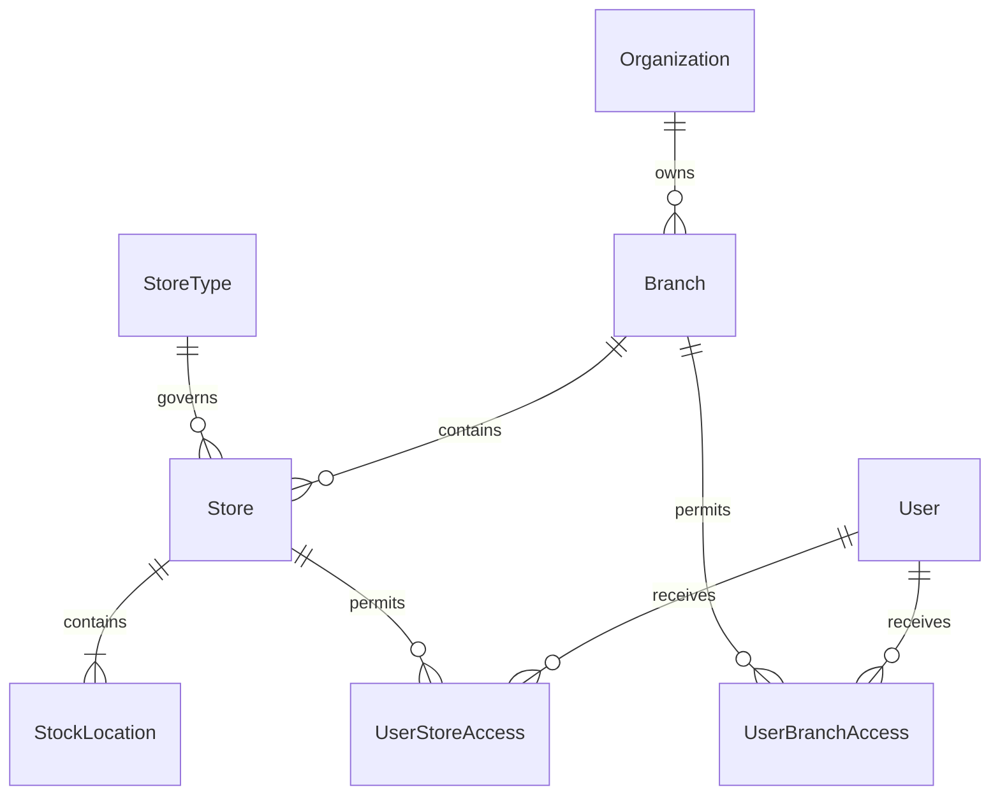
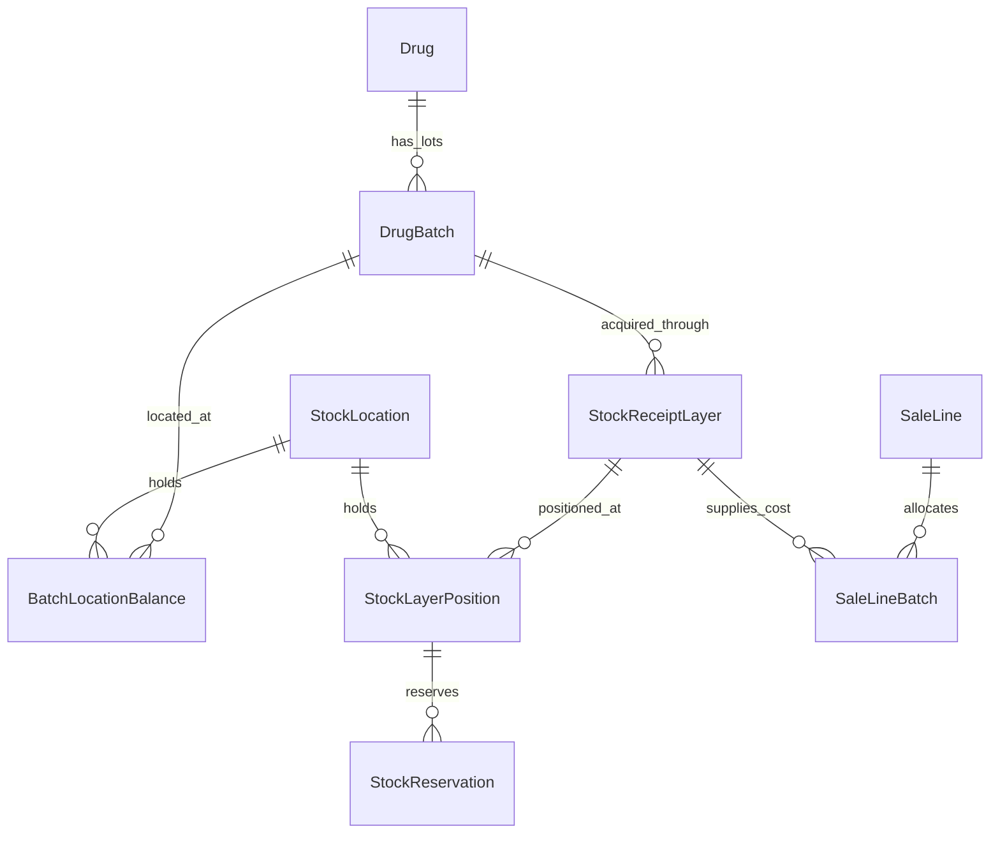
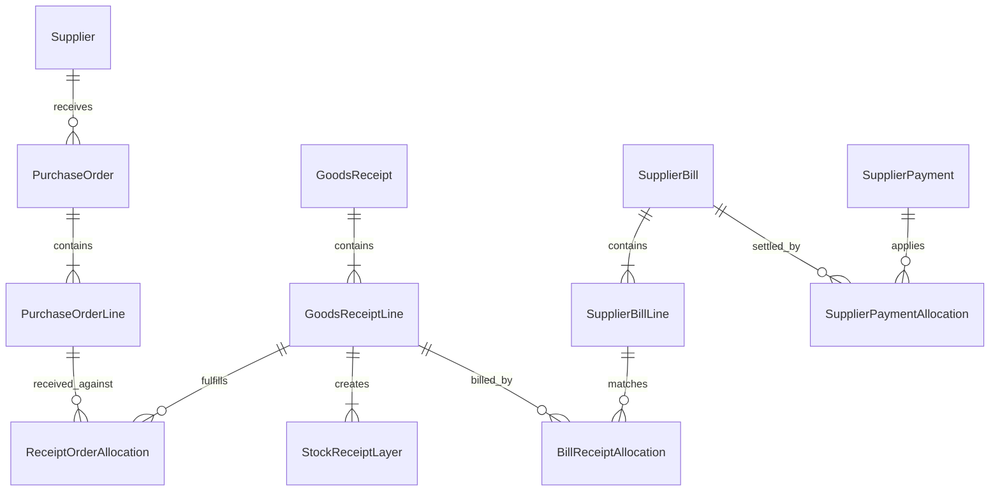

# Pharmacy schema and relationship blueprint

12 October 2026 · Proposed design · Kenyan retail pharmacies · Branches in Release 1

This is a schema proposal informed by the inspected PharmaPOS screens and our [current Prisma schema](/Users/bennyworld/Desktop/CodeManyatta/personal/pharmacy_system/prisma/schema.prisma). We have not accessed PharmaPOS's database or source code. Model names, fields, cardinalities, constraints and lifecycle rules below are our recommendations, not recovered competitor tables. Nothing here changes the operational schema or applies a migration.

The useful patterns to borrow are branch → store → location, separate document headers and lines, explicit unit conversion, linked purchasing documents, payment allocations, role/permission joins, and append-only ledgers. Preserve our consultation, prescription, insurance and dispensing models rather than replacing them with generic retail tables.

The [full-parity execution plan](/Users/bennyworld/Desktop/CodeManyatta/personal/pharmacy_system/docs/research/pharmacy-parity-execution-plan-2026-10-12.md) adds field contracts, implementation packages, posting rules and an expanded relationship catalogue. Use it as the implementation source of truth; this blueprint remains the detailed relational starting point.

## 1. Branches, stores and staff scope — build first

PharmaPOS exposes branches, stores, locations, store types and user store assignments. These support the following inferred hierarchy. See [branches](https://pharmapos.jisoftapps.cc/?page=settings/manage_branches), [stores](https://pharmapos.jisoftapps.cc/?page=settings/manage_stores), [locations](https://pharmapos.jisoftapps.cc/?page=settings/store_locations), [store rules](https://pharmapos.jisoftapps.cc/?page=settings/store_types) and [user assignments](https://pharmapos.jisoftapps.cc/?page=users/create_user).

| Model | Suggested fields beyond ID/timestamps | Relationships and constraints |
| --- | --- | --- |
| Existing `Organization` | Preserve tenant identity and shared catalog | Organization has many branches. A branch is not a separate tenant. |
| `Branch` | organizationId, code, name, address, timezone, status | Belongs to one organization; has many stores, registers and operational documents. Unique (organizationId, code). |
| `StoreType` | organizationId, code, name, canSell, canReceive, canTransfer, isQuarantine | One type serves many stores. Rules are enforced during stock allocation and document posting. |
| `Store` | organizationId, branchId, storeTypeId, code, name, status | Belongs to one branch; has many locations. Unique (branchId, code); branch must belong to organizationId. |
| `StockLocation` | organizationId, storeId, code, name, purpose, status | One store has many locations, including a default location. Unique (storeId, code). Purpose can distinguish shelf, receiving, transit and quarantine. |
| `UserBranchAccess` | organizationId, userId, branchId, isDefault | User ↔ Branch is many-to-many. Unique (userId, branchId). |
| `UserStoreAccess` | organizationId, userId, storeId | User ↔ Store is many-to-many. Unique (userId, storeId); access must be consistent with branch grants. |

Add branchId to Sale, PosOrder, ConsultationCase, purchase/receipt documents, Expense and RegisterSession. Keep patient, supplier and drug identities shared within the organization unless there is an explicit business reason to restrict them. Branch visibility of clinical records needs its own permission policy; a store grant must not automatically grant access to every patient's clinical history. Treat consolidated insurer invoices or supplier payments as potentially spanning branches through their underlying allocations rather than forcing every settlement to belong to just one branch.

## 2. Separate lot identity, stock position and acquisition cost

Our `DrugBatch` currently mixes lot identity with organization-wide quantity, supplier and cost. One lot can exist in multiple locations and arrive from different receipts at different costs. This is the most important schema change for transfers and reliable margin reporting. PharmaPOS's [stock registry](https://pharmapos.jisoftapps.cc/?page=inventory/stock), [batch expiry monitor](https://pharmapos.jisoftapps.cc/?page=purchases/expiry) and [transfer screen](https://pharmapos.jisoftapps.cc/?page=inventory/transfer_stock) motivate this separation; the exact cost-layer implementation is our design choice.

| Model | Suggested fields | Relationships and constraints |
| --- | --- | --- |
| Existing `Drug` | Retain clinical identity, prescription class, strength, route and barcode | One drug has many lots, units, prices and supplier receipt lines. Shared across branches in the organization. |
| Evolved `DrugBatch` | organizationId, drugId, batchNumber, expiryDate, manufacturerId?, status | Lot identity only. Retain (drugId, batchNumber) uniqueness where lot identifiers are unambiguous; define a migration rule for collisions. Quarantine at one location must not implicitly quarantine the entire lot unless intended. |
| `BatchLocationBalance` | organizationId, batchId, locationId, disposition, quantityOnHand, version | Batch ↔ Location is many-to-many through balances. Unique (batchId, locationId, disposition). Disposition distinguishes sellable, quarantined and damaged stock when they coexist at one location. |
| `StockReceiptLayer` | organizationId, batchId, receiptLineId, quantityReceivedBase, unitCostBaseSnapshot, receivedAt | Lot has many acquisition layers. Immutable received cost and supplier traceability come from the receipt. Same batch number does not imply same acquisition cost. |
| `StockLayerPosition` | organizationId, receiptLayerId, locationId, disposition, remainingQtyBase, version | Tracks each cost layer's remaining units by location/disposition. Its sum must equal the corresponding BatchLocationBalance; both are updated in the same transaction. Alternatively derive the aggregate and store only layer positions. |
| `StockReservation` | organizationId, layerPositionId, posOrderLineId? or transferLineId?, quantityBase, expiresAt, status | A position has many reservations; a queued line may reserve several positions. Exactly one reservation owner; expiry/cancellation releases it once. |
| Evolved `StockMovement` | organizationId, locationId, batchId, receiptLayerId, quantityDeltaBase, disposition, reason, actorId, postingGroupId, reversalOfId? | Append-only movements link to typed source allocations/posting groups. Sale, receipt, transfer, count and disposal post distinct movement types. Do not rely on an unchecked sourceType/sourceId pair for critical referential integrity. |
| Evolved `SaleLineBatch` | saleLineId, batchId, receiptLayerId, sourceLocationId, quantityBase, unitCostBaseSnapshot | One sale line has many lot/cost allocations. Cost snapshots never follow later edits to DrugBatch or Drug.costLast. |

Use Decimal base-unit quantities consistently if fractional units are supported, for example Decimal(18,6); validate allowed precision through UnitOfMeasure. Store currency amounts as Decimal with defined rounding. Available sellable stock = sellable on-hand minus active reservations. FEFO chooses usable lots by expiry; the accounting cost-layer policy must be defined separately. Transfers preserve receipt layers and cost; they do not create purchases or new revenue. Concurrent finalization needs atomic checks or locking, not just a pre-transaction availability read.

## 3. Transfer documents and stocktakes

| Model | Suggested fields | Relationships and constraints |
| --- | --- | --- |
| `StockTransfer` | organizationId, number, sourceStoreId, destinationStoreId, transitLocationId, status, requestedById, approvedById?, dispatchedAt? | Header has many lines and receipts. Source/destination must be different and in the same tenant. Cross-organization movements require a separate trade workflow. |
| `StockTransferLine` | transferId, drugId, quantityRequestedBase | Transfer has many product lines. Reservations and dispatched allocations identify actual batches and layers. |
| `TransferDispatchAllocation` | transferLineId, receiptLayerId, sourceLocationId, disposition, quantityDispatchedBase, unitCostBaseSnapshot | A line can dispatch several lots/layers; source outflow and transit inflow post atomically and reference this allocation. |
| `TransferReceipt` | organizationId, transferId, receivedById, receivedAt, idempotencyKey, status | Transfer has many partial receipts. Posting twice cannot receive stock twice. |
| `TransferReceiptLine` | receiptId, dispatchAllocationId, destinationLocationId, quantityReceivedBase, disposition, discrepancyReason? | Each line consumes a dispatched allocation. Total received plus formally resolved shortage cannot exceed dispatched quantity. |
| `StocktakeSession` | organizationId, storeId, number, countCutoffAt, status, countedById, approvedById? | Session has many count lines. Define whether movement continues during counting and how it is reconciled to the cutoff. |
| `StocktakeLine` | sessionId, batchId, locationId, disposition, expectedQtySnapshot, countedQty, reason | Unique per counted stock bucket. Approved variance produces linked stock adjustments; quantity edits do not silently rewrite history. |
| `StockAdjustment` / `StockAdjustmentLine` | organizationId, number, status, reason, actor/approver; line positionId, deltaBase, valuationEffect | Handles approved count differences, spoilage, loss and corrections. Positive unknown stock needs an explicit receipt/cost provenance policy. |

Recommended transfer states: DRAFT → APPROVED → DISPATCHED → PARTIALLY_RECEIVED → RECEIVED, with CANCELLED before dispatch. After dispatch, return/correction records reverse physical events; do not simply change the status and put all units back. These states and receiving controls exceed what was confirmed in the competitor UI.

## 4. Procurement: headers, lines and allocations

Borrow the distinct PO, GRN and invoice patterns visible in [purchase orders](https://pharmapos.jisoftapps.cc/?page=purchases/manage_purchase_orders), [GRNs](https://pharmapos.jisoftapps.cc/?page=purchases/manage_grn), [direct receipt](https://pharmapos.jisoftapps.cc/?page=purchases/items_invoice), [supplier invoices](https://pharmapos.jisoftapps.cc/?page=purchases/purchase_invoice) and [purchase returns](https://pharmapos.jisoftapps.cc/?page=purchases/purchase_returns).

| Model | Suggested fields | Relationships and constraints |
| --- | --- | --- |
| Existing `Supplier` | Add code, contactPerson, status, paymentTermsDays, taxIdentifier?, creditLimit? | Supplier has many POs, receipts, bills, returns and payments. Opening debt is a ledger document, not an editable balance field. |
| `PurchaseOrder` | organizationId, supplierId, branchId, targetStoreId, number, status, expectedAt, totals, actor/approver | One supplier has many POs. Unique document number within defined organization/branch series. |
| `PurchaseOrderLine` | poId, drugId, purchaseUnitId, quantity, conversionSnapshot, unitCost, discount/tax snapshots | PO has many lines; a line has many receipt allocations. Store ordered and base quantities explicitly. |
| `GoodsReceipt` | organizationId, supplierId, branchId, storeId, number, status, supplierDeliveryRef?, receivedAt | Has many lines. PO optional: direct receiving remains possible. Stock changes only when committed. |
| `GoodsReceiptLine` | receiptId, drugId, batchId, destinationLocationId, quantityBase, cost/tax snapshots | One line represents one batch/location acquisition allocation and creates a receipt layer. Split multiple lots into separate lines. |
| `ReceiptOrderAllocation` | receiptLineId, purchaseOrderLineId, quantityBase | Receipt lines ↔ PO lines through allocations; supports partial and combined deliveries without putting one PO ID on the whole receipt. |
| Existing `SupplierBill` | Add branch context where appropriate, supplier invoice reference, currency, posting status | Preserve bill/payment allocation behavior. Supplier invoice uniqueness should be scoped to supplier and tenant where a genuine reference exists. |
| `SupplierBillLine` | billId, drugId?, description, quantity, unit, cost/discount/tax snapshots | A bill has many lines; non-stock charges are explicit lines. |
| `BillReceiptAllocation` | billLineId, receiptLineId, quantityBase, amount | Billed lines ↔ received lines; support consolidated invoices, partial billing and three-way discrepancy review. |
| `SupplierReturn` / `SupplierReturnLine` | supplierId, branchId, number, status; originalReceiptLayerId, sourceLocationId, quantityBase, reason | Return line links to original acquired stock. The supplier's credit acceptance is separate from physical dispatch. |
| `SupplierCreditNote` / `SupplierCreditAllocation` | supplierId, returnId?, reference, amount; creditId, billId, appliedAmount | Supplier credit can settle one or several bills; an unallocated credit remains visible. |
| Existing `SupplierPaymentAllocation` | Keep paymentId, billId and applied amount; add explicit reversal support | Existing many-to-many allocation pattern is worth reusing for other settlements. |

Prevent over-receipt and over-return at posting time across all existing allocations. A header's total is a persisted snapshot reconciled to its lines. Delivery, stock receipt, supplier invoicing and payment are different events even if a quick-receive screen performs them together.

## 5. Product units, tax and pricing

| Model | Suggested fields | Relationships and constraints |
| --- | --- | --- |
| `UnitCategory` / `UnitOfMeasure` | organizationId, code, name; categoryId, symbol, decimalPlaces | Reusable quantity/volume/weight units. A category does not define a universal pack size. |
| `DrugUnit` | drugId, unitId, multiplierToBase, isPurchase, isSale, isBase, barcode? | Drug ↔ Unit is many-to-many with product-specific conversion. One box can mean 100 tablets for one drug and 30 for another. Exactly one base unit per drug. |
| `TaxClass` / `TaxRateVersion` | organizationId, code, treatment; classId, ratePercent, validFrom, validTo? | Drug belongs to a class; class has effective-dated rates. Distinguish zero-rated, exempt and out-of-scope even when all calculate zero. Avoid overlapping applicable periods. |
| `PriceList` / `DrugPrice` | organizationId, name, purpose, currency, branchId?; priceListId, drugUnitId, amount, validFrom/To | Preserve cash/insurance distinctions and add wholesale when needed. Snapshot selected price, unit factor and tax on each document line. |
| `DrugLocationPolicy` | drugId, locationId, reorderLevelBase, maxStockBase, leadTimeDays? | Per-location replenishment rules. Unique (drugId, locationId). |
| `Brand` / `Manufacturer` | organizationId, code, name, contact details, country | Optional normalized entities; Drug has nullable references. Preserve existing free text during migration. |
| Existing `DrugCategory` | Add parentId?, description, status | Category has optional parent and many children; reject cycles. Keep the existing drug/category join. |

Evidence: [unit conversion](https://pharmapos.jisoftapps.cc/?page=inventory/unit_conversion), [product form](https://pharmapos.jisoftapps.cc/?page=inventory/add_products), [tax rates](https://pharmapos.jisoftapps.cc/?page=inventory/manage_taxes). Exact tax mappings require separate current official validation.

## 6. Sales, credit, returns and registers

| Model | Suggested fields | Relationships and constraints |
| --- | --- | --- |
| Existing `Sale` / `SaleLine` | branchId, storeId, registerSessionId?, customerAccountId?, dueAt?; line unit/conversion/tax/discount/name snapshots | Keep patientId for the person receiving care. Sale lifecycle, payment settlement, stock fulfillment and fiscal submission are separate statuses. |
| `CustomerAccount` | organizationId, code, type, name, status, creditLimit, termsDays, billing identifiers | Financial payer identity, separate from Patient. Corporate payer may cover many patients; use `PatientAccountLink` if explicit memberships are needed. A cash walk-in need not create a clinical patient record. |
| Evolved `Payment` / `CustomerReceipt` | organizationId, accountId?, channel, amount, status, externalRef?, idempotencyKey | Existing Payment belongs to one Sale. To settle several invoices, introduce receipts and allocations rather than assuming all money maps to one sale. Decide whether to generalize Payment or keep it as tender detail. |
| `CustomerPaymentAllocation` | receiptId, saleId, amount, reversalOfId? | Receipt ↔ Sale is many-to-many. Total allocations cannot exceed confirmed available funds; balance remains derived from immutable charges/credits/allocations. |
| `SaleReturn` / `SaleReturnLine` | saleId, branchId, status, reason, actor/approver; saleLineId, quantityBase | Original sale has many partial returns. Approved cumulative return quantity cannot exceed original sold quantity. |
| `ReturnBatchDisposition` | returnLineId, originalSaleAllocationId, destinationLocationId?, quantityBase, disposition | A return line can split lots and dispositions. Patient-returned medicines default to review/quarantine; a refund does not itself authorize sellable restocking. |
| `CustomerCreditNote` / `CreditApplication` | accountId?, saleReturnId?, number, amount; creditId, saleId, appliedAmount | Financial credit is distinct from physical return and refund. Links reversal documents and applicable fiscal references. |
| `Refund` / `RefundAllocation` | return/credit reference, channel, amount, status, externalRef; originalPaymentId, amount | Supports refund split across original tenders and partial execution; unsuccessful refund attempts do not reduce confirmed cash. |
| `CashRegister` / `RegisterSession` | branchId, storeId, code; registerId, cashierId, openingFloat, openedAt, closedAt?, countedCash?, variance, status | Register has many sessions. At most one open session per physical register unless explicitly designed otherwise; cash transactions and cash movements belong to sessions. |
| `RegisterCashMovement` | sessionId, direction, amount, reason, actorId, reference | Cash-in/out events separate from sale revenue, customer debt payments and opening float. |
| `Quotation` / `QuotationLine` | accountId?, branchId, number, validUntil, status, convertedSaleId?; drugId?, description and unit/price/tax snapshots | Many lines per quotation; conversion links to at most one sale under chosen policy and rechecks stock/prices. |

Evidence: [customer accounts](https://pharmapos.jisoftapps.cc/?page=customers/add_customer), [debt settlement](https://pharmapos.jisoftapps.cc/?page=sales/invoice_payments), [returns](https://pharmapos.jisoftapps.cc/?page=sales/sales_returns_list), [register](https://pharmapos.jisoftapps.cc/?page=sales/sales_register) and [quotations](https://pharmapos.jisoftapps.cc/?page=sales/manage_quotations).

Keep insurer claims/invoices distinct from ordinary customer credit. Existing InsuranceInvoiceLine links insurance payments to insurer invoices; do not merge the same insurance receivable into a second customer debt ledger. ConsultationCheckout can continue linking one consultation case to its cashier sale.

## 7. Finance, permissions and background work

| Model group | Recommended relationships and fields |
| --- | --- |
| `LedgerAccount`, `JournalEntry`, `JournalLine` | Organization has accounts and entries; entry has at least two lines, each linking an account, optional branch dimension, debit/credit amount and currency. Balanced totals required before posting. Reversal references the original entry. Operational posting links must be unique to avoid duplicate accounting. |
| `SettlementAccount`, `ReconciliationSession`, `ReconciliationItem` | Settlement account belongs to tenant and optionally branch. Session covers account/period; items map imported bank/mobile entries to confirmed system settlements, with unmatched state and reviewer audit. External statement entries need deduplication by provider/reference or stable import identity. |
| `Role`, `Permission`, `RolePermission`, `UserRoleAssignment` | Role ↔ Permission and User ↔ Role use joins. Assignments can have branch scope. Keep UserRole enum during transition; map it into seeded roles before replacing code authorization. |
| `ApprovalRequest`, `ApprovalDecision` | Request has many decisions with actor, timestamp, rationale and target version. Critical workflow models carry typed approval links; a generic target string is not a substitute for enforced document references. |
| `PaymentAttempt`, `WebhookEvent` | Payment has attempts; provider events have provider/event key, verified payload reference/hash, processing state and processedAt. Deduplicate events and compare amount/currency/reference before confirming payment. Minimize retained sensitive payload data. |
| `GatewayConfiguration` | Tenant/optional branch, provider, environment, shortcode, secret-manager reference, status. Credential reference rather than plaintext secrets. Branch fallback must be explicit. |
| `FiscalDocument`, `FiscalSubmissionAttempt` | Sale or credit note links to a typed fiscal document; document has immutable request snapshots, acknowledgment identifiers and many attempts. Retries do not issue duplicate fiscal documents. Current provider requirements remain to be validated. |
| `OutboxEvent`, `MutationReceipt`, `DocumentSequence` | Atomic outbox event with posting transaction; mutation receipt unique by tenant/client operation; document sequence unique by tenant, branch where required, type and period. Different records handle delivery retry, operation replay and numbering. |
| `Notification`, `NotificationDelivery`, `CommunicationPreference` | Notification has deliveries; recipient/channel preferences are explicit. A refill notification references Prescription; an overdue notification references an invoice/account. Unique deduplication keys suppress duplicate reminders. Existing PromoCampaign can remain the campaign header. |
| `LoyaltyAccount`, `LoyaltyEntry` | Customer account has a loyalty ledger; signed point entries reference earning sale, redemption and reversal. Derived balance, not an independently edited numeric total. |
| `Employee`, `PayrollRun`, `PayrollLine`, `PayrollAdjustment`, `EmployeeAdvance`, `PayrollPaymentAllocation` | Employee optionally links User and home branch; run contains employee-period lines and snapshot adjustments. Advances/repayments and salary allocations are separate ledgers. Optional later scope; payroll rules require current domain validation. |
| `SupportTicket`, `TicketMessage`, `Attachment` | Ticket has requester, assignee, status and priority; many messages and scoped attachments. Avoid a globally accessible generic attachment table. |

Relevant observed screens: [accounts](https://pharmapos.jisoftapps.cc/?page=accounting/accounts), [journal entries](https://pharmapos.jisoftapps.cc/?page=accounting/journal_entry), [reconciliation](https://pharmapos.jisoftapps.cc/?page=accounting/bank_reconciliation), [permissions](https://pharmapos.jisoftapps.cc/?page=users/permission_list), [communications](https://pharmapos.jisoftapps.cc/?page=settings/send_bulk_sms), [loyalty](https://pharmapos.jisoftapps.cc/?page=customers/manage_loyalty), [payroll](https://pharmapos.jisoftapps.cc/?page=payroll/employees) and [tickets](https://pharmapos.jisoftapps.cc/?page=ticketing/tickets). Outbox, cost layers, verified webhook handling and dedicated fiscal attempt models are recommended engineering designs, not confirmed competitor schema.

## 8. Constraints worth deciding before writing migrations

- **Tenant-consistent references:** tenant-owned entities expose unique (organizationId, id) keys where needed. Composite foreign keys include organizationId so a line, location or allocation cannot reference another tenant's record. Auth checks remain necessary even with database constraints.
- **Branch consistency:** store belongs to the document branch; location belongs to the chosen store; source and destination transfer locations obey their respective store scopes. Enforce with suitable composite references and transactional validation.
- **Quantities and money:** positive quantities on receipt/dispatch/return lines, signed deltas on movements, nonnegative usable balances and bounded allocations. Aggregate constraints such as total returned ≤ sold require posting-time locking or atomic guards; a row-level check alone is insufficient.
- **Document lifecycle:** immutable posted documents and snapshot fields; corrections post reversals or credits. Record createdBy, approvedBy, postedBy, postedAt and reversal links. Protect posted financial/stock history from cascade deletion; use RESTRICT and explicit archival policies. Our existing cascade relations need review when extending these domains.
- **Idempotency:** unique (organizationId, operationType, clientMutationId), provider event keys scoped to provider/account, and unique source posting references. A retry must return the earlier result, not rerun a stock or payment mutation.
- **Numbers:** unique document number within a deliberate organization/branch series, allocated atomically. Do not generate the next number with only max(number) + 1.
- **Effective dates:** reject overlapping applicable tax and price versions; snapshot applied versions on documents. Correcting master data does not rewrite closed transactions.
- **Indexes:** balances by tenant/location/batch; usable lots by tenant/drug/expiry; reservations by status/expiry/position; documents by tenant/branch/status/date; allocations by both foreign keys; movements by position/time and source posting.
- **Derived totals:** account balances, available quantity, paid/due amounts, loyalty balance and gross profit have one authoritative derivation. Cached projections need reconciliations and cannot be freely edited.
- **Clinical separation:** pharmacy staff permissions govern patient/prescription records separately from customer financial accounts, payroll and loyalty. Preserve marketingConsent and add channel-purpose preferences where needed.

## 9. Migration order and compatibility notes

1. Add branch/store/location tables and default records for each current organization. Backfill operational document branch and stock location scope; preserve existing IDs and organization isolation.
2. Separate lot identity from holdings. Create default-location positions from DrugBatch.quantityOnHand. Where historical receipts are unavailable, create explicitly labeled legacy opening layers with known cost or an unknown-cost marker; do not invent provenance or historical costs.
3. Snapshot historical allocation costs only where evidence supports them. Mark reconstructed versus known costs; changing current batch cost must not silently restate past profit. Build a reconciliation report before switching analytics.
4. Transition FEFO, sale finalization, adjustments and POS availability to location/layer positions behind one allocation service. Do not keep DrugBatch.quantityOnHand and new balances as two independent sources of truth. Temporary dual writes must be transactional and removed after cutover.
5. Add reservations, transfer dispatch/receipt and stocktake posting with idempotency, cross-branch authorization and two-branch acceptance scenarios.
6. Add units/tax line snapshots, direct receipts and PO/GRN/bill allocations; extend existing SupplierBill and SupplierPayment instead of creating duplicate payable systems.
7. Add returns/register/reconciliation and verified payment lifecycles. Generalize receipt allocation only when customer credit scope is implemented; retain insurer-specific billing distinctions.
8. Add ledger, notifications, price lists, loyalty and optional payroll in the agreed backlog order. Enabling a ledger requires reconciling opening inventory, receivables, payables and equity; it is not just adding a Journal table.

Before drafting executable Prisma models, resolve costing policy, allowed quantity precision, reservation timing, branch numbering, clinical access rules and whether customer receipts settle multiple sales. The blueprint provides a concrete recommended starting point without assuming that every listed model must be built in Release 1.

## Links to the feature review

- [Feature-gap report and acceptance criteria](/Users/bennyworld/Desktop/CodeManyatta/personal/pharmacy_system/docs/research/pharmacy-feature-gaps-2026-10-12.md)
- [Searchable competitive comparison](/Users/bennyworld/Desktop/CodeManyatta/personal/pharmacy_system/docs/research/pharmacy-compintel-2026-10-12.html)
- [Structured feature backlog](/Users/bennyworld/Desktop/CodeManyatta/personal/pharmacy_system/docs/research/pharmacy-feature-backlog-2026-10-12.json)
